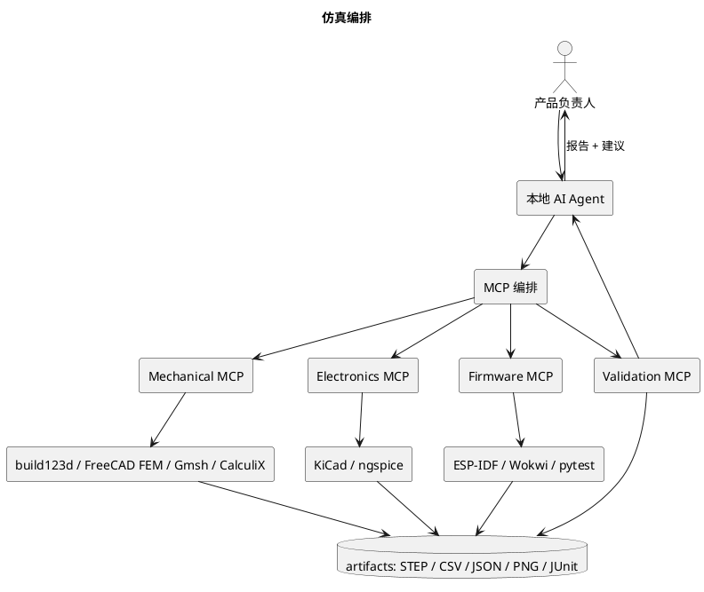

# AI Hardware Engineering Pipeline

> 项目：Smart Coaster 智能杯垫  
> 版本：V1.1（新增仿真工程 / MCP 编排 / 参考资料）  
> 目标：建立一套以本地 AI Agent 为核心、通过 MCP 调用专业工具、以参数化设计和自动化验证为基础的硬件研发流程。

---

## 1. 项目目标

本项目尝试建立一套 AI 原生的硬件研发工作流。

传统硬件开发通常需要在机械 CAD、电路 EDA、仿真、固件 IDE 等工具之间切换，设计信息分散在不同文件和软件中。

本项目希望实现：

1. 使用自然语言描述产品需求和设计约束。
2. 由本地 AI Agent 将需求拆解为机械、电路、固件和验证任务。
3. Agent 通过 MCP 调用本地专业工具。
4. 使用文本和代码驱动参数化设计。
5. 尽可能先完成数字样机、仿真和自动化检查。
6. 验证通过后再进行 3D 打印、PCB 打样和实物组装。
7. 通过 Git 管理设计文件、需求、验证结果和版本变更。

核心原则：

**AI 负责理解、规划、生成和协作，专业工具负责几何建模、电路分析和工程验证，人负责关键决策与验收。**

不将 AI 生成结果直接视为经过验证的工程设计。

## 2. 总体研发架构

```text
                   用户 / 产品负责人
                          │
                          ▼
                 本地 AI Agent
                          │
                需求分析 / 任务规划
                          │
                          ▼
                  MCP 工具调用层
                          │
        ┌─────────────────┼─────────────────┐
        │                 │                 │
        ▼                 ▼                 ▼
   机械设计工具       电路设计工具       软件开发工具
   AgentCAD           KiCad             ESP-IDF
   build123d          ngspice           Python
   FreeCAD            电路仿真          BLE
        │                 │                 │
        ▼                 ▼                 ▼
   3D 模型            PCB / 原理图       固件程序
   STEP / STL         Gerber            单元测试
        │                 │                 │
        └─────────────────┼─────────────────┘
                          ▼
                     验证与集成
                          │
             ┌────────────┼────────────┐
             ▼            ▼            ▼
          几何检查      电气检查      软件测试
             │            │            │
             └────────────┼────────────┘
                          ▼
                     实物打样
                          │
                          ▼
                    实际测试与迭代
```

## 3. 工具链设计

### 3.1 本地 AI Agent

要求：

- 能够读取和修改项目文件。
- 能够执行本地命令。
- 支持 MCP 工具调用。
- 能够读取项目中的 PRD、设计规范和验证记录。
- 支持多个专业 Agent 协作。
- 不绑定特定厂商或特定模型。

建议划分以下角色：

| Agent | 职责 |
|---|---|
| Product Agent | 维护需求、功能定义和优先级 |
| Mechanical Agent | 机械结构设计、参数化建模 |
| Electronics Agent | 原理图、PCB 和电路验证 |
| Firmware Agent | MCU 固件、传感器驱动、BLE |
| Validation Agent | 测试计划、自动化验证、结果归档 |
| Integration Agent | 系统集成、接口协调、版本管理 |

初期不要求部署多个独立 Agent 实例，可以由一个主 Agent 按角色执行任务。

### 3.2 机械设计工具

第一阶段：

- AgentCAD
- build123d
- Python

第二阶段：

- FreeCAD（装配、工程图、STEP 复核、**FEM 前处理**）
- CalculiX（有限元求解）
- Gmsh（网格）

职责划分：

| 工具 | 用途 |
|---|---|
| AgentCAD | 提供 AI Agent 驱动的 CAD 工作流 |
| build123d | 使用 Python 进行参数化几何建模 |
| FreeCAD | 装配、工程图、STEP 检查和人工复核；FEM 前处理 |
| CalculiX | 应力/应变/位移求解（线弹性 + 接触） |
| Gmsh | 参数化网格，批量参数扫描 |

> 仿真的完整设计见 §13；工具安装位置见 §13.6。

设计要求：

- 优先采用参数化建模。
- 关键尺寸集中管理。
- 模型生成与参数配置分离。
- 所有关键结构均应有明确的设计依据。
- 未确认的尺寸不能伪装成已验证尺寸。
- 每次修改应能通过 Git 追溯。

### 3.3 电路设计工具

第二阶段引入：

- KiCad：原理图、PCB、ERC、DRC，内置 ngspice。
- ngspice：直流工作点、AC 扫描、瞬态、噪声、蒙特卡洛。
- Python：数据处理和测试脚本。

**第三阶段（2026-11-05 增补）：EasyEDA Pro 第二实现**

- **工具**：EasyEDA Pro / 嘉立创EDA专业版 **4.1.97** 桌面客户端 + 内置 `lceda-pro` CLI 桥 + 官方 `easyeda-eprj3-skill` **2.2.1**（离线 `.eprj3` 生成）；另有 `easyeda-agent` **v1.16.0**（typed action/daemon/connector，按需）。
- **定位**：`electronics/kicad/` 仍是**主交付**（ERC/DRC/Gerber/DFM 证据不变）；[`electronics/easyeda/`](../electronics/easyeda/README.md) 是**第二实现**——从同一份 canonical 电气/机械数据重建 `.eprj3`（原理图 + 2 层 PCB + 铜），**不是**格式转换，也不修改原 KiCad 工程。
- **live 状态（2026-11-05 实测）**：用客户端激活文件后，官方 SDK 原理图 DRC **0 fatal / 0 error / 0 warn**；客户端网表导出 **47 器件 / 213 pins / 29 nets**；PCB 客户端 DRC 仍有余项（NC 语义已修、50 个连接错误清零，剩 23 clearance + 4 同封装 + 1 netlist error），不冒充通过。
- **交叉验证**：两个 EDA **不能打开同一原生工程文件**（EasyEDA 官方只导入 KiCad 5.1/5.9；KiCad 无 `.eprj3` 读取器），因此按**数据契约层**做交叉验证，见 §13.3.1。

> **HX711 没有公开的芯片级 SPICE 模型**：电路仿真只能做桥路等效 + 行为模型，
> 不能声称仿真了芯片内部。

设计流程：

```text
需求
  │
  ▼
系统硬件架构
  │
  ▼
器件选型
  │
  ▼
原理图设计
  │
  ▼
ERC 检查
  │
  ▼
PCB Layout
  │
  ▼
DRC 检查
  │
  ▼
Gerber / BOM
  │
  ▼
PCB 打样
```

电路设计必须保留器件型号、数据手册、关键参数和选型依据。

### 3.4 固件开发工具

后续采用：

- ESP-IDF（真实固件构建）
- C/C++
- Wokwi（ESP32-S3 + HX711 + OLED 虚拟样机；云服务，非完全本地）
- pytest（本地确定性算法测试）
- BLE 协议栈

固件功能包括：

- 传感器数据采集。
- 数据滤波和校准。
- 饮水事件判断。
- OLED 显示。
- 按键处理。
- BLE 数据同步。
- 低功耗管理。

普通版和 Solar 版应共享尽可能多的业务逻辑，但允许底层硬件和功耗管理实现不同。

## 4. 项目目录结构

建议采用：

```text
smart-coaster/
│
├── AGENTS.md
├── README.md
├── requirements.yaml
├── BOM.md
├── VALIDATION_PLAN.md
│
├── docs/
│   ├── 01_AI_Hardware_Engineering_Pipeline.md
│   ├── 02_Smart_Coaster_PRD.md
│   ├── architecture/
│   └── decisions/
│
├── config/
│   ├── mechanical_params.yaml
│   ├── electronics.yaml
│   └── firmware.yaml
│
├── mechanical/
│   ├── src/
│   ├── assemblies/
│   ├── exports/
│   └── reports/
│
├── electronics/
│   ├── schematic/
│   ├── pcb/
│   ├── simulation/
│   └── fabrication/
│
├── firmware/
│   ├── main/
│   ├── components/
│   ├── tests/
│   └── config/
│
├── simulation/
│   ├── mechanical/
│   ├── electronics/
│   └── system/
│
├── tests/
│   ├── mechanical/
│   ├── electronics/
│   └── firmware/
│
├── scripts/
│
└── build/
```

目录可以随着开发逐步完善，不要求一开始创建所有子目录。

## 5. 需求驱动开发

产品需求统一维护在 PRD 和结构化配置文件中。

例如：

```yaml
project:
  name: smart-coaster
  version: "1.0"

product:
  ordinary_version:
    display: true
    connectivity: BLE
    power: USB-C

  solar_version:
    display: false
    connectivity: BLE
    power: solar_energy_harvesting

mechanical:
  width_mm: 100
  length_mm: 100
  dimensions_status: initial_target

sensor:
  model: HY928D
  type: sheet_like_strain_sensor
  rated_capacity_kg: 5
  status: pending_verification
```

注意：

- 配置文件记录设计目标和当前状态。
- 不确定的参数必须明确标记。
- 配置文件不是实物规格书。
- 任何影响结构、电路或固件的需求变更都要同步更新相关文档。

## 6. 机械设计工作流

### M0：设计输入和结构分析

输入：

- 产品需求。
- 外观参考。
- HY928D 图纸。
- 传感器实物照片。
- 供应商资料。

输出：

- 产品结构方案。
- 传感器安装方式分析。
- 受力路径图。
- 参数清单。
- 未确认事项。

不直接生成最终外壳。

### M1：关键结构建模

先设计：

- HY928D 参数化参考模型。
- 传感器安装接口。
- 浮动顶板。
- 底壳安装区域。
- 过载保护结构。

传感器真实安装方式必须先确认。

### M2：完整机械建模

设计：

- 顶板。
- 底壳。
- OLED 安装区域。
- 圆形按键。
- PCB 固定结构。
- USB-C 开孔。
- 防滑脚垫。
- 排线通道。

### M3：机械验证

检查：

- 零件尺寸。
- 装配干涉。
- 顶板运动空间。
- 传感器安装可达性。
- 螺钉装配空间。
- 排线活动空间。
- 称重旁路。
- 过载限位。

输出 STEP、STL 和装配报告。

## 7. 电路设计工作流

### E0：系统架构

明确：

- MCU。
- 传感器。
- ADC / 称重采集前端。
- OLED。
- 按键。
- 电源。
- USB-C。
- BLE。

### E1：器件选型

每个器件必须记录：

- 型号。
- 数据手册。
- 工作电压。
- 工作电流。
- 接口类型。
- 封装。
- 选型原因。
- 风险和替代方案。

### E2：原理图

完成：

- 电源输入。
- 电源管理。
- 称重采集。
- MCU。
- OLED。
- 按键。
- USB-C。
- 调试接口。

### E3：PCB

检查：

- 器件布局。
- 电源回路。
- 模拟信号走线。
- 接地。
- 接插件位置。
- 机械安装孔。
- PCB 外形与底壳匹配。

### E4：电路验证

完成 ERC、DRC 和必要的仿真。

不能将仿真结果替代真实硬件测试。

## 8. 固件设计工作流

### F0：软件架构

划分模块：

```text
Application
    │
    ├── Hydration Logic
    ├── Weight Processing
    ├── Display Manager
    ├── Button Manager
    ├── BLE Service
    └── Power Manager
             │
             ▼
       Hardware Drivers
             │
             ├── Sensor Frontend
             ├── OLED
             ├── GPIO
             └── Battery / Power
```

### F1：传感器采集

实现：

- 原始数据读取。
- 零点校准。
- 重量换算。
- 数字滤波。
- 异常值处理。
- 稳定性判断。

### F2：饮水行为识别

根据重量变化判断：

- 杯子放入。
- 杯子移走。
- 饮水导致的重量下降。
- 加水导致的重量上升。
- 杯子移动或外部干扰。
- 重量稳定状态。

### F3：显示与交互

普通版实现：

- 当前重量。
- 饮水量或饮水提醒。
- 状态提示。
- 按键操作。

### F4：BLE

实现：

- 设备发现。
- 配对和连接。
- 数据同步。
- 断线重连。
- 手机端数据接收。

## 9. 验证与质量管理

所有功能都必须有可验证的验收条件。

### 机械验证

- 尺寸检查。
- 装配检查。
- 干涉检查。
- 顶板活动检查。
- 过载保护检查。
- 称重路径检查。

### 电气验证

- 电源电压。
- 电源电流。
- 传感器采集噪声。
- ADC 稳定性。
- OLED 工作状态。
- BLE 通信。
- 低功耗表现。

### 固件验证

- 单元测试。
- 驱动测试。
- 事件识别测试。
- BLE 测试。
- 异常恢复测试。
- 长时间运行测试。

### 整机验证

- 不同杯型。
- 不同杯底尺寸。
- 空杯和满杯。
- 少量饮水和大量饮水。
- 杯子移动。
- 杯子重新放置。
- 长时间静置。
- 不同温度和环境条件。

## 10. AI Agent 执行规范

所有 Agent 必须遵循：

1. 先读取 PRD、AGENTS.md 和相关设计文档。
2. 先分析，再修改文件。
3. 重要结构先给方案，等待人工确认。
4. 不得虚构器件参数。
5. 不得将推测当作事实。
6. 不得随意改变已确认的设计约束。
7. 每次修改都应记录原因。
8. 生成文件后必须执行检查。
9. 对无法验证的结论明确标记。
10. 不允许未经确认直接进入高成本打样阶段。

每个任务输出：

- 任务目标。
- 输入信息。
- 设计假设。
- 修改文件。
- 执行过程。
- 验证结果。
- 未解决问题。
- 下一步建议。

## 11. 开发里程碑

| 阶段 | 目标 | 交付 |
|---|---|---|
| P0 | 环境搭建 | AgentCAD、build123d、MCP |
| P1 | 产品结构方案 | 结构图、参数表 |
| P2 | 机械设计 | 3D 模型、STEP、STL |
| P3 | 电路设计 | 原理图、PCB、BOM |
| P3.5 | **印花/多材料一体打印线**（2026-11-06 增补，见 §17） | Kromacut 图片→多材料几何、外壳开槽、Blender 数字样机、Bambu 装配 3MF；数字样机完成，实物未打样 |
| P4 | 固件开发 | 传感器、显示、BLE |
| P5 | 数字验证 | 见 §13：S1 机械 FEA → S2 电路 SPICE → S3 固件仿真 → S4 MCP 编排 |
| P6 | 实物打样 | 3D 打印、PCB |
| P7 | 整机验证 | 测试报告 |
| P8 | 产品迭代 | V1.1 / Solar 版 |

## 12. 核心原则

本项目不是让 AI 一次性生成一个看起来完整的产品，而是建立一套能够持续迭代、验证和追溯的硬件研发体系。

优先保证：

- 可复现。
- 可验证。
- 可修改。
- 可追溯。
- 可迁移。
- 工具链开放。
- 设计不绑定单一 Agent 或模型。

最终目标是让产品需求、机械模型、电路设计、固件和测试结果形成统一的工程闭环。

---

## 13. 仿真工程（Simulation Engineering）

> 新增章节。**M1.2 的 13 实体无干涉只证明几何不碰撞**，不代表结构强度、称重性能、电气指标已经通过。

### 13.1 四层仿真，而不是找一个包办软件

| 层 | 主工具 | 验证什么 | 输出 |
|---|---|---|---|
| 机械 | build123d → FreeCAD FEM + Gmsh + CalculiX | 传感器/顶板/支撑的应力、应变、位移、接触、过载 | 应力云图、位移曲线、安全系数、JSON 指标 |
| 电路 | KiCad + ngspice | 惠斯通电桥、HX711 前端、电源、滤波、噪声 | 工作点、AC/瞬态曲线、噪声谱、参数扫描 |
| 固件 | ESP-IDF + Wokwi + pytest | 采样、状态机、显示、按键、BLE 业务逻辑 | 单元测试、场景回放、JUnit/CSV |
| 系统 | Python + MCP + Git | 参数→仿真→验收→报告→归档 | 一条命令的验证报告、可追溯版本 |

原则：**专业软件做求解，Agent 做编排、读数和判断**；不让 Agent 靠"看图片"验收。

### 13.2 机械仿真

```
build123d 参数化模型
        │  export STEP
        ▼
FreeCAD FEM / Gmsh（前处理、网格）
        │  .inp
        ▼
CalculiX（求解）
        │  .frd / .dat
        ▼
Python（提取指标：max σ、max δ、接触状态、安全系数）
        │
        ▼
Agent（对比阈值、生成报告、失败时给修改建议）
```

**三个仿真对象**

| 对象 | 载荷/边界 | 重点指标 |
|---|---|---|
| A. HY928D 本体 | 4 孔固定 + 中央力（假设 A）；或 2 孔固定 + 自由端（假设 B） | 梁根应变、中央位移、应力集中、全桥输出估算 |
| B. 顶板 + 传力柱 | 中心/偏载（r=30、r=45）+ 1 kg / 5 kg | 顶板挠度、柱端接触应力、偏载倾角 |
| C. 整体装配 | 传感器 + 4 角柱 + 底壳 + 限位 | 过载 0.5/0.6 mm 是否先接触、旁路力、安全系数 |

**必须先冻结的前置条件**

1. HY928D 的 U 形槽是通槽还是浅腔、梁宽/槽深（`ref/HY928D_5kg_称重传感器_图纸转录.md` §4）。
2. 安装方案 A/B/C（四角固定+中央 / 单点 / 四角+球头）。
3. 材料：65Mn，E=210 GPa，ν=0.3，ρ=7.85 g/cm³；屈服强度按供应商状态。
4. 实际灵敏度 ±0.2 mV/V、额定形变、安全位移（待实测）。

**验收指标（示例，阈值待传感器数据确认）**

```yaml
mechanical_validation:
  cases:
    - name: center_load_1kg
      load_n: 9.81
      metrics: {max_displacement_mm: null, max_stress_mpa: null, sensor_strain: null}
    - name: center_load_5kg
      load_n: 49.05
    - name: eccentric_load_1kg
      position_mm: [30, 0]
      metrics: {max_tilt_deg: null, rim_gap_remaining_mm: null}
  acceptance:
    max_stress_mpa: null          # < 屈服/安全系数
    overload_stop_before_sensor_yield: null
    no_bypass_contact_below: 0.5  # mm
  status: pending_material_and_sensor_data
```

**能证明 / 不能证明**

- 能：相对趋势、应力集中位置、哪个零件先屈服、限位是否先接触、偏载影响量级。
- 不能：仅凭 CAD 算出最终称重精度；应变片位置/桥路/胶层/温漂必须实物标定。

#### 13.2.1 S1 可执行流程（HY928D 第一轮，实际命令）

| 步 | 做什么 | 具体 |
|---|---|---|
| 1 | 冻结模型 | `mechanical/hy928d/build/hy928d_v2.step`（通槽，34×34×1.0，4×Ø3.1 @28×28） |
| 2 | 网格 | `gmsh hy928d_v2.step -3 -order 2 -clscale 0.2 -format inp -o case.inp`；C3D10，厚度方向 ≥3 层 |
| 3 | 材料 | 65Mn：E=210000 MPa，ν=0.3，ρ=7.85e-9 t/mm³（线弹性） |
| 4 | 边界（假设 A） | 4 个角孔 ±2.2 mm 夹紧区、全厚度 `ENCASTRE` |
| 5 | 载荷 | 5 kg = 49.05 N，−Z，顶面 r≤4 mm 均布；另算 1 kg = 9.81 N |
| 6 | 求解 | `ccx -i case`（`*STATIC`，线性） |
| 7 | 提取 | 中心 `|Uz|`、max von Mises 及位置、4 孔支反力合计、舌片/梁根应力；两种网格尺寸的收敛差 |
| 8 | 对比 | U 槽 **0.7 mm 浅腔** vs **通槽**，比较刚度/应力 |
| 9 | 产物 | `simulation/mechanical/hy928d/{case_*.inp, mesh_*.msh, results.json, *.png, README.md}` |
| 10 | 验收（S1 实测回填） | 支反力合计 = 载荷 ±2%；5 kg 时裙边间隙 >0（方形剩 0.156 mm，约 7.3 kg 接触）；max σ < 屈服/1.5（屈服待供应商确认）；网格收敛差 <10% |

> 说明：这是"能不能当秤"的第一轮趋势分析，不是最终精度结论；应变片/桥路/温漂仍需实物标定。结果入口：`simulation/mechanical/hy928d/README.md`。

**S1 实测（HY928D v2 通槽，C3D10 h=0.28，304,892 节点）**：5 kg 中心 **0.3435 mm**（k≈142.8 N/mm）、支反力合计 **100%**、+y 两颗承担 **99.4%**、非奇异热点 **468 MPa** @ 竖槽端、U 槽 90° 尖角 588 MPa（奇异，实物倒圆）。通槽 vs 0.7 mm 浅腔：浅腔 1.72× 更刚，但灵敏度 −42%、热点只降 6.5% → **保留通槽**。

### 13.3 电路仿真（KiCad + ngspice）

**四个模块**

| 模块 | 仿真 | 目的 |
|---|---|---|
| 惠斯通电桥 | 4 电阻桥 + 灵敏度 1.2/0.6 mV/V | 输出量级、共模、桥臂偏差对零点 |
| HX711 前端 | 行为模型（输入阻抗、增益、±12.9 mV@3.3V、噪声） | 输入范围、增益选择、RC 滤波 |
| 电源 | USB-C 5 V、充电、LDO/片内稳压、电池 | 电压/电流/功耗、纹波 |
| MCU 接口 | GPIO 上拉、I²C、复位、电平 | 电平兼容、上电时序 |

**分析类型**：`.op`（工作点）、`.dc`（载荷扫描）、`.ac`（滤波/噪声增益）、`.tran`（上电/纹波）、`.noise`（输入等效噪声）、蒙特卡洛（电阻容差）。

**理论量级**（按 HY928D 5 kg 全桥 1.2 mV/V）：

| 激励 | 满量程输出 | 占 HX711 ±20 mV |
|---|---|---|
| 3.3 V | 3.96 mV | **30.7%**（±12.9 mV；5 V 供电时才是 19.8%） |
| 4.3 V | 5.16 mV | 25.8% |
| 5.0 V | 6.00 mV | 30.0% |

**边界**：HX711 芯片级 SPICE 模型不存在；只能验证**信号链量级、滤波、噪声预算**，不能替代实物噪声/温漂测试。

**本机状态（2026-11-04 更新）**：S2 已补齐为四模块×六类分析（`simulation/electronics/run_s2.py`，28 个结果：21 PASS / 7 个真实设计发现）。桥路 5 kg=3.960 mV→0.506 V（×128）；**实际外部 RC 截止 530.5 Hz**（旧网表漏算 R25/R26 的 1 k，1.65 kHz 是错的）；50 Hz 总衰减 −14.18 dB 主要来自 10 Hz ODR 极点，外部 RC 仅 −0.04 dB。核心发现：**连续采样功耗 5.02 mA→4.2 天（7 天目标需模拟前端占空）**、I2C 4.7k@400kHz 超时（已改 2.2k）、TP4056 深放热调节。详见 `docs/S2_CIRCUIT_SIM.md`、`docs/REVIEW_ELECTRICAL.md`。KiCad 9.0.9：**43 器件 / 28 网络、ERC 0 error/0 warning、网表逐引脚 PASS**；**2 层 PCB 已布线到 0 DRC / 0 unconnected**（576 track + 62 via），Gerber/钻孔/坐标/DFM 已出；ESP32-S3-MINI-1 已换官方封装。详见 `docs/HANDOFF.md`、`docs/REPORT_技术报告.md`。
> 注：S2 目前只覆盖桥路 + HX711 行为前端的 DC/AC；电源、MCU 接口、`.tran`/`.noise`/蒙特卡洛仍是 GAP（见 `docs/AUDIT_PIPELINE.md` §13.3）。

#### 13.3.1 双 EDA 交叉验证（KiCad ↔ EasyEDA Pro，2026-11-05）

电路没有软件那样便宜的 UT，但“两个工具打开/处理同一份设计”可以拆成两层：

1. **原生工程文件互换：不可行**。EasyEDA Pro 官方导入只支持 KiCad 5.1/5.9（当前工程是 KiCad 9 格式），且没有 `.eprj3 → .kicad_pcb` 的反向读取；不要为了互换去降级工程。
2. **数据契约层交叉验证：可行且已落地**。同一份电气意图（`design.py` / `smartcoaster.net` / `2l.kicad_pcb`，只读）分别进入 KiCad 与 EasyEDA 两套数据模型，再用独立脚本逐项对账。

**交叉验证矩阵**（脚本 `electronics/easyeda/scripts/check_cross_tool.sh`，产物 `reports/cross_tool.json`）：

| 编号 | 对账项 | KiCad 侧 | EasyEDA 侧 | 当前结果 |
|---|---|---|---|---|
| X1 | 网表（逐脚） | `smartcoaster.net`（9.0.9） | **live 客户端导出的网表**（`eda.js netlist`） | **168 connected pins / 28 nets 一致** ✅ |
| X2 | 器件摆放 | pcbnew footprint x/y/angle | `.epcb2` COMPONENT x/y/angle | 47 件，最大误差 **0.0005 mil** ✅ |
| X3 | 焊盘绝对位置 | pcbnew pad 坐标 | `.epcb2` 内嵌 footprint pad + 组件旋转 | 全部一致（含 MH/MP 机械焊盘映射）✅ |
| X4 | 铜 | pcbnew tracks/vias | `.epcb2` LINE/VIA | 576 track + 62 via 一致（≤0.16 mil 写入容差）✅ |
| X5 | 板框 | 冻结机械设计 93.2 mm | `.epcb2` BOARD_OUTLINE bbox | **3669.3 × 3669.3 mil**（93.2 mm）✅ |

> X1 是**两套解析器**的独立回读（EasyEDA 客户端重新解析原理图）；X2–X5 是生成器写入后对 KiCad 板的反向核对，覆盖 y 翻转、层映射（KiCad B.Cu=2 → EasyEDA bottom=2）、旋转、NC 语义、pin↔pad 映射等易错点。

**DRC 也是交叉证据，但两套规则不能相互替代**：

- KiCad 9.0.9：ERC **0/0**、DRC **0/0**（主交付，见 `electronics/kicad/build/`）；
- EasyEDA 客户端：原理图 DRC **0 fatal / 0 error / 0 warn**；PCB DRC 尚未通过（23 clearance + 4 同封装间距 + 1 netlist error），已把 PCB 上的 NC 焊盘改为“无网络”（此前 50 个 NC 连接错误清零）。差异来自 pad 形状/圆角、45° 走线端帽、同封装规则与 netlist 口径，**必须分别记录、各自收敛**。

**能证明 / 不能证明**

- 能证明：坐标、层、网络、焊盘、板框在两种数据模型间一致；能抓住格式写入、坐标翻转、层映射、NC 语义、pin↔pad 绑定这类“实现错误”。
- 不能证明：电路本身正确；两个实现共享同一 canonical 提取，**共同错误会同时通过**；也不能替代 SPICE 分析、手板标定、EMC/热/电源完整性实测。
- 因此电路验收仍按 §16.4：ERC/DRC/网表/仿真/实物标定五件套；交叉验证只是其中“实现一致性”一层。

### 13.4 固件仿真（ESP-IDF + 主机测试 + QEMU）

- **ESP-IDF v6.1（2026-11-04 更新）**：`idf.py build` 通过，bin **519,184 B（0x7EC10）**；QEMU 9.2.2 启动冒烟在骨架阶段通过（QEMU 构建加 `WEIGHT_MOCK`/`BATTERY_STUB`，绕过 QEMU 未实现的 S3 SAR ADC 自校准）；删 halo 后未重跑，按 `firmware/REPORT.md` §5.3 可重建。
- **主机测试**：C host `core 11/11`（41 checks）+ `mock 9/9`（198 checks）；C↔Python 差分 **16/16 场景 / 82 条记录**；Python pytest **16 passed**。
- **Wokwi：搁置**（云/公开项目/限额，且不传第三方）；`firmware/wokwi/` 仅保留离线 lint，不参与验收。
- **边界**：HX711/OLED 没有本地外设模型；真实传感器/显示只能上板验证。架构见 [`docs/06_Firmware_Architecture.md`](06_Firmware_Architecture.md)。

### 13.5 系统级自动化与 MCP 编排



**工具接口（建议，Phase 1 用 Python 包装，Phase 2 再包 MCP）**

```text
mechanical.generate_model(params)
mechanical.export_step(assembly)
mechanical.run_fea(model, load_cases)
mechanical.check_interference(assembly)
electronics.generate_schematic(spec)
electronics.run_erc(project)
electronics.run_spice(netlist, scenarios)
electronics.run_drc(project)
firmware.build(target)
firmware.run_wokwi(scenario)
firmware.run_unit_tests()
validation.run_suite(profile)
validation.generate_report(results)
```

**调用方式**：Python API / CLI / 工程文件，**不做 GUI 点击自动化**。

### 13.6 工具安装位置（需要时）

| 工具 | 来源 | 安装位置（建议） | 状态 |
|---|---|---|---|
| CalculiX | FreeCAD 1.0.2 自带 ccx 2.22 | `/data/Documents/tools/freecad/squashfs-root/usr/bin/ccx`（`~/.local/bin/ccx`） | ✅ 已装 |
| Gmsh | FreeCAD 1.0.2 自带 4.13.1 | `.../freecad/.../usr/bin/gmsh`（`~/.local/bin/gmsh`） | ✅ 已装 |
| FreeCAD FEM | 已装 FreeCAD 1.0.2 | `/data/Documents/tools/freecad` | ✅ 已装 |
| KiCad | 9.0.9（官方 PPA jammy deb 解包，含 kicad-cli） | `/data/Documents/tools/kicad`（`~/.local/bin/kicad-cli`） | ✅ 已装 |
| ngspice | 36（apt deb 解包） | `/data/Documents/tools/ngspice`（`~/.local/bin/ngspice`） | ✅ 已装 |
| ESP-IDF | v6.1（本机已有；`source /home/pi/.espressif/tools/activate_idf_v6.1.sh`） | `~/.espressif/v6.1/esp-idf` | ✅ 本机 |
| Wokwi CLI | 0.29.1（GitHub Release 静态二进制） | `/data/Documents/tools/wokwi-cli` | ✅ 已装（仅本地 lint；云仿真需 token） |
| Blender | 4.5.3 LTS（官方 tarball，清华镜像） | `/data/Documents/tools/blender`（`~/.local/bin/blender`） | ✅ 已装 |
| EasyEDA Pro（LCEDA Pro） | 4.1.97（国内站 `image.lceda.cn` 官方 zip；国际站仍 3.2.209） | `/data/Documents/tools/easyeda-pro`（`~/.local/bin/lceda-pro`） | ✅ 已装并**已用激活文件激活**（2026-11-05；客户端 GUI/CLI 桥可用，sch DRC 0/0/0；见 `EASYEDA_INSTALL_NOTES.md`） |
| easyeda-agent | v1.16.0 CLI/daemon + connector 1.16.0（GitHub Release） | `/data/Documents/tools/easyeda-agent`（`~/.local/bin/easyeda`） | ✅ 已装（daemon ok；connector 可选，需在 EasyEDA 扩展管理器导入并允许外部交互） |
| easyeda-eprj3-skill | v2.2.1（官方离线 `.eprj3` 生成） | `/data/Documents/tools/easyeda-eprj3-skill` | ✅ 已装（离线生成/5 门禁/网表对账 PASS；live 客户端 sch DRC/截图/网表已跑通；交叉验证 X1–X5 PASS，见 §13.3.1） |
| Kromacut | 4.2.0（官方 AppImage 解包 + v4.2.0 源码 tag；AGPL-3.0） | `/data/Documents/tools/Kromacut`（`~/.local/bin/kromacut`；headless 桥接 `tools/kromacut-flatpaint.mjs`） | ✅ 已装（GUI 在 Xvfb 下截屏验证；headless Flat Paint 产出 dog/elf 多材料 3MF+STL，见 `appearance/README.md`） |

> 原则：能用官方预编译包就不源码编译；需要 clone 的一律装到 `/data/Documents/tools/<tool>`；版本锁定写进 `requirements.yaml`。
> **FEA 求解器复用 FreeCAD 1.0.2 自带**（ccx 2.22 / gmsh 4.13.1），不另建 `tools/calculix`、`tools/gmsh`。
> 已验证：ccx 2.22 悬臂梁 C3D8I 0.037668 mm（解析 0.038095，−1.1%）；gmsh 4.13.1 对 HY928D v2 STEP 生成 1374 节点 / 7180 单元。
> 详见 `/data/Documents/tools/FEA_INSTALL_NOTES.md`。

### 13.7 实施顺序（S1–S4）

| 阶段 | 目标 | 交付 | 前置 |
|---|---|---|---|
| **S1** | 机械 FEA 打通 | CalculiX/Gmsh 安装；HY928D 中心加载 + 顶板中心/偏载；应力/位移 JSON + 云图 | 冻结 A/B 安装假设 |
| **S2** | 电路 SPICE 打通 | KiCad 桥路 + HX711 行为模型；DC/AC/噪声/蒙特卡洛；参数扫描报告 | 桥路确认 |
| **S3** | 固件仿真打通 | ESP-IDF + Wokwi 虚拟杯垫；7 个场景自动化；pytest 算法测试 | 引脚/外设冻结 |
| **S4** | MCP 编排 | 一条命令跑 S1–S3，生成统一报告 + Git 记录 | S1–S3 稳定 |

**建议先做 S1**：已有 build123d 源 + 完整装配，是最成熟的输入。S2/S3 可并行准备，但不要把"仿真通过"当成"实物通过"。

### 13.8 边界与原则

1. 仿真结果必须落成**机器可读指标**（JSON/CSV），不能只看图片。
2. 每个仿真任务写明**假设、边界条件、材料、版本**；假设变了结果作废。
3. 不确定的参数（U 形槽、桥路、灵敏度的容差）用**参数扫描**表达，不给单点假精确值。
4. 仿真不能替代实物：最终灵敏度、温漂、回差、蠕变必须标定。
5. 任何"通过"都必须有**阈值来源**（PRD、标准、供应商数据、实测）。

### 13.9 可视化渲染（Blender）

- **工具**：Blender 4.5.3 LTS，后台 `blender -b --python render/<version>/build_scene.py`。
- **输入**：零件级 STL（mm，世界坐标）；**STEP 仍是打印/尺寸源**。实测 `build123d.export_gltf()` 的**逐件 GLB 会丢装配位置**，渲染改用逐件 STL；要单文件 GLB 场景时用 trimesh 把 STL 合成一个 Scene。
- **场景**：材质/灯光/相机/爆炸位移集中在 `render/<version>/config.json`；屏幕 UI 用自发光贴图；halo 用自发光环/边框。
- **输出**：`hero/front/pcb_detail/exploded.png`；方形 B 与 LUMEN 各一套。
- **KiCad 3D**：待布线、封装带 3D 模型后接 `kicad-cli pcb export step/glb`；当前 PCB 用机械 CAD 的电子占位。

---

## 14. MCP 仿真编排层

### 14.1 目标

让本地 Agent 能：读 PRD/参数 → 生成/修改模型 → 跑仿真 → 读指标 → 判断 → 失败给建议 → 人审批 → Git 提交。

### 14.2 分层

```text
Agent
  │  MCP (tool calls, JSON in/out)
  ▼
Local Simulation MCP
  ├── mechanical  (build123d / FreeCAD / Gmsh / CalculiX)
  ├── electronics (KiCad / ngspice)
  ├── firmware    (ESP-IDF / Wokwi / pytest)
  └── validation  (pytest / pandas / report)
        │
        ▼
artifacts/  (STEP, INP, FRD, CSV, JSON, PNG, JUnit, report.md)
```

### 14.3 接口契约

每个工具返回统一结构：

```json
{
  "tool": "mechanical.run_fea",
  "status": "success",
  "inputs": {"model": "build/assembly/assembly_v01.step", "case": "center_5kg"},
  "artifacts": {"report": "sim/mech/center_5kg.json", "image": "sim/mech/center_5kg.png"},
  "metrics": {"max_stress_mpa": null, "max_disp_mm": null, "safety_factor": null},
  "warnings": [],
  "duration_s": 0
}
```

- 失败必须带 `error_kind`、`stderr` 摘要、可复现命令。
- 所有路径相对项目根；产物进 `simulation/` 或 `build/`。
- 版本：模型、网表、固件 commit + 参数哈希写入报告。

### 14.4 不建议的做法

- 用 GUI 自动化（点菜单、拖窗口）调专业软件。
- 让 Agent 用"看图"代替数值验收。
- 把仿真器的默认值当成设计值。
- 在没有冻结边界条件时给出"精度 ±x g"的结论。

---

## 15. 参考资料（ref/）

| 资料 | 转录 | 关键结论 |
|---|---|---|
| `ref/hy928d.webp` | [`ref/HY928D_5kg_称重传感器_图纸转录.md`](../ref/HY928D_5kg_称重传感器_图纸转录.md) | 5 kg/H=1.0/全桥 1.2 mV/V/4×Ø3.1@28/Ø5/马蹄形 U 槽；通槽 vs 浅腔未定 |
| `ref/hx711官方资料(海芯).pdf` | [`ref/HX711_数据手册_海芯.md`](../ref/HX711_数据手册_海芯.md) | 24-bit/增益 128=±20 mV/10 Hz/25-27 脉冲/片内稳压 |
| `ref/ref.jpeg` + 构建日志 | [`ref/Hydrate_AI_拆解与结构参考.md`](../ref/Hydrate_AI_拆解与结构参考.md) | SC134 单点 + 斜向悬臂；**与 HY928D 四角固定不同**；可借鉴包装/交互 |
| `ref/design.png` | 同上 §3 | 100×100×14 / OLED "250 g" / 双按键 / 四层爆炸 |

> 详细索引见 [`ref/README.md`](../ref/README.md)。

**对现有设计的直接影响**

1. HY928D 的 U 形槽需要按图纸重建（不能用 `SlotOverall` 近似），并做"通槽/浅腔"两版 FEA。
2. 安装方案 A/B/C 必须先选；参考产品的单点式不能直接套。
3. 目标形态 14 mm 需要专门的高度预算（当前 18 mm）。
4. 按键从 1 个增加到 2–3 个，全部固定在底壳、不跨浮动面。

---

## 16. 验收注意事项与经验清单（跨产品复用，2026-11-04 增补）

> 本章由 SmartCoaster V1 的两轮完整交付（机械 / 电子 / 固件 / P3 + 电路仿真补齐 + 逐条审计 + 独立验收）总结，
> 每条都来自真实踩过的坑。下一个产品/下一轮迭代可直接当 **checklist** 使用。

### 16.1 通用验收原则（先读这 10 条）

1. **证据优先**：每个“通过”必须能指到文件 / 命令输出 / 时间戳；没有证据 = 没做。
2. **单一来源**：每个域只有一个唯一来源（`design.py` / `square_model.py` / 固件代码），其它产物都是生成物。
3. **变更传播**：BOM / 原理图 / PCB / 坐标 / 装配图 / 文档必须一起更新（本项目踩过：器件值改了、装配图还是旧版）。
4. **PROVISIONAL 纪律**：未确认参数必须标记并写进 config；不得在报告里把推测写成实测。
5. **仿真边界**：行为级 ≠ 芯片级；仿真通过 ≠ 实物通过；报告必须写“能证明 / 不能证明”。
6. **阈值来源**：每个验收阈值要有出处（PRD / 数据手册 / 标准 / 实测），否则只能“记录”不能“判定通过”。
7. **独立复核**：交付前由不参与实现的角色只读复跑；不接受作者自述。
8. **文档时效**：审计/报告带基线 commit 与时间；后续变更用“快照注记”，不悄悄改旧结论。
9. **用户侧边界**：采购 / 装配 / 实物标定 / 打样由用户执行；AI 只准备清单与记录表，不得代填结果。
10. **红线合规**：本地/免费工具、不传第三方、关闭遥测、git remote 需负责人授权、原始资料只读。

### 16.2 环境与可复现性

- 版本锁定 `requirements.yaml`，**新增工具立即登记**（本项目漏过 Freerouting/Java/Xvfb，换机就复现不了布线）。
- 每个域都要有“一条命令”：本项目 = `electronics/kicad/scripts/build.sh`（电子全链路）、`mechanical/*/cad/verify_v01.py`、`tests/firmware/run_host_tests.sh`、`simulation/electronics/run_s2.py`。
- 仿真固定随机种子，结果落 **JSON/CSV**，不能只落图；图只是辅助。
- 无头/沙箱环境预判：`/tmp` 可能每次调用独立、XDG 目录可能只读、需要 Xvfb、`MPLCONFIGDIR` 要可写、注意工具特殊退出码（`ccx -v`=201、ESP-IDF activate 脚本=1）。
- 每次验收记录**工具版本**（本项目：KiCad 9.0.9 / ngspice 36 / ccx 2.22 / gmsh 4.13.1 / FreeCAD 1.0.2 / ESP-IDF v6.1 / Blender 4.5.3）。

### 16.3 机械验收

- 自检最少项：实体数、bbox、valid、单实体、装配干涉 0、行程/浮动间隙、过载限位先接触、STEP 回读。
- **“几何不干涉”≠“功能成立”**：必须单独检查唯一载荷路径与旁路（螺钉 / 屏 / 按键 / PCB / 电池 / 线缆不得跨浮动面）。
- 关键尺寸与**公差清单**；`PROVISIONAL` 尺寸单列（本项目 HY928D U 腔/拱/竖槽）。
- 任何修改后**重导出 STEP/STL/GLB** 并重跑自检；渲染必须用同一版 STL。
- **外观变体**：冻结功能区（安装 / 传力 / 浮动 / 限位 / PCB 占位 / 窗口 / 按键 / USB-C / 天线净空），只改外皮；每个变体做“功能区坐标不变”的 diff 检查（见 §16.12）。
- **圆形 vs 方形先算包络**：圆形外壳若装方形 PCB，先算对角线（例：93.2 方板对角线 131.8 mm > Ø110）——装不下就属于功能变更，不是外观变更。

### 16.4 电子验收

- 设计正确性四件套：**网表逐引脚 PASS、ERC 0/0、DRC 0/0、DFM PASS**；每项都要有报告文件与时间戳。
- **双 EDA 交叉验证**：不同工具不能打开同一原生工程，按数据契约层对账（§13.3.1 的 X1–X5）；两套 DRC 分别记录、各自收敛，不能用一个工具的 0/0 代替另一个。
- 规则策略显式化：silk 类豁免要写进项目 DRC 配置与 `DFM.md`，不能“默认忽略”。
- 生成物链：原理图 → 网表 → PCB → Gerber/钻孔/坐标 → 装配图 → DFM；改任一环，全部重跑并检查**时间戳顺序**。
- 第三方互操作要验：DSN/SES 导出后检查解析警告；**字符串里的引号/特殊字符会静默破坏网表解析**（本项目 `OLED 0.91"` 导致下一个 footprint 错位、产生 14 个 unconnected）。
- 电路仿真：四模块（桥路 / 传感器前端 / 电源 / MCU 接口）× 六类（`.op/.dc/.ac/.tran/.noise/蒙特卡洛`）；每条结果 JSON 带阈值与来源。
- **功耗预算要列全每条轨/每个连续负载**（本项目漏算桥路激励 3.3 mA，7 天变 4.15 天）；给场景表（占空/电池容量）。
- 接口时序要用公式+仿真+实测三步（I2C 上拉 vs 总线电容 vs 速率：4.7k@400kHz=398ns>300ns；改 2.2k 后 186ns）。
- 热要算：线性充电 / LDO 耗散 × θJA，给结温与降额方案（TP4056 深放 1.0 W → 热调节）。
- 电源完整性：IPC-2221 载流、路径电阻、过孔载流、去耦位置；2 层无铺铜单独列风险（本项目 GND 路径 117–202 mΩ）。
- 保护/安全：过充/过放/过流、load-sharing、反接、ESD；缺证据的标“实物待测”。
- RF：金属外壳/顶板与天线距离；**材质文档必须一致**；天线净空区不得有铜（本项目铝顶板压天线 + CMF 写 PC/ABS 的矛盾）。

### 16.5 固件验收

- 分层可测：纯逻辑层不依赖 SDK；**host + mock + C↔Python 差分 + pytest**；差分要有变异测试证明非空转。
- 状态机覆盖：放杯/拿杯/sip/refill/干扰/外来物/去抖/长按；计数与阈值写进报告。
- 构建：`idf.py build` 0 warning，记录 bin 大小；QEMU 只能做启动/逻辑冒烟（外设缺失、PM 不支持）。
- HAL 契约：硬件/mock 同一接口，错误码可区分；标定系数（`counts_per_g`）集中管理并标 `PROVISIONAL`。
- BLE：服务/特征表、notify 频率、广播占空、断线重连；用 nRF Connect 等工具留记录。
- **不能把“host 测试通过”写成“实物通过”**。

### 16.6 可视化与提交物

- 渲染必须用**同一版几何与材质表**；废弃件（旧 LED / 光导 / 测试点）不得出现在任何图里。
- 渲染命令/参数/时间戳落 `render/RENDER_LOG.md`；提交包图与文档一致。
- CMF 材质表要与机械 meta、质量、RF 自洽（铝 vs PC/ABS 会影响重量与天线）。
- 每次外观变更后重出：hero/front/exploded/CMF/包装/提交包，并检查文件时间戳。

### 16.7 跨层一致性与文档

- 一致性检查表：**BOM ↔ 原理图 ↔ PCB ↔ pos ↔ 装配图 ↔ 机械占位 ↔ 固件引脚 ↔ docs**；方法 = 关键字 grep + 时间戳 + 一次全链路重跑。
- 文档过期 = 缺陷：状态句、数字、路径、旧结论都要校准；历史文档加 `OBSOLETE` 横幅而不是删。
- 审计报告带基线 HEAD；后续变更加“快照注记”。
- 每轮结束更新 `HANDOFF`（状态 / 根因 / 命令 / 剩余项 / 红线）并 commit。

### 16.8 独立验收与审计

- 先让 verifier 按清单只读复跑（不采信自述），再让审计员逐条对照 PRD/流水线。
- 抽样：每个数字至少抽 1 个复跑；每个“0”必须看原始报告；每个“全部通过”必须问“哪些没测”。
- 发现项编号、定级、给整改建议与工作量；能修的当轮修，不能修的进风险登记（不要悄悄降级）。
- 常见误区：只看 README/自述、只看图、只看测试总数不看阈值、把历史证据当当前证据。

### 16.9 合规与安全

- 工具全部本地/免费，安装到 `/data/Documents/tools/<tool>`，版本进 `requirements.yaml`。
- 不上传项目文件到第三方；**关闭工具遥测**（本项目 Freerouting `allow_telemetry=false`/`disable_analytics=true`）；云仿真（Wokwi）默认搁置。
- **git remote 的授权状态要负责人确认**；推送前检查是否含未授权/敏感内容（本项目曾发现历史上有 27 次 push 到 GitHub remote）。
- 原始资料（`ref/`、`mechanical/original_cad/`）只读，不改写。

### 16.10 阶段交付清单模板（每阶段复制）

- [ ] 输入 / 假设 / 边界写清
- [ ] 唯一来源更新
- [ ] 生成物全部重跑（列出命令）
- [ ] 自检报告（0/0/0，阈值来源）
- [ ] 证据文件与时间戳
- [ ] 文档 / README / HANDOFF 同步
- [ ] 独立复核通过
- [ ] 风险 / 未测项登记
- [ ] commit（信息写清原因与证据）

### 16.11 常见失败模式（速查）

| 现象 | 根因 | 预防 |
|---|---|---|
| “DRC 里 pin 全是 [T]、没有 [S]” | grep 子串匹配假象（`Rect[A]` 命中 `RoundRect[T]Pad`） | 用全词/结构化解析复核；别拿单个 grep 当根因 |
| Freerouting 返回空 SES / “0 unrouted” | DSN 解析被未转义引号破坏 / 坐标错位 | 导出后断言引号平衡；导入后核对 track/via 数与 0 unconnected |
| 装配图/坐标还是旧板 | 只改了 BOM/板，没重跑生成链 | 变更传播清单 + 时间戳检查 |
| “7 天续航”实测只有 4 天 | 功耗预算漏连续负载（桥路激励） | 每条轨逐项列全 + 场景表 |
| I2C 偶发失败 | 上拉电阻 vs 总线电容 vs 速率不匹配 | 公式 + 仿真 + 示波器三步 |
| BLE 距离短 | 金属顶板/外壳压天线 | 天线净空 + 非金属窗 + 实测距离 |
| 仿真“通过”但芯片指标未知 | 把行为模型当芯片级 | 报告写清模型等级与“不能证明” |
| 测试全绿但功能不对 | 用例只覆盖 happy path | 变异测试 + 差分 + 边界/异常注入 |
| 文档/报告数字互相矛盾 | 多处手写同一数字 | 单一来源 + 生成物引用 + 审计快照 |
| 外观变体破坏称重 | 外皮改动碰到浮动板/传力/限位 | 冻结清单 + 每变体不变量检查 |

### 16.12 外观变体阶段专用验收（本项目下一阶段）

- 先冻结**功能区**（安装/传力/浮动/限位/PCB 占位/窗口/按键/USB-C/天线净空），只允许改外皮与 CMF。
- 每个变体必须过：① 功能区坐标 diff = 0；② 浮动间隙/过载限位/行程检查；③ 干涉 0；④ 窗/键/USB-C/天线可达性；⑤ STEP 回读；⑥ 渲染与 CMF 一致。
- 具体冻结清单、允许变化项、圆形可行性结论与验收流程见 `docs/13_Appearance_Variants_Plan.md`。

---

## 17. 印花/多材料一体打印线（appearance/，2026-11-06 增补）

> 目标：把 IP 印花图片变成**有厚度的多材料几何**，嵌入外壳浅槽，与外壳**一次多材料打印**成型。
> 这不是"外观贴图"：印花是真实几何（逐耗材对象），外壳有真实开槽，两者在 Blender/3MF 里**保持分离**，
> 由 Bambu Studio 在切片阶段解析材料交界并融合。完整方法/规范见 [`appearance/README.md`](../appearance/README.md)，
> 技术汇总见 [`REPORT_技术报告.md`](REPORT_技术报告.md) §11，成果图见 [`REPORT_成果展示.md`](REPORT_成果展示.md) §2.5。

### 17.1 在流水线中的位置

```text
M1–M3 机械（已验证外壳/顶板）
        │
        ▼
外观变体（docs/13，只改外皮）───┐
        │                      │
        ▼                      ▼
P3.5 印花多材料线：图片 → Kromacut Flat Paint 几何 → 外壳开槽 → Blender 数字样机 → Bambu 装配 3MF
        │                                    → 打印交付（可打印 STL + 床面排版 + 参考图）
        ▼
P6 实物打样（3D 打印 + 多材料/AMS）
```

- **与 P3 渲染的区别**：P3 渲染是"好看"，P3.5 产出的是**可切片的多材料几何 + 适配过的外壳**；
- **与外观变体的区别**：外观变体改外皮/CMF；P3.5 改的是顶板（开槽）并新增独立印花对象，
  属于"结构适配 + 多材料工艺"，因此必须单独做几何/切片验收（本线已做，且标了 `PROVISIONAL`）。

### 17.2 技术栈汇总（本线新增，版本已入 `requirements.yaml`）

| 环节 | 工具/库 | 版本 | 位置 / 入口 | 职责 | 许可/约束 |
|---|---|---|---|---|---|
| 图片→多材料几何 | **Kromacut**（Flat Paint / Auto-paint） | **4.2.0** | `/data/Documents/tools/Kromacut`；GUI `kromacut`，headless `tools/kromacut-flatpaint.mjs` | 图片色层 → 逐耗材几何 + 3MF | AGPL-3.0；**只调用、不修改**，不把其代码嵌入发布物 |
| 桥接运行时 | Node.js / three / jszip / vite | 24.15.0 / 0.180.0 / 3.10.1 / 7.1.2 | `/usr/bin/node`、`/data/Documents/tools/Kromacut/node_modules` | 以 Vite SSR 加载 Kromacut TS 引擎；3MF 打包/几何 | 本地免费 |
| 素材处理 | Python + Pillow + numpy | 3.10 / 12.3.0 / 2.2.6 | 系统 `python3`；`appearance/tools/make_art.py` | 拆图/椭圆回正圆/透明/Lab 量化/层网格 | 本地 |
| 外壳开槽 | **build123d**（OCCT） | 0.10.0 | `mechanical/square_v1/.venv`；`appearance/cad/build_recessed.py` | 从已验证 STEP 导入 + 圆柱布尔切槽 | 复用既有工具，不新增 CAD |
| 数字样机/渲染 | **Blender** | 4.5.3 LTS | `/data/Documents/tools/blender/blender` | 装配、材质、渲染、.blend、3MF 生成；做法/手渲见 [`appearance/RENDER_HOWTO.md`](../appearance/RENDER_HOWTO.md) | 本地免费 |
| 打印交付 | Python + Pillow + Blender | 3.10 / 12.3.0 / 4.5.3 | `render/print/appearance/run_print_stage.sh` | 可打印 STL 套件 + 220 床面排版 + 打印参考图 + checksums | 本地免费 |
| 切片/融合 | **Bambu Studio**（用户侧） | 用户环境 | — | 多零件装配、AMS 耗材映射、逐层检查、切片 | 本机未安装，**未验证** |
| 验收 | Python（zipfile/ElementTree/struct/Pillow） | 3.10 | `appearance/tools/acceptance_check.py` | 只读回验 140 项 | 独立于生成脚本 |

> 原则沿用 §13.6：能用官方预编译包就不源码编译；需要 clone 的一律装到 `/data/Documents/tools/<tool>`；
> 版本锁定写进 `requirements.yaml`；**不做 GUI 自动化**（§14.4）——Kromacut 以 headless 引擎接入。

### 17.3 数据流与一键命令

**一键编译（推荐；唯一配置 `appearance/config/appearance_project.yaml`，输入清单见 [`appearance/INPUTS.md`](../appearance/INPUTS.md)）**

```bash
bash appearance/compile.sh --dry-run    # 只校验输入/配置/工具/阶段常量（253 项，零写入）
bash appearance/compile.sh              # art → convert → shell → render → print → acceptance
#   ≈9m22s；全流程校验 412/412；结尾 140/140 验收；报告 appearance/build/COMPILE_REPORT.{json,md}
```

> 给未来 AI agent 的复制粘贴提示词：[`appearance/AGENT_PROMPT.md`](../appearance/AGENT_PROMPT.md)
> （含"只换印花 / 换外壳"两个变体；compiler 对非 config-only 改动会提前报错并点名要改的文件/常量）。

等价的**分阶段手跑**（排错 / 单阶段重跑时用；`compile.sh` 只是把它们串起来并加校验）：

```bash
# 0) 首次/换机安装（官方 AppImage + v4.2.0 源码 + node 依赖）
bash appearance/tools/install_kromacut.sh

# 1) 素材 → 印花层网格（art.json + layer_counts.bin + 透明 PNG）
python3 appearance/tools/make_art.py

# 2) Kromacut Flat Paint 引擎 → 多材料 3MF + 每耗材 STL + manifest
bash appearance/kromacut/run_convert.sh

# 3) 外壳顶板开槽（导入已验证 STEP + 圆柱布尔切；单实体/平面度/包围盒校验）
bash appearance/cad/run_shell.sh

# 4) Blender 装配 + 渲染 + 装配 3MF + 回读校验（末尾自动调用第 5 步）
bash appearance/render/run_all.sh

# 5) 打印交付：可打印 STL 套件 + 220 床面排版 + 打印参考图 + manifest/checksums
bash render/print/appearance/run_print_stage.sh     # ≈82 s，幂等

# 6) Lead 只读独立验收（140 项）
python3 appearance/tools/acceptance_check.py
```

> 打印交付的**独立规范**（方向约定、刚体变换、断言值、文件清单、门槛、Bambu 导入顺序、失败模式）见
> [`appearance/PRINT_DELIVERY_SPEC.md`](../appearance/PRINT_DELIVERY_SPEC.md)。

**数据契约**（下游只读，不猜参数）：

| 文件 | 内容 |
|---|---|
| `appearance/build/art/<art>/art.json` | 画幅/像素尺寸/层高/层数/色板（bottom-up）/厚度/直径/sha256 |
| `appearance/build/art/<art>/layer_counts.bin` | uint16 LE、行优先、`0=透明`、`1..N=层数`（= palette index+1） |
| `appearance/build/print/<art>/manifest.json` | 逐耗材 STL+hex、bbox、三角面、厚度、界面面统计、sha256 |
| `appearance/build/shell/shell.json` | 每形状沿口/槽底/槽深/印花厚度/放置变换/校验数值 |
| `appearance/build/3mf/validation.json` | 装配 3MF 回读校验（对象/component/材料/Z 范围/包围盒） |
| `render/print/stl/<v>/manifest.json` | 打印交付（版本目录）：零件/耗材/方向/支撑/STL+sha256/床面排版/两条打印路线 |
| `render/print/stl/<v>/` | **可直接 3D 打印的 STL**（shell/plate_recessed/button/印花逐耗材）+ `PRINT_READY.3mf` + 打印参考图/排版渲染 + layout/manifest/CHECKSUMS |
| `render/print/stl/{README.md,delivery.json,PRINT_SHEET_BOTH.png}` | 交付根：总索引 / 全局 pose+sha 校验 / 两版对比板 |
| `appearance/config/appearance_project.yaml` | **一键编译唯一输入源**（版本/素材裁切/色板/STEP/几何/床/按键/回归基线） |
| `appearance/build/COMPILE_REPORT.{json,md}` | 一键编译报告：412 项校验、逐阶段状态/耗时、产出清单；`compile.log` 全日志 |
| `appearance/build/ACCEPTANCE.{json,md}` | Lead 独立验收 140 项结果 |

### 17.4 关键规范（工程要求，不是建议）

1. **像素/层高/层数/厚度/槽深必须联动**：`印花厚度 = 色数 × 层高`，`槽深 = 厚度 + 0.05 mm`，
   色数改动会同时改印花厚度、槽深与顶板剩余肉厚；
2. **印花尺寸与外壳槽径**：印花 Ø86.4（576 px × 0.15 mm）、槽 Ø86.0，名义径向过盈 0.2 mm
   （实测最大 0.288 mm，含像素台阶角点）；**不要导入后缩放/镜像**；
3. **顶面齐平**：印花顶 = 沿口 − 0.05 mm；槽底是印花 Z 基准；
4. **保持多对象**：外壳与印花**不做布尔合并**；3MF 里印花 = 1 个装配对象 + 每耗材 1 个 component，
   三角面**不得去重**（相邻闭合材料件的反向绕序重合端盖是正常表示，去重会破坏闭合性）；
5. **精度下限**：FDM 可靠线条 ≈0.45–0.6 mm（3–4 px）；渲染比实物锐利，不能拿渲染当打印验收；
6. **多材料前提**：6/7 色需要 AMS/CFS/换头；单喷头同层多色不可行；
7. **未验证项必须标记**：Bambu 切片/实物打印/开槽顶板 FEA 均 `PROVISIONAL`，不得写成已验证；
8. **打印交付必须给真实 STL**：外壳/开槽顶板/按键/印花逐耗材都要有可打印 STL（按**打印姿态**烘焙，
   用三角数/体积/bbox=旋转后源 bbox 证明刚体等价），**按外壳分类放 `render/print/stl/{round,square}/`**
   （每版目录内同时放打印参考图/排版渲染，避免混在一起分不清），
   并附床面排版与打印参考图；印花 STL **不带材料信息**，必须逐耗材多文件同时导入并逐对象分配 AMS；
   **印花正面（图案面）必须贴床、作为第一层**，因此顶板+印花整体翻转（凹槽朝下）同盘打印，**无需支撑**，
   打完整体翻面才见图案；备选是分开打印后压配/胶接（非原位粘合）。

### 17.5 验收门槛（本线实际达成）

| 门槛 | 实际 | 证据 |
|---|---|---|
| 工具安装与 headless 可用 | GUI Xvfb 截屏 + 三模块加载 + 模块 sha256 入 manifest | `/data/Documents/tools/KROMACUT_INSTALL_NOTES.md` |
| 素材 | 10/10（尺寸/色板/层数/透明/孤立像素 0） | `appearance/build/art/REPORT.md` |
| 印花几何 | 25/25 自检 ×2 版；两次转换 STL 逐字节一致 | `appearance/build/print/REPORT.md` |
| 外壳开槽 | 94/94（单实体/平面度 0/包围盒不变/内部件余量） | `appearance/build/shell/REPORT.md` |
| 装配 3MF | 两版 `ok:true`、errors []；component 三角数 == STL；材料色 == manifest | `appearance/build/3mf/validation.json` |
| 渲染 | 11 张 PNG + .blend + RENDER_LOG；shell/print 分离 | `appearance/render/RENDER_LOG.md` |
| 打印交付 | 床面 ≤220、间距 ≥5、印花正面贴床第一层（z=0.05）、无需支撑、刚体等价、每版 CHECKSUMS | `render/print/stl/<v>/{layout.json,manifest.json,CHECKSUMS.sha256}`、`render/print/stl/delivery.json` |
| Lead 独立只读验收 | **140/140 PASS** | `appearance/build/ACCEPTANCE.{json,md}` |

### 17.6 边界、风险与已知缺陷

- **Kromacut 边界**：只做图片→几何；不做外壳融合、曲面贴图、CAD；无官方 CLI（本项目自建薄桥接，
  上游升级需重跑 `run_convert.sh` 验证）。
- **未验证**：Bambu Studio 实际导入/耗材映射/逐层切片与打印；实物颜色/层厚/结合/耐热/清洁；
  开槽顶板刚度（未重跑 FEA 与 21 项功能自检）。
- **源模型缺陷（未改源）**：`mechanical/lumen/build/parts/plate_v01.step` 是 2-shell 实体，
  内含封闭锥形空腔（apex 16.1 / ceiling 16.7 / R48），顶面实为 z=17.0 平面；切槽后在槽壁留
  0.0625 mm 亚喷嘴环缝。已另出 `plate_recessed_clean.*`（填实空腔、外形不变），建议上游修复。
- **规模**：狗/精灵印花 1.94M/2.50M 三角面（0.15 mm 像素导致），切片器偏重；降规模最有效旋钮是
  加大像素尺寸（0.30 mm → −70% 面），但需同步改印花直径/槽径。
- **材料**：6/7 色需 ≥6 槽位；4 槽 AMS 需换料/第二台 AMS，或下一轮压到 4 色重出（槽深同步改浅）。
- **打印方向**：印花正面（图案面）必须先打、贴床；顶板+印花整体翻转（凹槽朝下）同盘打印、**无需支撑**，
  打完整体翻面才见图案；切片预览里看不到图案是**正确**的（看到的是印花背面）。此为 `PROVISIONAL`
  工艺选择（首层 0.05 mm 贴合、按钮可见面朝下），未实际切片/打印。
- **STL 交付是烘焙副本**：交付 STL 与源不是逐字节一致，而是按打印姿态做刚体变换；用三角数/体积/
  bbox=旋转后源 bbox 证明等价，方向矩阵与源 sha 记录在 `render/print/stl/delivery.json`。
- **STL 交付的边界**：STL 不携带材料/装配信息；已交付逐耗材 STL + 装配 3MF，但仍需用户在切片器里
  逐对象分配 AMS 并逐层检查。

### 17.7 与 MCP 编排（§14）的接口建议

本线已按"CLI + JSON 契约"实现，可直接包成 §14 的工具接口：

```text
appearance.make_art(sheet, art_params)                        -> art.json + layer_counts.bin
appearance.kromacut_flatpaint(art_dir, out_dir, smooth)       -> print 3MF/STL + manifest.json
appearance.shell_pocket(plate_step, pocket_dia, depth)        -> plate_recessed.step/stl + shell.json
appearance.assemble_render(versions, out_dir)                 -> renders + .blend + assembled 3mf + validation.json
appearance.export_print_delivery(versions, out_dir)           -> baked print-pose STLs (render/print/stl) + bed-layout 3MF + sheets + manifest/checksums
appearance.acceptance()                                       -> ACCEPTANCE.json（130 checks）
```

每个接口统一返回 `{tool, status, inputs, artifacts, metrics, warnings, duration_s}`（§14.3），
失败带 `error_kind` 与可复现命令；产物落 `appearance/build/`，不依赖 GUI。

---

## 18. 可复用 Agent 系统（agent-system/，2026-11-07 增补）

> 把本项目跑通的"AI 原生硬件研发闭环"（印花/外观/机械/电路/PCB/固件/仿真/测试）**蒸馏**成一套可复用系统，
> 供下一个硬件项目直接套用。入口：[`agent-system/README.md`](../agent-system/README.md)。

- **形态**：`agent-system/`（39 个文件）——机器可读 `SYSTEM.yaml` + 人类可读角色/工作流/门禁/模板/脚手架/校验脚本。
- **规模**：8 个角色（product / mechanical / electronics-EDA / firmware / simulation / appearance-print / validation / integration）、
  7 个域、**28 个阶段**（M0–M3、E0–E4+PCB-FAB、F0–F4、S1–S4、A0–A2、P3.5–P3.6、V0–V1、I0–I1）、
  **7 组门禁 / 145 条检查**、9 个模板、2 个脚本（`new_project.py` 脚手架、`check_system.py` 自校验）。
- **内容**：角色 charter（职责/输入输出/DoD/禁止事项/交接协议）；各域工作流（阶段表 + 检查清单 + 已知失败模式）；
  门禁 YAML（判据/证据文件/严重度/状态，含本项目真实阈值 21/21、ERC/DRC 0/0、DFM 5/5、host 11/11、
  仿真 28 结果、外观+打印 140/140）；产物契约（STEP/STL/3MF/JSON/CSV/PNG、命名、机器可读优先）；
  复用清单；本项目证据映射（含"未达成项"清单，避免下一个项目继承虚假信心）。
- **校验**：`python3 agent-system/scripts/check_system.py` → `RESULT: PASS (0 warning(s))`；
  `SYSTEM.yaml` 可被 `yaml.safe_load` 解析；`new_project.py` 在 `/tmp` 实测生成 24 目录 + 11 文件、骨架验收 15/15 PASS。
- **可复用的"一键编译"范式示例**（本仓库已落地）：`appearance/INPUTS.md`（输入契约）+ `appearance/config/appearance_project.yaml`
  （唯一配置）+ `appearance/tools/compile.py`（编排/校验/报告）+ `appearance/AGENT_PROMPT.md`（agent 提示词）——
  新项目可按同样四件套包装自己的生成链，并在 `agent-system/templates/` 里复制该结构。
- **复用方式**：复制 `agent-system/` 到新项目 → `python3 agent-system/scripts/new_project.py <name> --root …` →
  按 `REUSE_CHECKLIST.md` 改 8 处项目特定值 → 跑骨架验收与门禁。
- **诚实边界**：系统记录本项目实际完成 10 项、未完成 10 项（手板标定、Bambu 切片/实物打印、FEA B/C、
  MCP 编排等）；`check_system.py` 只验证证据文件存在，不替代重跑门禁。