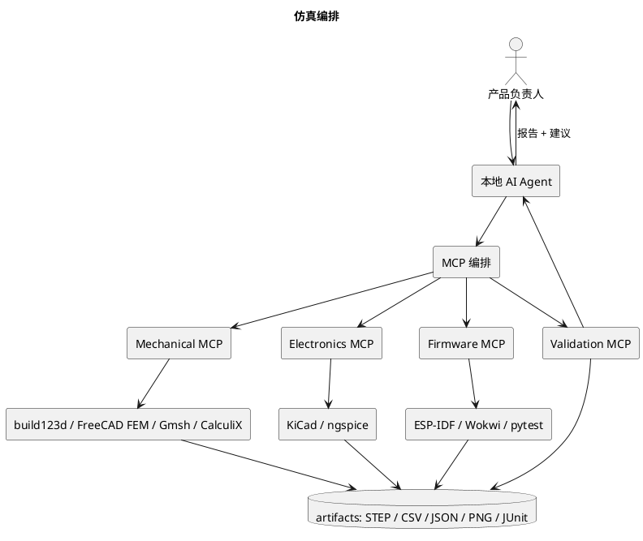

# AI Hardware Engineering Pipeline

> 项目：Smart Coaster 智能杯垫  
> 版本：V1.1（新增仿真工程 / MCP 编排 / 参考资料）  
> 目标：建立一套以本地 AI Agent 为核心、通过 MCP 调用专业工具、以参数化设计和自动化验证为基础的硬件研发流程。

---

## 1. 项目目标

本项目尝试建立一套 AI 原生的硬件研发工作流。

传统硬件开发通常需要在机械 CAD、电路 EDA、仿真、固件 IDE 等工具之间切换，设计信息分散在不同文件和软件中。

本项目希望实现：

1. 使用自然语言描述产品需求和设计约束。
2. 由本地 AI Agent 将需求拆解为机械、电路、固件和验证任务。
3. Agent 通过 MCP 调用本地专业工具。
4. 使用文本和代码驱动参数化设计。
5. 尽可能先完成数字样机、仿真和自动化检查。
6. 验证通过后再进行 3D 打印、PCB 打样和实物组装。
7. 通过 Git 管理设计文件、需求、验证结果和版本变更。

核心原则：

**AI 负责理解、规划、生成和协作，专业工具负责几何建模、电路分析和工程验证，人负责关键决策与验收。**

不将 AI 生成结果直接视为经过验证的工程设计。

## 2. 总体研发架构

```text
                   用户 / 产品负责人
                          │
                          ▼
                 本地 AI Agent
                          │
                需求分析 / 任务规划
                          │
                          ▼
                  MCP 工具调用层
                          │
        ┌─────────────────┼─────────────────┐
        │                 │                 │
        ▼                 ▼                 ▼
   机械设计工具       电路设计工具       软件开发工具
   AgentCAD           KiCad             ESP-IDF
   build123d          ngspice           Python
   FreeCAD            电路仿真          BLE
        │                 │                 │
        ▼                 ▼                 ▼
   3D 模型            PCB / 原理图       固件程序
   STEP / STL         Gerber            单元测试
        │                 │                 │
        └─────────────────┼─────────────────┘
                          ▼
                     验证与集成
                          │
             ┌────────────┼────────────┐
             ▼            ▼            ▼
          几何检查      电气检查      软件测试
             │            │            │
             └────────────┼────────────┘
                          ▼
                     实物打样
                          │
                          ▼
                    实际测试与迭代
```

## 3. 工具链设计

### 3.1 本地 AI Agent

要求：

- 能够读取和修改项目文件。
- 能够执行本地命令。
- 支持 MCP 工具调用。
- 能够读取项目中的 PRD、设计规范和验证记录。
- 支持多个专业 Agent 协作。
- 不绑定特定厂商或特定模型。

建议划分以下角色：

| Agent | 职责 |
|---|---|
| Product Agent | 维护需求、功能定义和优先级 |
| Mechanical Agent | 机械结构设计、参数化建模 |
| Electronics Agent | 原理图、PCB 和电路验证 |
| Firmware Agent | MCU 固件、传感器驱动、BLE |
| Validation Agent | 测试计划、自动化验证、结果归档 |
| Integration Agent | 系统集成、接口协调、版本管理 |

初期不要求部署多个独立 Agent 实例，可以由一个主 Agent 按角色执行任务。

### 3.2 机械设计工具

第一阶段：

- AgentCAD
- build123d
- Python

第二阶段：

- FreeCAD（装配、工程图、STEP 复核、**FEM 前处理**）
- CalculiX（有限元求解）
- Gmsh（网格）

职责划分：

| 工具 | 用途 |
|---|---|
| AgentCAD | 提供 AI Agent 驱动的 CAD 工作流 |
| build123d | 使用 Python 进行参数化几何建模 |
| FreeCAD | 装配、工程图、STEP 检查和人工复核；FEM 前处理 |
| CalculiX | 应力/应变/位移求解（线弹性 + 接触） |
| Gmsh | 参数化网格，批量参数扫描 |

> 仿真的完整设计见 §13；工具安装位置见 §13.6。

设计要求：

- 优先采用参数化建模。
- 关键尺寸集中管理。
- 模型生成与参数配置分离。
- 所有关键结构均应有明确的设计依据。
- 未确认的尺寸不能伪装成已验证尺寸。
- 每次修改应能通过 Git 追溯。

### 3.3 电路设计工具

第二阶段引入：

- KiCad：原理图、PCB、ERC、DRC，内置 ngspice。
- ngspice：直流工作点、AC 扫描、瞬态、噪声、蒙特卡洛。
- Python：数据处理和测试脚本。

> **HX711 没有公开的芯片级 SPICE 模型**：电路仿真只能做桥路等效 + 行为模型，
> 不能声称仿真了芯片内部。

设计流程：

```text
需求
  │
  ▼
系统硬件架构
  │
  ▼
器件选型
  │
  ▼
原理图设计
  │
  ▼
ERC 检查
  │
  ▼
PCB Layout
  │
  ▼
DRC 检查
  │
  ▼
Gerber / BOM
  │
  ▼
PCB 打样
```

电路设计必须保留器件型号、数据手册、关键参数和选型依据。

### 3.4 固件开发工具

后续采用：

- ESP-IDF（真实固件构建）
- C/C++
- Wokwi（ESP32-S3 + HX711 + OLED 虚拟样机；云服务，非完全本地）
- pytest（本地确定性算法测试）
- BLE 协议栈

固件功能包括：

- 传感器数据采集。
- 数据滤波和校准。
- 饮水事件判断。
- OLED 显示。
- 按键处理。
- BLE 数据同步。
- 低功耗管理。

普通版和 Solar 版应共享尽可能多的业务逻辑，但允许底层硬件和功耗管理实现不同。

## 4. 项目目录结构

建议采用：

```text
smart-coaster/
│
├── AGENTS.md
├── README.md
├── requirements.yaml
├── BOM.md
├── VALIDATION_PLAN.md
│
├── docs/
│   ├── 01_AI_Hardware_Engineering_Pipeline.md
│   ├── 02_Smart_Coaster_PRD.md
│   ├── architecture/
│   └── decisions/
│
├── config/
│   ├── mechanical_params.yaml
│   ├── electronics.yaml
│   └── firmware.yaml
│
├── mechanical/
│   ├── src/
│   ├── assemblies/
│   ├── exports/
│   └── reports/
│
├── electronics/
│   ├── schematic/
│   ├── pcb/
│   ├── simulation/
│   └── fabrication/
│
├── firmware/
│   ├── main/
│   ├── components/
│   ├── tests/
│   └── config/
│
├── simulation/
│   ├── mechanical/
│   ├── electronics/
│   └── system/
│
├── tests/
│   ├── mechanical/
│   ├── electronics/
│   └── firmware/
│
├── scripts/
│
└── build/
```

目录可以随着开发逐步完善，不要求一开始创建所有子目录。

## 5. 需求驱动开发

产品需求统一维护在 PRD 和结构化配置文件中。

例如：

```yaml
project:
  name: smart-coaster
  version: "1.0"

product:
  ordinary_version:
    display: true
    connectivity: BLE
    power: USB-C

  solar_version:
    display: false
    connectivity: BLE
    power: solar_energy_harvesting

mechanical:
  width_mm: 100
  length_mm: 100
  dimensions_status: initial_target

sensor:
  model: HY928D
  type: sheet_like_strain_sensor
  rated_capacity_kg: 5
  status: pending_verification
```

注意：

- 配置文件记录设计目标和当前状态。
- 不确定的参数必须明确标记。
- 配置文件不是实物规格书。
- 任何影响结构、电路或固件的需求变更都要同步更新相关文档。

## 6. 机械设计工作流

### M0：设计输入和结构分析

输入：

- 产品需求。
- 外观参考。
- HY928D 图纸。
- 传感器实物照片。
- 供应商资料。

输出：

- 产品结构方案。
- 传感器安装方式分析。
- 受力路径图。
- 参数清单。
- 未确认事项。

不直接生成最终外壳。

### M1：关键结构建模

先设计：

- HY928D 参数化参考模型。
- 传感器安装接口。
- 浮动顶板。
- 底壳安装区域。
- 过载保护结构。

传感器真实安装方式必须先确认。

### M2：完整机械建模

设计：

- 顶板。
- 底壳。
- OLED 安装区域。
- 圆形按键。
- PCB 固定结构。
- USB-C 开孔。
- 防滑脚垫。
- 排线通道。

### M3：机械验证

检查：

- 零件尺寸。
- 装配干涉。
- 顶板运动空间。
- 传感器安装可达性。
- 螺钉装配空间。
- 排线活动空间。
- 称重旁路。
- 过载限位。

输出 STEP、STL 和装配报告。

## 7. 电路设计工作流

### E0：系统架构

明确：

- MCU。
- 传感器。
- ADC / 称重采集前端。
- OLED。
- 按键。
- 电源。
- USB-C。
- BLE。

### E1：器件选型

每个器件必须记录：

- 型号。
- 数据手册。
- 工作电压。
- 工作电流。
- 接口类型。
- 封装。
- 选型原因。
- 风险和替代方案。

### E2：原理图

完成：

- 电源输入。
- 电源管理。
- 称重采集。
- MCU。
- OLED。
- 按键。
- USB-C。
- 调试接口。

### E3：PCB

检查：

- 器件布局。
- 电源回路。
- 模拟信号走线。
- 接地。
- 接插件位置。
- 机械安装孔。
- PCB 外形与底壳匹配。

### E4：电路验证

完成 ERC、DRC 和必要的仿真。

不能将仿真结果替代真实硬件测试。

## 8. 固件设计工作流

### F0：软件架构

划分模块：

```text
Application
    │
    ├── Hydration Logic
    ├── Weight Processing
    ├── Display Manager
    ├── Button Manager
    ├── BLE Service
    └── Power Manager
             │
             ▼
       Hardware Drivers
             │
             ├── Sensor Frontend
             ├── OLED
             ├── GPIO
             └── Battery / Power
```

### F1：传感器采集

实现：

- 原始数据读取。
- 零点校准。
- 重量换算。
- 数字滤波。
- 异常值处理。
- 稳定性判断。

### F2：饮水行为识别

根据重量变化判断：

- 杯子放入。
- 杯子移走。
- 饮水导致的重量下降。
- 加水导致的重量上升。
- 杯子移动或外部干扰。
- 重量稳定状态。

### F3：显示与交互

普通版实现：

- 当前重量。
- 饮水量或饮水提醒。
- 状态提示。
- 按键操作。

### F4：BLE

实现：

- 设备发现。
- 配对和连接。
- 数据同步。
- 断线重连。
- 手机端数据接收。

## 9. 验证与质量管理

所有功能都必须有可验证的验收条件。

### 机械验证

- 尺寸检查。
- 装配检查。
- 干涉检查。
- 顶板活动检查。
- 过载保护检查。
- 称重路径检查。

### 电气验证

- 电源电压。
- 电源电流。
- 传感器采集噪声。
- ADC 稳定性。
- OLED 工作状态。
- BLE 通信。
- 低功耗表现。

### 固件验证

- 单元测试。
- 驱动测试。
- 事件识别测试。
- BLE 测试。
- 异常恢复测试。
- 长时间运行测试。

### 整机验证

- 不同杯型。
- 不同杯底尺寸。
- 空杯和满杯。
- 少量饮水和大量饮水。
- 杯子移动。
- 杯子重新放置。
- 长时间静置。
- 不同温度和环境条件。

## 10. AI Agent 执行规范

所有 Agent 必须遵循：

1. 先读取 PRD、AGENTS.md 和相关设计文档。
2. 先分析，再修改文件。
3. 重要结构先给方案，等待人工确认。
4. 不得虚构器件参数。
5. 不得将推测当作事实。
6. 不得随意改变已确认的设计约束。
7. 每次修改都应记录原因。
8. 生成文件后必须执行检查。
9. 对无法验证的结论明确标记。
10. 不允许未经确认直接进入高成本打样阶段。

每个任务输出：

- 任务目标。
- 输入信息。
- 设计假设。
- 修改文件。
- 执行过程。
- 验证结果。
- 未解决问题。
- 下一步建议。

## 11. 开发里程碑

| 阶段 | 目标 | 交付 |
|---|---|---|
| P0 | 环境搭建 | AgentCAD、build123d、MCP |
| P1 | 产品结构方案 | 结构图、参数表 |
| P2 | 机械设计 | 3D 模型、STEP、STL |
| P3 | 电路设计 | 原理图、PCB、BOM |
| P4 | 固件开发 | 传感器、显示、BLE |
| P5 | 数字验证 | 见 §13：S1 机械 FEA → S2 电路 SPICE → S3 固件仿真 → S4 MCP 编排 |
| P6 | 实物打样 | 3D 打印、PCB |
| P7 | 整机验证 | 测试报告 |
| P8 | 产品迭代 | V1.1 / Solar 版 |

## 12. 核心原则

本项目不是让 AI 一次性生成一个看起来完整的产品，而是建立一套能够持续迭代、验证和追溯的硬件研发体系。

优先保证：

- 可复现。
- 可验证。
- 可修改。
- 可追溯。
- 可迁移。
- 工具链开放。
- 设计不绑定单一 Agent 或模型。

最终目标是让产品需求、机械模型、电路设计、固件和测试结果形成统一的工程闭环。

---

## 13. 仿真工程（Simulation Engineering）

> 新增章节。**M1.2 的 13 实体无干涉只证明几何不碰撞**，不代表结构强度、称重性能、电气指标已经通过。

### 13.1 四层仿真，而不是找一个包办软件

| 层 | 主工具 | 验证什么 | 输出 |
|---|---|---|---|
| 机械 | build123d → FreeCAD FEM + Gmsh + CalculiX | 传感器/顶板/支撑的应力、应变、位移、接触、过载 | 应力云图、位移曲线、安全系数、JSON 指标 |
| 电路 | KiCad + ngspice | 惠斯通电桥、HX711 前端、电源、滤波、噪声 | 工作点、AC/瞬态曲线、噪声谱、参数扫描 |
| 固件 | ESP-IDF + Wokwi + pytest | 采样、状态机、显示、按键、BLE 业务逻辑 | 单元测试、场景回放、JUnit/CSV |
| 系统 | Python + MCP + Git | 参数→仿真→验收→报告→归档 | 一条命令的验证报告、可追溯版本 |

原则：**专业软件做求解，Agent 做编排、读数和判断**；不让 Agent 靠"看图片"验收。

### 13.2 机械仿真

```
build123d 参数化模型
        │  export STEP
        ▼
FreeCAD FEM / Gmsh（前处理、网格）
        │  .inp
        ▼
CalculiX（求解）
        │  .frd / .dat
        ▼
Python（提取指标：max σ、max δ、接触状态、安全系数）
        │
        ▼
Agent（对比阈值、生成报告、失败时给修改建议）
```

**三个仿真对象**

| 对象 | 载荷/边界 | 重点指标 |
|---|---|---|
| A. HY928D 本体 | 4 孔固定 + 中央力（假设 A）；或 2 孔固定 + 自由端（假设 B） | 梁根应变、中央位移、应力集中、全桥输出估算 |
| B. 顶板 + 传力柱 | 中心/偏载（r=30、r=45）+ 1 kg / 5 kg | 顶板挠度、柱端接触应力、偏载倾角 |
| C. 整体装配 | 传感器 + 4 角柱 + 底壳 + 限位 | 过载 0.5/0.6 mm 是否先接触、旁路力、安全系数 |

**必须先冻结的前置条件**

1. HY928D 的 U 形槽是通槽还是浅腔、梁宽/槽深（`ref/HY928D_5kg_称重传感器_图纸转录.md` §4）。
2. 安装方案 A/B/C（四角固定+中央 / 单点 / 四角+球头）。
3. 材料：65Mn，E=210 GPa，ν=0.3，ρ=7.85 g/cm³；屈服强度按供应商状态。
4. 实际灵敏度 ±0.2 mV/V、额定形变、安全位移（待实测）。

**验收指标（示例，阈值待传感器数据确认）**

```yaml
mechanical_validation:
  cases:
    - name: center_load_1kg
      load_n: 9.81
      metrics: {max_displacement_mm: null, max_stress_mpa: null, sensor_strain: null}
    - name: center_load_5kg
      load_n: 49.05
    - name: eccentric_load_1kg
      position_mm: [30, 0]
      metrics: {max_tilt_deg: null, rim_gap_remaining_mm: null}
  acceptance:
    max_stress_mpa: null          # < 屈服/安全系数
    overload_stop_before_sensor_yield: null
    no_bypass_contact_below: 0.5  # mm
  status: pending_material_and_sensor_data
```

**能证明 / 不能证明**

- 能：相对趋势、应力集中位置、哪个零件先屈服、限位是否先接触、偏载影响量级。
- 不能：仅凭 CAD 算出最终称重精度；应变片位置/桥路/胶层/温漂必须实物标定。

### 13.3 电路仿真（KiCad + ngspice）

**四个模块**

| 模块 | 仿真 | 目的 |
|---|---|---|
| 惠斯通电桥 | 4 电阻桥 + 灵敏度 1.2/0.6 mV/V | 输出量级、共模、桥臂偏差对零点 |
| HX711 前端 | 行为模型（输入阻抗、增益、±20 mV、噪声） | 输入范围、增益选择、RC 滤波 |
| 电源 | USB-C 5 V、充电、LDO/片内稳压、电池 | 电压/电流/功耗、纹波 |
| MCU 接口 | GPIO 上拉、I²C、复位、电平 | 电平兼容、上电时序 |

**分析类型**：`.op`（工作点）、`.dc`（载荷扫描）、`.ac`（滤波/噪声增益）、`.tran`（上电/纹波）、`.noise`（输入等效噪声）、蒙特卡洛（电阻容差）。

**理论量级**（按 HY928D 5 kg 全桥 1.2 mV/V）：

| 激励 | 满量程输出 | 占 HX711 ±20 mV |
|---|---|---|
| 3.3 V | 3.96 mV | 19.8% |
| 4.3 V | 5.16 mV | 25.8% |
| 5.0 V | 6.00 mV | 30.0% |

**边界**：HX711 芯片级 SPICE 模型不存在；只能验证**信号链量级、滤波、噪声预算**，不能替代实物噪声/温漂测试。

### 13.4 固件仿真（ESP-IDF + Wokwi + pytest）

- **ESP-IDF**：真实固件编译、驱动、FreeRTOS、BLE。
- **Wokwi**：ESP32-S3 + HX711（支持 5 kg 模式）+ OLED 的虚拟样机；可脚本设置重量、跑场景。
- **pytest**：滤波、稳定判定、事件状态机、饮水累计等纯算法，本地确定性测试。

| 场景 | 输入 | 预期 |
|---|---|---|
| 空杯放置 | 300 g | 建立基线 |
| 喝水 | 300→250 g | 识别 -50 g |
| 加水 | 250→400 g | 识别 refill，不计量 |
| 拿走 | 400→0 g | 移除 |
| 放回 | 0→400 g | 新基线 |
| 抖动 | 400 g ±5 g | 不触发 |
| 断线 | 超时 | 错误恢复 |

**边界**：Wokwi 是云端服务，不是完全本地求解器；不能替代应变片力学、桥路温漂、HX711 真实噪声、PCB EMI、装配回差。

> 本机安装：`wokwi-cli 0.29.1`（`~/.local/bin`）。**仿真必须 `WOKWI_CLI_TOKEN`（https://wokwi.com/dashboard/ci），且会上传 diagram/固件到云端**；按本项目"不上传第三方"的约定，默认只用 `wokwi-cli lint --offline`，云仿真需人工明确授权。
> ESP-IDF v6.1 激活：`source /home/pi/.espressif/tools/activate_idf_v6.1.sh`（直接 source `export.sh` 会因缺 `IDF_TOOLS_PATH` 失败）。

### 13.5 系统级自动化与 MCP 编排



**工具接口（建议，Phase 1 用 Python 包装，Phase 2 再包 MCP）**

```text
mechanical.generate_model(params)
mechanical.export_step(assembly)
mechanical.run_fea(model, load_cases)
mechanical.check_interference(assembly)
electronics.generate_schematic(spec)
electronics.run_erc(project)
electronics.run_spice(netlist, scenarios)
electronics.run_drc(project)
firmware.build(target)
firmware.run_wokwi(scenario)
firmware.run_unit_tests()
validation.run_suite(profile)
validation.generate_report(results)
```

**调用方式**：Python API / CLI / 工程文件，**不做 GUI 点击自动化**。

### 13.6 工具安装位置（需要时）

| 工具 | 来源 | 安装位置（建议） | 状态 |
|---|---|---|---|
| CalculiX | FreeCAD 1.0.2 自带 ccx 2.22 | `/data/Documents/tools/freecad/squashfs-root/usr/bin/ccx`（`~/.local/bin/ccx`） | ✅ 已装 |
| Gmsh | FreeCAD 1.0.2 自带 4.13.1 | `.../freecad/.../usr/bin/gmsh`（`~/.local/bin/gmsh`） | ✅ 已装 |
| FreeCAD FEM | 已装 FreeCAD 1.0.2 | `/data/Documents/tools/freecad` | ✅ 已装 |
| KiCad | 9.0.9（官方 PPA jammy deb 解包，含 kicad-cli） | `/data/Documents/tools/kicad`（`~/.local/bin/kicad-cli`） | ✅ 已装 |
| ngspice | 36（apt deb 解包） | `/data/Documents/tools/ngspice`（`~/.local/bin/ngspice`） | ✅ 已装 |
| ESP-IDF | v6.1（本机已有；`source /home/pi/.espressif/tools/activate_idf_v6.1.sh`） | `~/.espressif/v6.1/esp-idf` | ✅ 本机 |
| Wokwi CLI | 0.29.1（GitHub Release 静态二进制） | `/data/Documents/tools/wokwi-cli` | ✅ 已装（仅本地 lint；云仿真需 token） |

> 原则：能用官方预编译包就不源码编译；需要 clone 的一律装到 `/data/Documents/tools/<tool>`；版本锁定写进 `requirements.yaml`。
> **FEA 求解器复用 FreeCAD 1.0.2 自带**（ccx 2.22 / gmsh 4.13.1），不另建 `tools/calculix`、`tools/gmsh`。
> 已验证：ccx 2.22 悬臂梁 C3D8I 0.037668 mm（解析 0.038095，−1.1%）；gmsh 4.13.1 对 HY928D v2 STEP 生成 1374 节点 / 7180 单元。
> 详见 `/data/Documents/tools/FEA_INSTALL_NOTES.md`。

### 13.7 实施顺序（S1–S4）

| 阶段 | 目标 | 交付 | 前置 |
|---|---|---|---|
| **S1** | 机械 FEA 打通 | CalculiX/Gmsh 安装；HY928D 中心加载 + 顶板中心/偏载；应力/位移 JSON + 云图 | 冻结 A/B 安装假设 |
| **S2** | 电路 SPICE 打通 | KiCad 桥路 + HX711 行为模型；DC/AC/噪声/蒙特卡洛；参数扫描报告 | 桥路确认 |
| **S3** | 固件仿真打通 | ESP-IDF + Wokwi 虚拟杯垫；7 个场景自动化；pytest 算法测试 | 引脚/外设冻结 |
| **S4** | MCP 编排 | 一条命令跑 S1–S3，生成统一报告 + Git 记录 | S1–S3 稳定 |

**建议先做 S1**：已有 build123d 源 + 完整装配，是最成熟的输入。S2/S3 可并行准备，但不要把"仿真通过"当成"实物通过"。

### 13.8 边界与原则

1. 仿真结果必须落成**机器可读指标**（JSON/CSV），不能只看图片。
2. 每个仿真任务写明**假设、边界条件、材料、版本**；假设变了结果作废。
3. 不确定的参数（U 形槽、桥路、灵敏度的容差）用**参数扫描**表达，不给单点假精确值。
4. 仿真不能替代实物：最终灵敏度、温漂、回差、蠕变必须标定。
5. 任何"通过"都必须有**阈值来源**（PRD、标准、供应商数据、实测）。

---

## 14. MCP 仿真编排层

### 14.1 目标

让本地 Agent 能：读 PRD/参数 → 生成/修改模型 → 跑仿真 → 读指标 → 判断 → 失败给建议 → 人审批 → Git 提交。

### 14.2 分层

```text
Agent
  │  MCP (tool calls, JSON in/out)
  ▼
Local Simulation MCP
  ├── mechanical  (build123d / FreeCAD / Gmsh / CalculiX)
  ├── electronics (KiCad / ngspice)
  ├── firmware    (ESP-IDF / Wokwi / pytest)
  └── validation  (pytest / pandas / report)
        │
        ▼
artifacts/  (STEP, INP, FRD, CSV, JSON, PNG, JUnit, report.md)
```

### 14.3 接口契约

每个工具返回统一结构：

```json
{
  "tool": "mechanical.run_fea",
  "status": "success",
  "inputs": {"model": "build/assembly/assembly_v01.step", "case": "center_5kg"},
  "artifacts": {"report": "sim/mech/center_5kg.json", "image": "sim/mech/center_5kg.png"},
  "metrics": {"max_stress_mpa": null, "max_disp_mm": null, "safety_factor": null},
  "warnings": [],
  "duration_s": 0
}
```

- 失败必须带 `error_kind`、`stderr` 摘要、可复现命令。
- 所有路径相对项目根；产物进 `simulation/` 或 `build/`。
- 版本：模型、网表、固件 commit + 参数哈希写入报告。

### 14.4 不建议的做法

- 用 GUI 自动化（点菜单、拖窗口）调专业软件。
- 让 Agent 用"看图"代替数值验收。
- 把仿真器的默认值当成设计值。
- 在没有冻结边界条件时给出"精度 ±x g"的结论。

---

## 15. 参考资料（ref/）

| 资料 | 转录 | 关键结论 |
|---|---|---|
| `ref/hy928d.webp` | [`ref/HY928D_5kg_称重传感器_图纸转录.md`](../ref/HY928D_5kg_称重传感器_图纸转录.md) | 5 kg/H=1.0/全桥 1.2 mV/V/4×Ø3.1@28/Ø5/马蹄形 U 槽；通槽 vs 浅腔未定 |
| `ref/hx711官方资料(海芯).pdf` | [`ref/HX711_数据手册_海芯.md`](../ref/HX711_数据手册_海芯.md) | 24-bit/增益 128=±20 mV/10 Hz/25-27 脉冲/片内稳压 |
| `ref/ref.jpeg` + 构建日志 | [`ref/Hydrate_AI_拆解与结构参考.md`](../ref/Hydrate_AI_拆解与结构参考.md) | SC134 单点 + 斜向悬臂；**与 HY928D 四角固定不同**；可借鉴包装/交互 |
| `ref/design.png` | 同上 §3 | 100×100×14 / OLED "250 g" / 双按键 / 四层爆炸 |

> 详细索引见 [`ref/README.md`](../ref/README.md)。

**对现有设计的直接影响**

1. HY928D 的 U 形槽需要按图纸重建（不能用 `SlotOverall` 近似），并做"通槽/浅腔"两版 FEA。
2. 安装方案 A/B/C 必须先选；参考产品的单点式不能直接套。
3. 目标形态 14 mm 需要专门的高度预算（当前 18 mm）。
4. 按键从 1 个增加到 2–3 个，全部固定在底壳、不跨浮动面。
