# SmartCoaster 成果展示

> **一句话**：一杯水，一块杯垫，一个不需要你盯着手机的理由。
> **定位**：把称重放进杯垫，喝水自动被记录；信息只在需要时出现在 26×7 的屏窗里——**没有灯，没有声音，没有另一个 App 要打开**。
> 日期：2026-11-04 · 技术细节见 [REPORT_技术报告.md](REPORT_技术报告.md) · 交接见 [HANDOFF.md](HANDOFF.md)

---

## 0. 一览

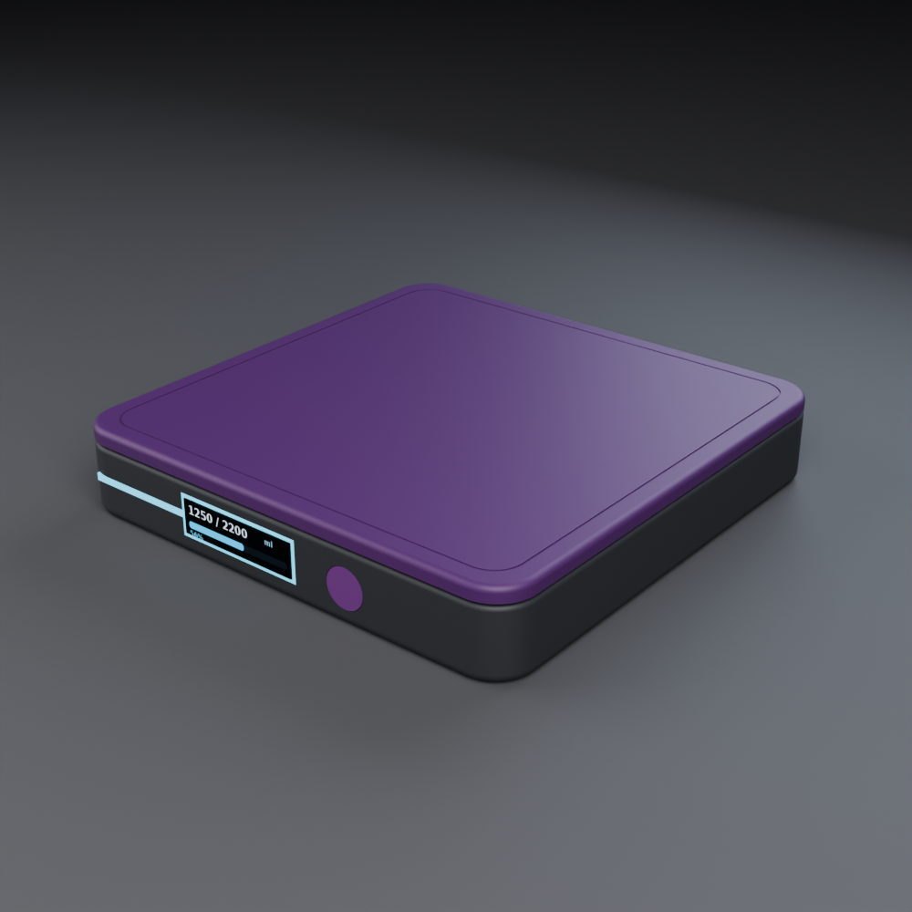

| 维度 | 数字 |
|---|---|
| 整机 | **100 × 100 × 18 mm** / ≈ **155 g**（12 个零件） |
| 称重 | HY928D 5 kg + HX711 24-bit，10 SPS；1.2 mV/V 全桥 → 3.96 mV FS（用满 HX711 量程 30.7%） |
| 电路 | **43 器件 / 28 网络**，2 层 PCB，**0 DRC / 0 unconnected**，ERC 0/0 |
| 显示 | 0.91" 128×32 OLED，**26×7 可视窗** + Ø8.2 实体按键；8 s 息屏 |
| 连接 | BLE 5（NimBLE，服务 0xFF00：重量/今日/目标/电量/命令/时间） |
| 续航 | 500 mAh，PM light sleep + BLE 占空广播，**7 天级估算**（待实测） |
| 固件 | bin 519,184 B；host 11/11 + mock 9/9 + C↔Python 差分 16/16 + pytest 16 |
| 验证 | 机械 21/21、FEA 5 kg 0.3435 mm、DFM 5/5 PASS、独立验收 7/7 PASS |

---

## 1. 产品与体验

**问题**：提醒喝水的手环/手机通知总在“另一个屏幕”上被忽略；量杯/App 记录都要求额外动作；桌面杯垫一直在场，却只承担隔热。

**洞察**：喝水是一个**放下杯子**的动作。把称重放进杯垫，这件事就自动被记录。

**体验闭环**

```text
杯子放上杯垫 → 识别杯重 → 持续称重 → 判断饮水（拿起-放下差值）
            → 估算本次饮水量 → 更新今日累计 → 26×7 屏窗提示 / BLE 同步
```

**三种状态**：空杯（EMPTY）/ 喝水（HYDRATION）/ 秤（SCALE）。
**手势**：单击看进度；双击手动切秤；长按 2 s 记杯重；长按 5 s 进入 BLE 配对（120 s 窗口）。

---

## 2. 外观与 CMF

| 前脸（无灯） | 爆炸图 |
|---|---|
| 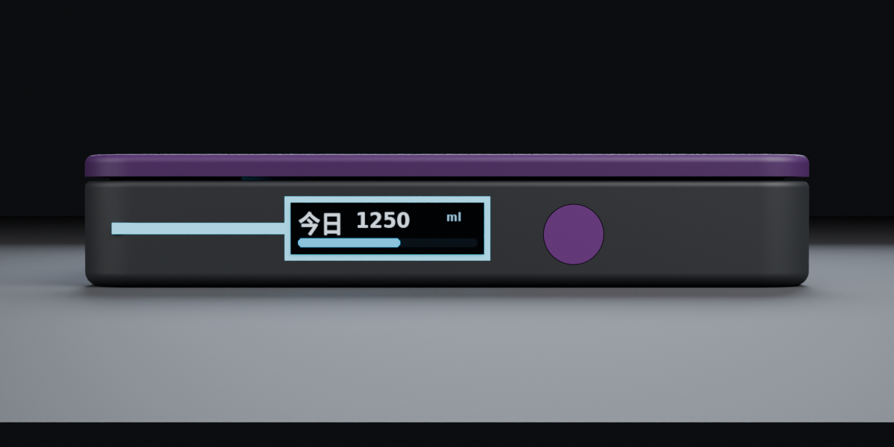 | 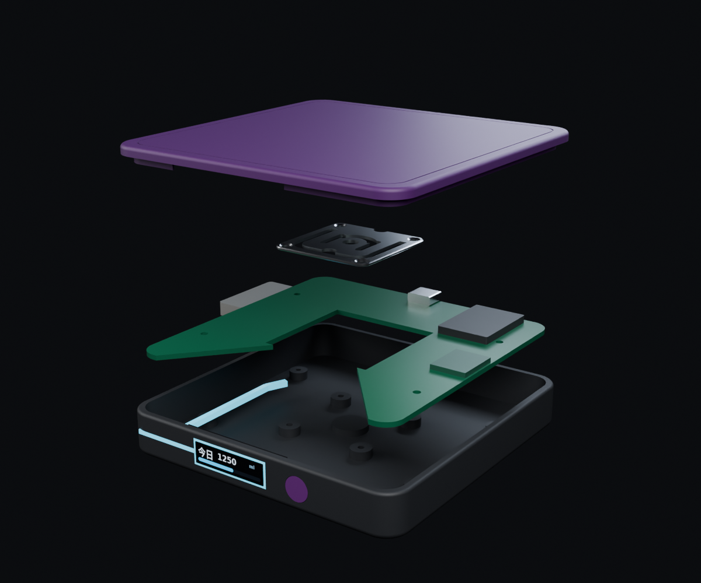 |

- 前脸只有 **26×7 烟熏屏窗（x=−8）+ Ø8.2 按键（x=17）**，同一水平线；唯一缝隙是顶板-底座 **0.5 mm 称重浮动缝**——它是功能缝，不是灯缝。
- **Quiet tech** 设计语言：哑光、圆角、无 logo；屏只在需要时出现。
- 主色 **Lumen Violet**（顶板 Pantone 2665C / 壳体 426C），另有 Moss / Sand / Graphite。

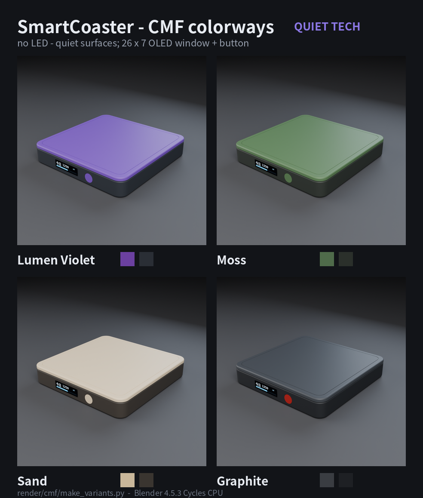

> 2026-11-04 用户决定去掉 LED 与全部光导：窗周 halo、前缘灯线、底部灯线、Y 分光、缝隙光环全部取消；P3 全部资产已按“无灯”重渲。

---

## 3. 机械结构

- **12 件**：底壳 / 浮动顶板 / PCB / HY928D / ESP32 模块 / HX711 / USB-C / 电池 / OLED / 按键 / 窗玻璃 / 硅胶垫。
- **称重路径**：杯子 → 浮动顶板 → Ø6 传力柱（z 6.0→15.0）→ HY928D 中央 → 四角 boss → 底壳 → 桌面；顶板下裙边只定位、不承重。
- **过载保护**：顶板-壳口 **0.5 mm** 限位；5 kg 时传感器下沉 0.343 mm，剩 **0.157 mm** 才接触；按 150%（≈7.3 kg）接触设计。
- **C 形 PCB**：93.2×93.2×1.6、R6、中央 38×38 开口、前缘 80° C 口、4×M2 @80×48、z=5.0。
- 自检：**21/21**、37 组干涉 0、STEP 回读 12 solids；FreeCAD 无头复核。

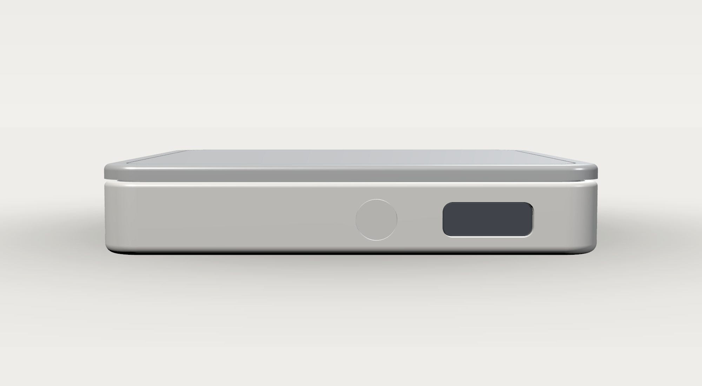

---

## 4. 电子

| 原理图（43 器件 / 28 网络） | 2 层 PCB 布线 |
|---|---|
| 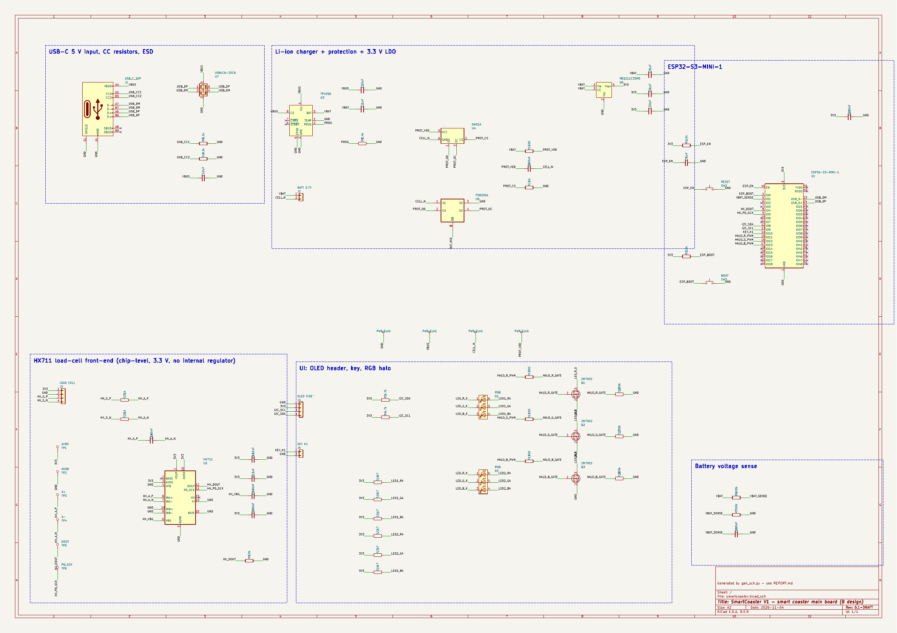 | 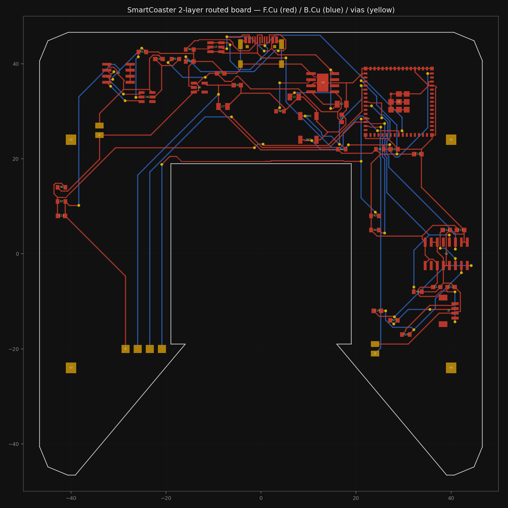 |

| 装配图（1:1，可直接打印） | 电源与称重链 |
|---|---|
| 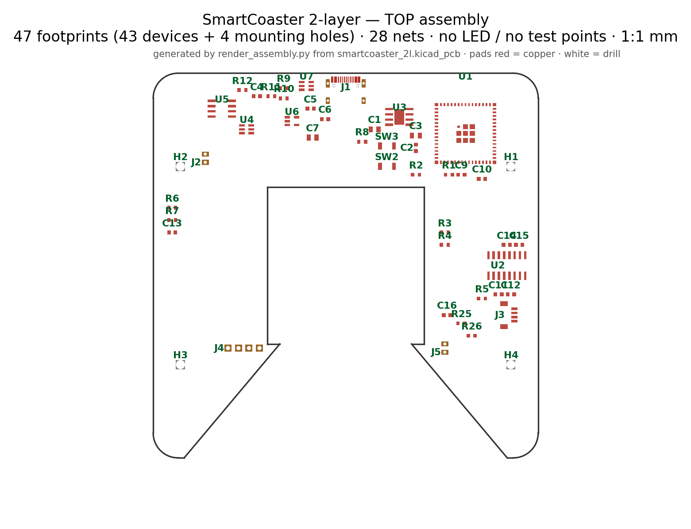 | 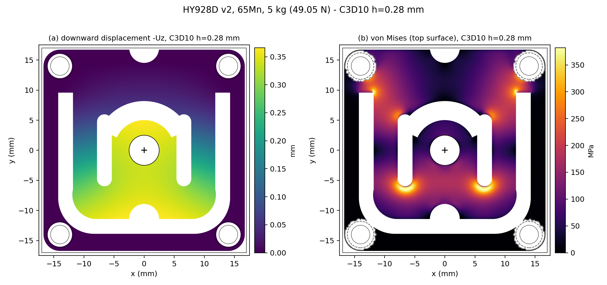 |

- **电源树**：USB-C 5 V → ESD（USBLC6-2SC6）→ TP4056 充电 → 500 mAh LiPo → DW01A+FS8205A 保护 → ME6211C33 3.3 V → ESP32-S3 / HX711 / OLED；电池 1:2 分压进 ADC1。
- **称重**：HY928D 4 线全桥（JST-SH 4P）→ HX711 gain 128 → 3.96 mV FS → 0.506 V → 24-bit @10 SPS。
- **布线结果**：2 层、47 footprint、576 track + 62 via、最小线宽 0.2 mm、过孔 0.6/0.3；**0 DRC / 0 unconnected**（576+62 全连通）。
- **可制造**：9 层 Gerber + Excellon 钻孔 + 坐标 + zip；JLC 2 层 DFM 5/5 PASS（线宽 0.2≥0.127、过孔钻 0.3≥0.2、环宽 0.15≥0.13、板边 0.3、层数 2）。

---

## 5. 固件能力


| 能力 | 实现 |
|---|---|
| 采样/滤波 | 25 脉冲 HX711、5 点中值 + 0.3 s 稳定窗（极差 ≤2 g）、去尖峰 >40 g、超时/IO 错误码 |
| 事件识别 | 放杯/拿杯、sip/refill、外来物进 SCALE、模式切换；事件历史 |
| 提醒 | 距上次饮水 >60 min、10 min 冷却、达标屏上动效 3 s |
| 显示 | 128×32 OLED、中文子集、进度条、8 s 息屏 |
| 交互 | 30 ms 去抖、单击/双击/长按 2 s/5 s |
| BLE | NimBLE GATT 0xFF00：0xFF01 重量、0xFF02 今日、0xFF03 目标（写）、0xFF04 电量、0xFF05 命令、0xFF06 Unix 秒；1 Hz notify；广播占空 |
| 存储/时间 | NVS（today/goal/tare/mode）；epoch 跨日 reset |
| 功耗 | PM automatic light sleep + BT modem sleep；估算 2–3 mA（7 天级） |

**BLE 服务表**

| UUID | 属性 | 含义 |
|---|---|---|
| 0xFF01 | read + notify | 当前重量（g） |
| 0xFF02 | read + notify | 今日累计（ml） |
| 0xFF03 | read + write | 目标（ml） |
| 0xFF04 | read | 电量（%，本轮修复此前恒 100 的缺陷） |
| 0xFF05 | write | 命令：1=清零，2=去皮 |
| 0xFF06 | write | Unix 秒（时间同步/跨日） |

> 手机 App 尚未实现（见技术报告 §7 R8）；当前可用任意 BLE 调试器（如 nRF Connect）验证协议。

---

## 6. 包装与 Red Dot 提交包

| 包装开箱 | 打印拼版 |
|---|---|
| 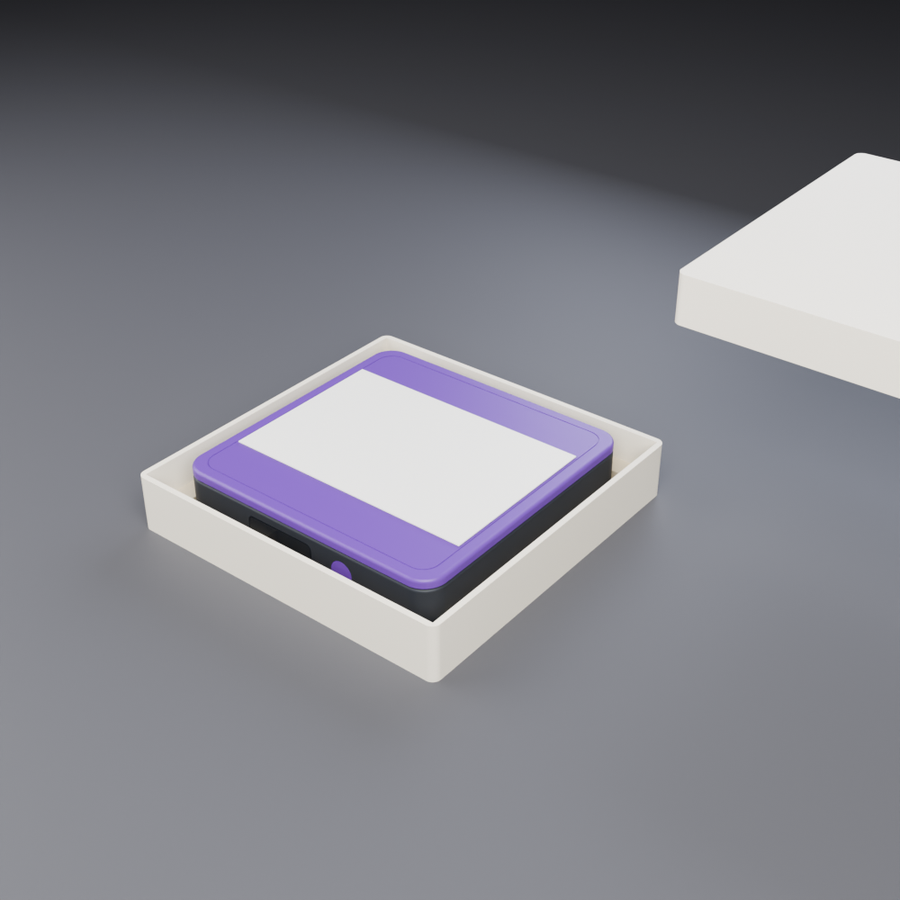 | 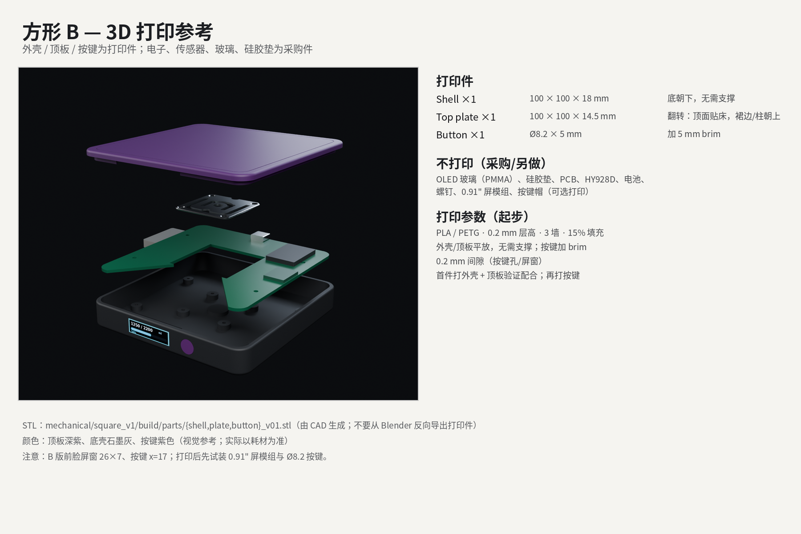 |

- **包装**：120×120×36 天地盖 + 纸浆模塑内衬 + 腰封；FSC、无塑料泡棉、无胶带；STEP/STL + 3 张渲染。
- **Red Dot 2026 提交包**（`../submission/`）：`01_hero.png`、`02_front.png`、`03_exploded.png`、`04_package.png` + `SmartCoaster_Story.pdf`（A3 300 dpi）+ 可复现 `make_story.py`。
- 叙事关键词：**Invisible input · Ambient feedback（仅屏幕）· Repairable · Local-first**。

---

## 7. 可信度（不是“看起来完成”）

| 证据 | 结果 | 位置 |
|---|---|---|
| 机械 21 项自检 | 12 件、37 对干涉 0、0.5 mm 行程、STEP 回读 | `../mechanical/square_v1/build/verify_report.json` |
| S1 FEA | 5 kg 中心 0.3435 mm、支反力 100%、非奇异热点 468 MPa | `../simulation/mechanical/hy928d/` |
| 电路 ERC | 0 error / 0 warning | `../electronics/kicad/build/ERC.rpt` |
| PCB DRC | **0 violation / 0 unconnected** | `../electronics/kicad/build/DRC_2l.rpt` |
| DFM | JLC 2 层 5/5 PASS | `../electronics/kicad/build/DFM.md` |
| 固件 | host 11/11、mock 9/9、差分 16/16、pytest 16 | `../firmware/REPORT.md` |
| 独立验收 | **7/7 PASS**（另一位 verifier 本机复跑） | [VERIFY_REPORT.md](VERIFY_REPORT.md) |
| 逐条审计 | PRD 185 条 + 流水线 146 项 + 环境 15 版本 | [AUDIT_PRD.md](AUDIT_PRD.md)、[AUDIT_PIPELINE.md](AUDIT_PIPELINE.md)、[AUDIT_ENV.md](AUDIT_ENV.md) |

> 说明：以上均为**数字样机/仿真/主机测试**证据；真实灵敏度、温漂、回差必须手板标定（见技术报告 §8.6）。

---

## 8. 与参考产品对比

| 维度 | Hydrate AI（参考拆解） | **SmartCoaster** |
|---|---|---|
| 称重结构 | SC134 单点 + 斜向悬臂 | HY928D 四角固定 + 中央传力柱 + 0.5 mm 过载限位 |
| 外观 | 100×100×14、OLED“250 g”、双按键 | 100×100×18、26×7 窗 + 单按键、**无灯** |
| 反馈 | 屏 + App | 屏（唯一反馈）+ BLE，无灯/无声音 |
| 可维修 | — | 4×M2 + 卡扣，电池可换，30% PCR 外壳 |
| 数据 | 云端 | **本地优先**（NVS + 手机），无云依赖 |

**差异化**：真实工程闭环——参数化 CAD + 自检、2 层板 0/0 + DFM、固件差分测试、独立验收与逐条审计；不是只有渲染图的概念稿。

---

## 9. 路线图

| 阶段 | 内容 | 状态 |
|---|---|---|
| 数字设计 P1–P3 | 机械/电子/固件/P3 | ✅ 完成 |
| 数字验证 S1–S4 | FEA A / SPICE 前端 / host 测试 ✅；FEA B/C、SPICE 全量、MCP 编排 ⏳ | ⚠️ 部分 |
| M2 工程核实 | HY928D 供应商确认（U 腔/桥路/灵敏度）、线缆/电池收口 | ⛔ 待关闭 |
| M5 实物样机 | 采购 → 装配 → 11 项 bring-up → 砝码标定 → 7 天记录 | ⛔ 未开始（用户侧） |
| 量产/Red Dot | CMF 样板、认证评估、Red Dot 2026 提交 | ⏳ 资产就绪，待实物 |

---

## 10. 资产索引

**看图**

- 外观：`../render/square_b/renders/{hero,front,exploded,pcb_detail}.png`
- CMF：`../render/cmf/CMF_variants.png` 及 4 个变体
- 包装：`../render/packaging/renders/{closed,open,insert}.png`
- 电路：`../electronics/kicad/build/{sch-1.png,pcb_2l.png,pcb_layout.png}`
- 装配：`../electronics/kicad/build/assembly/{top,bottom}.{pdf,png}`
- 仿真：`../simulation/mechanical/hy928d/figs/*.png`
- 机械：`../mechanical/square_v1/build/render/*.png`
- 提交包：`../submission/01_hero.png` 等 4 图 + `SmartCoaster_Story.pdf`

**看文件**

- 机械源：`../mechanical/square_v1/cad/square_model.py`；导出：`build/parts/`、`build/assembly/`
- 电子源：`../electronics/kicad/scripts/design.py`；板：`smartcoaster/smartcoaster_2l.kicad_pcb`；制造：`build/gerbers/`、`build/smartcoaster_2l_gerbers.zip`
- 固件：`../firmware/esp32/main/`；测试：`../tests/firmware/`
- 文档：`../docs/`（技术报告、HANDOFF、AUDIT、VERIFY）
- 一键复现：`../electronics/kicad/scripts/build.sh`（电子全链路）、`verify_v01.py`（机械）、`run_host_tests.sh`（固件）

> 完整清单与命令见 [REPORT_技术报告.md](REPORT_技术报告.md) §9–§10。
