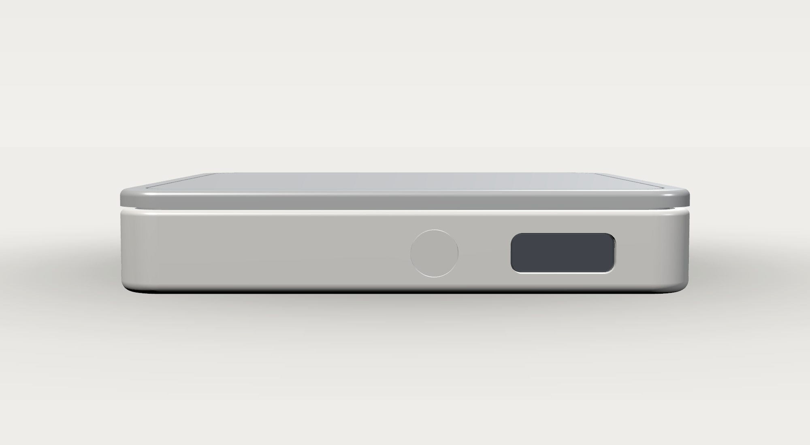
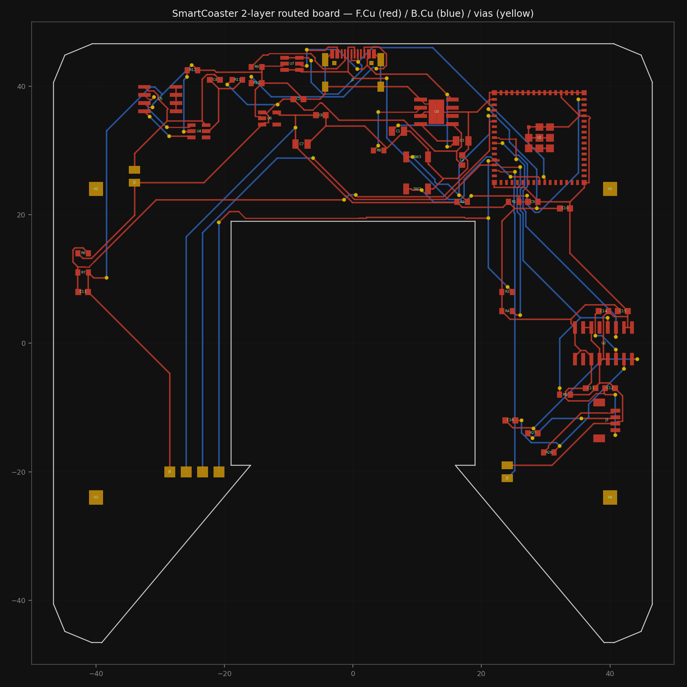
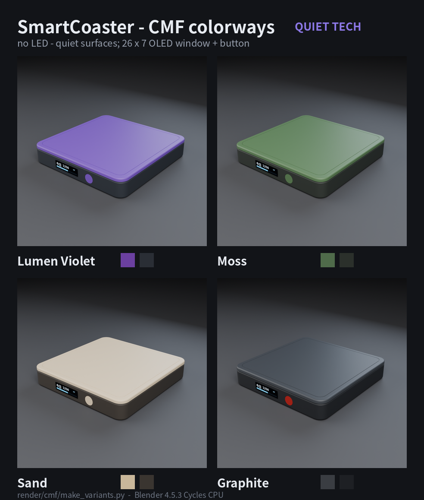
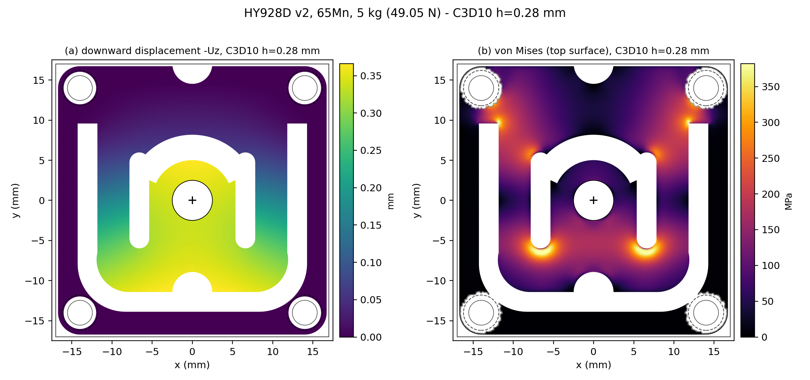

# SmartCoaster 技术报告

> **项目**：SmartCoaster 智能杯垫（方形 V1，100 × 100 × 18 mm）
> **报告日期**：2026-11-04（第二轮收口后）
> **代码基线**：`git log -1` = `ae17e10`（本轮收口提交前的工作区；本报告另含本轮未提交的文档/固件小修）
> **报告定位**：回答“**docs/01 流水线与 docs/02 PRD 的全部任务/需求是否达成**”，并完整记录**环境搭建 → 设计结果 → 验证与手动验收 → 最终资产**。
> **配套文档**：
> - 逐条审计：[AUDIT_PIPELINE.md](AUDIT_PIPELINE.md)（docs/01，146 项）/ [AUDIT_PRD.md](AUDIT_PRD.md)（docs/02，185 项）/ [AUDIT_ENV.md](AUDIT_ENV.md)（环境）
> - 独立验收：[VERIFY_REPORT.md](VERIFY_REPORT.md)
> - 交接入口：[HANDOFF.md](HANDOFF.md)；成果展示：[REPORT_成果展示.md](REPORT_成果展示.md)

---

## 0. 执行摘要

### 0.1 一句话

本项目用本地 AI Agent（DSH + 4 个专业 teammate）跑通了一次**从需求到可制造数字样机**的硬件研发闭环：机械 12 件、电路 43 器件 / 28 网络、**2 层 PCB 布线到 0 DRC / 0 unconnected**、固件主机/差分测试全绿、P3 视觉与 Red Dot 提交包齐备；**尚未做实物打样与实物标定**（用户侧）。

### 0.2 关键结果

| 维度 | 结果 | 证据 |
|---|---|---|
| 机械 | 12 件、100×100×18、78,338 mm³ / ≈155 g；**21/21 自检**、37 组干涉 0、0.5 mm 浮动缝与过载限位保留 | `../mechanical/square_v1/build/verify_report.json` |
| 机械仿真 | HY928D 5 kg 中心 **0.3435 mm**（k≈142.8 N/mm）、支反力 **100%**、非奇异热点 **468 MPa**；通槽 vs 0.7 mm 浅腔（1.72× 更刚但灵敏度 −42%） | `../simulation/mechanical/hy928d/README.md` |
| 电路 | **43 器件 / 28 网络**，ERC **0 error / 0 warning**；2 层 PCB 47 footprint、576 track + 62 via、**0 DRC / 0 unconnected** | `../electronics/kicad/build/ERC.rpt`、`../electronics/kicad/build/DRC_2l.rpt` |
| 制造 | 2 层 Gerber/钻孔/坐标/zip；JLC 2 层 DFM **5/5 PASS** | `../electronics/kicad/build/gerbers/`、`../electronics/kicad/build/DFM.md` |
| 电路仿真 | 桥路 + HX711 行为前端：3.956 mV → 0.506 V（×128）、RC −3 dB 1.65 kHz、50 Hz −14.2 dB | `../electronics/simulation/hy928d_frontend.json` |
| 固件 | halo 全删；bin **519,184 B（0x7EC10）**；host 11/11（41 checks）+ mock 9/9（198 checks）+ C↔Python 差分 16/16（82 records）+ pytest 16 | `../firmware/REPORT.md` |
| 软件能力 | 无感称重/事件识别/提醒/OLED/按键/BLE GATT 0xFF00/NVS/PM light sleep 全部实现；手机 App 未做 | `../docs/06_Firmware_Architecture.md` |
| P3 | CMF 4 变体、包装 120×120×36、4 张提交图 + A3 故事页；无 LED/光导 | `../submission/`、`../render/` |
| 需求达成 | docs/02 PRD **185 条**：PASS 91 / PARTIAL 50 / GAP 28 / SUPERSEDED 3 / N/A 13；docs/01 流水线 **146 项**：PASS 71 / PARTIAL 46 / GAP 28 / N/A 1 | `AUDIT_PRD.md`、`AUDIT_PIPELINE.md` |

### 0.3 结论（是否达成）

- **数字设计闭环（流水线 P0–P4 + docs/01 的 M/E/F 工作流）**：**达成**。机械、电子、固件三域都有“唯一来源 + 生成脚本 + 自检 + 证据文件”。
- **数字验证（P5 / S1–S4）**：**部分达成**。S1 只完成 HY928D 本体（对象 A），顶板/整机 B/C 未做；S2 只完成桥路+HX711 前端；S3 主机侧完整、QEMU 为历史证据、Wokwi 搁置；**S4 / MCP 编排层未实现**。
- **实物（P6–P8、PRD M5/M6）**：**未开始**，依赖采购/打样/3D 打印/砝码标定，属于用户侧外部依赖。
- **PRD M2（机械与传感器工程核实）**：**未关闭**——HY928D 8 个供应商问题未答（U 形腔/中心孔/桥路/灵敏度/额定形变/螺钉/传力柱端部/线缆电池收口）。这是当前**最大技术风险**。
- 综合：**“可制造的数字样机 + 完整验证证据链”已达成；“可交付实物样机”未达成**，且差距已被逐条登记（§7）而不是隐藏。

---

## 1. 项目与需求基线

### 1.1 产品定义

方形智能杯垫：称重传感器（HY928D 5 kg 薄片式）+ HX711 24-bit ADC + ESP32-S3 + 0.91" 128×32 OLED（26×7 可视窗）+ 单实体按键 + BLE + USB-C 充电 + 500 mAh 电池；顶板浮动 0.5 mm，四角支撑、中央传力柱，C 形环绕 PCB。

### 1.2 需求演进（关键：2026-11-04 用户变更）

| 时点 | 决定 | 影响 |
|---|---|---|
| M1.2（2026-11-03，PRD 基线） | 100×100×18、四角称重、C 形板、OLED+按键 | 形成 `docs/02`、参数手册、方形 V1 几何 |
| P1/P2/P3 阶段 | 曾做 RGB halo + 光导（P3 有 Y 分光分析、包装/CMF/Red Dot 包） | 产生 4 层 PCB 与光导件、halo 固件、大量渲染 |
| **2026-11-04 用户决定** | **光导全删、LED 全删、PCB 最多 2 层（清到 0/0）、前脸只留 26×7 屏窗 + 按键** | 删 D1/Q1–Q3/R13–R21/TP1–TP6（62→43 器件）、机械 13→12 件、固件删 halo、P3 全部重渲、PCB 从 4 层改 2 层并重新布通 |

变更后的统一口径（写入 `docs/07`、`docs/10`、`HANDOFF`）：**无灯、无灯缝**；唯一缝隙是顶板-底座 0.5 mm 称重浮动缝。

### 1.3 文档与版本基线

- Git：31 次提交；本轮收口前 HEAD = `ae17e10`（2 层板 0/0 + 去灯清理 + P3 重渲）。
- 文档导航：

| 文档 | 作用 |
|---|---|
| `docs/01_AI_Hardware_Engineering_Pipeline.md` | 流水线规范（15 章、流水线阶段/检查项/仿真工程/MCP） |
| `docs/02_Smart_Coaster_PRD.md` | 产品需求（M1.2 基线 + 2026-11-04 状态横幅） |
| `docs/05` / `docs/06` / `docs/08` / `docs/09` | bring-up 计划 / 固件架构 / 功耗 / 装配 |
| `docs/07` / `docs/10` / `docs/11` / `docs/12` | 路线图 / CMF / 叙事 / 光导分析（已 OBSOLETE） |
| `docs/HANDOFF.md` | 唯一交接入口 |
| `docs/AUDIT_*.md` / `docs/VERIFY_REPORT.md` | 逐条审计 / 独立验收 |

---

## 2. 环境搭建

> 完整核对见 [AUDIT_ENV.md](AUDIT_ENV.md)（实测版本、安装位置、许可、12 步复现、18 条坑）。

### 2.1 平台

- Ubuntu 22.04.5 LTS / x86_64 / kernel 6.8；Python 3.10.12；36 核 / 62 GB RAM。
- 原则：**只用本地/免费工具**；工具装到 `/data/Documents/tools/<tool>`，版本锁定在 `requirements.yaml`；不把项目文件传第三方。

### 2.2 工具链清单（实测，15/15 与 `requirements.yaml` 一致）

| 域 | 工具 | 版本 | 位置 / 入口 | 用途 |
|---|---|---|---|---|
| 机械 | agentcad / build123d / OCP | 0.7.1 / 0.10.0 / 7.8.1.1 | `/data/Documents/tools/agentcad-venv`；项目 `mechanical/*/.venv` | 参数化建模、版本化构建 |
| 机械 | FreeCAD（+ccx/gmsh） | 1.0.2（Rev 39319）/ ccx 2.22 / gmsh 4.13.1 | `/data/Documents/tools/freecad`；`~/.local/bin/{freecad,freecadcmd,ccx,gmsh}` | STEP 复核、FEM 前处理/求解 |
| 电子 | KiCad | 9.0.9 | `/data/Documents/tools/kicad`；`~/.local/bin/kicad-cli` | 原理图/ERC/PCB/DRC/Gerber |
| 电子 | ngspice | 36 | `/data/Documents/tools/ngspice`；`~/.local/bin/ngspice` | 桥路/前端 DC/AC |
| 电子 | Freerouting | **2.5.0**（自带 Java **25.0.4.1**） | 项目 `.tools/freerouting/`（**位置偏差，见 §2.5**） | 2 层板自动布线 |
| 显示 | Xvfb | xorg-server 2:21.1.4 | 项目 `.tools/xvfb/`（系统未装） | 无头运行需要 AWT 的工具 |
| 固件 | ESP-IDF / QEMU | 6.1.0 / 9.2.2 | `~/.espressif`（既有）；`activate_idf_v6.1.sh` | 固件构建 / 启动冒烟 |
| 固件 | pytest / Wokwi CLI | 9.2.0（sim-venv）/ 0.29.1 | `~/.local/bin/pytest-sim`、`wokwi-cli` | 单元测试 / 离线 lint |
| 渲染 | Blender / VTK | 4.5.3 LTS / 9.1.0 | `/data/Documents/tools/blender`；系统 VTK | P3 渲染、机械截图 |

> 本轮已把实际在用的 **Freerouting 2.5.0 / Java 25.0.4.1 / Xvfb 2:21.1.4** 补进 `requirements.yaml`（此前缺项）。

### 2.3 从零复现（最短路径）

```bash
# 0) 基础环境（既有）：Ubuntu 22.04 + python3.10 + git + cmake/ninja + poppler-utils(pdftoppm)
# 1) 机械：agentcad + build123d（固定 0.10，勿 pip -U）
python3.10 -m venv /data/Documents/tools/agentcad-venv
/data/Documents/tools/agentcad-venv/bin/pip install -i https://pypi.tuna.tsinghua.edu.cn/simple \
    "agentcad[mcp]==0.7.1" "build123d==0.10.0"
ln -sf /data/Documents/tools/agentcad-venv/bin/agentcad ~/.local/bin/agentcad
# 2) FreeCAD 1.0.2 AppImage 解包 -> /data/Documents/tools/freecad
#    ccx/gmsh 复用 FreeCAD 自带，软链到 ~/.local/bin
# 3) KiCad 9.0.9 deb 解包 -> /data/Documents/tools/kicad；软链 kicad-cli
# 4) ngspice 36 deb 解包；5) Blender 4.5.3 tarball 解包
# 6) Freerouting 2.5.0 app-image 解压到 项目 .tools/freerouting（含 Java 25）
# 7) Xvfb deb 解包到 项目 .tools/xvfb（系统无 Xvfb）
# 8) ESP-IDF v6.1：已有 ~/.espressif；source activate_idf_v6.1.sh（注意 rc=1，用 ; 分步）
# 9) 验证：
python3 --version && ~/.local/bin/kicad-cli version && ~/.local/bin/ngspice -v | head -1
~/.local/bin/ccx -v | head -1 && ~/.local/bin/gmsh --version
/data/Documents/tools/agentcad-venv/bin/python -c "import build123d, OCP; print(build123d.__version__, OCP.__version__)"
blender --version | head -1
```

### 2.4 已知坑（精选，完整 18 条见 AUDIT_ENV §7）

| # | 坑 | 规避 |
|---|---|---|
| 1 | DSH 沙箱**每次 bash 调用有独立 `/tmp` tmpfs** | Xvfb 与 Freerouting 必须在**同一次**调用里启动 |
| 2 | 写 `~/.config`/`~/.local/state` 被拒（只读） | `XDG_CONFIG_HOME`/`XDG_STATE_HOME`/`XDG_CACHE_HOME` 指向工作区 `.tools/` |
| 3 | `kicad-cli` 每次打印 `schema file not found` | 该解包版已知噪音，退出码 0，忽略 |
| 4 | `activate_idf_v6.1.sh` 退出码 = 1（末尾 `eim select` 失败） | 用 `;` 分步，不要 `&&` |
| 5 | 裸 `pytest` 是 9.1.0，项目要 9.2.0 | 用 `~/.local/bin/pytest-sim` 或 sim-venv |
| 6 | `ccx -v` 返回码 201 | 正常，解析输出即可 |
| 7 | matplotlib 默认缓存目录不可写 | `MPLCONFIGDIR` 指到工作区 |
| 8 | Freerouting 多线程优化会生成 clearance 违规 | `-mt 1` |
| 9 | Freerouting 默认遥测开 | 已用 `scripts/freerouting.settings.json` 模板关闭（allow_telemetry=false、disable_analytics=true） |
| 10 | `agentcad` 无 `--version` | 用 `pip show agentcad` |

### 2.5 环境合规发现（需要负责人知悉/决策）

| 发现 | 事实 | 影响 / 处理 |
|---|---|---|
| **Git remote 与“不传第三方”** | `origin = git@github.com:bdus/SmartCoaster.git`；`.git/logs/refs/remotes/origin/master` 有 **27 条 `update by push`**（最新 495e7ba，2026-11-04 19:36，均在本轮之前） | 与 `AGENTS.md` 第 6 条冲突；**本机无法判断是否已获项目负责人授权**。本轮**未推送**任何提交（HEAD ae17e10 仅本地），请负责人确认该仓库授权状态或删除 remote |
| Freerouting 遥测 | 默认 `allow_telemetry: true` / `disable_analytics: false`，历史日志有 `/v1/analytics/*` 上报尝试（超时失败，未发现上传项目文件） | 已关闭：新增模板 `electronics/kicad/scripts/freerouting.settings.json`，`route_2l.sh` 首次运行自动落盘 |
| 安装位置偏差 | Freerouting/Xvfb 在项目 `.tools/` 而非 `/data/Documents/tools/` | 记录在 `requirements.yaml` 注释与 AUDIT_ENV；不影响复现（脚本用相对路径） |

---

## 3. 研发流水线执行（docs/01 对照）

> 逐条判定见 [AUDIT_PIPELINE.md](AUDIT_PIPELINE.md)。本节按流水线阶段讲“做了什么、产物在哪”。

### 3.1 阶段总览

| 流水线阶段（docs/01 §11） | 状态 | 关键证据 |
|---|---|---|
| P0 环境搭建 | ✅ 达成 | 工具链版本 15/15 一致（AUDIT_ENV） |
| P1 产品结构方案 | ✅ 达成 | `docs/02`、参数手册、`docs/design/*`、M0 分析 |
| P2 机械设计 | ✅ 达成 | 12 件 STEP/STL、`mechanical/square_v1/build/` |
| P3 电路设计 | ✅ 达成 | 43/28 原理图、2 层 PCB 0/0、BOM、Gerber |
| P4 固件开发 | ✅（数字闭环） | 传感器/显示/按键/BLE/NVS/PM 全部实现；手机 App 除外 |
| P5 数字验证 | ⚠️ 部分 | S1（对象 A）✅；S2 部分；S3 部分；**S4 未实现** |
| P6 实物打样 | ⛔ 未开始（用户侧） | 采购/打样/3D 打印 |
| P7 整机验证 | ⛔ 未开始（用户侧） | 11 项 bring-up + 砝码标定 |
| P8 产品迭代 | ⛔ 未开始 | Solar 版未立项 |

### 3.2 机械工作流 M0–M3

- **M0 设计输入**：`ref/` 的 HY928D 图纸转录、HX711 手册、Hydrate AI 拆解参考、`ref/design.png` → 结构方案/受力路径/参数清单（`docs/02 §4`、`docs/恢复：智能杯垫工程（自包含参数手册）.md`）。
- **M1 关键结构**：HY928D 参数化参考模型（`mechanical/hy928d/`）、四角固定+中央传力柱、浮动顶板、过载限位 0.5 mm。
- **M2 完整建模**：`mechanical/square_v1/cad/square_model.py`（唯一几何源，**12 件**）；`export_v01.py` 出 12×STEP/STL + 总装。
- **M3 机械验证**：`cad/verify_v01.py` **21 项**（实体数/包围盒/valid/浮动缝/行程/37 对干涉/STEP 回读）；`tools/freecad_verify.py` FreeCAD 无头回读复核；`agentcad` 版本快照 v6。
- 产物：`mechanical/square_v1/build/{parts,assembly,render,verify_report.json}`。

### 3.3 电路工作流 E0–E4

- **E0 架构**：ESP32-S3 + HY928D + HX711 + OLED + 单键 + USB-C/TP4056/DW01A+FS8205A/ME6211 + BLE（`electronics/pinmap.md`）。
- **E1 选型**：`design.py` + `BOM.csv`（每器件型号/封装/说明；10 行 passive 缺 MPN 属采购后补齐项）。
- **E2 原理图**：`design.py` 唯一来源 → `gen_sch.py` 生成 `.kicad_sch`/`.kicad_pro`/符号库；43 器件 / 28 网络。
- **E3 PCB**：`gen_pcb.py`（C 形板框 93.2×93.2、38×38 中央开口、80° C 口、4×M2、placement）→ `route_2l.sh`（DSN→Freerouting 2.5.0→SES→KiCad 导入→加宽/清悬空）→ 2 层 0/0。
- **E4 验证**：ERC 0/0；DRC 0/0；ngspice 桥路+前端；Gerber/钻孔/坐标/DFM。
- 本轮定位并修复的两个真实根因：
  1. **DSN 引号根因**：J4 的 value 含 `"`（`OLED 0.91"`）→ DSN 未转义 → Freerouting 解析错位 → U2/HX711 被静默错放 → 14 个 unconnected。改为 `OLED 0.91in` 并在导出阶段断言引号平衡。
  2. **旧 HANDOFF 的 `[T]/[S]` 判断是 grep 假象**（`Rect[A]` 匹配了 `RoundRect[T]Pad`），不是根因。

### 3.4 固件工作流 F0–F4

| 阶段 | 实现 | 证据 |
|---|---|---|
| F0 软件架构 | 分层：app / ui / hydration / reminder / intake / weight_process / HAL（`hx711_hw` / `hx711_mock`）/ oled / button / battery / ble / storage | `docs/06`、`firmware/esp32/main/` |
| F1 传感器采集 | 25 脉冲读取、tare、counts→g、5 点中值 + 0.3 s 稳定窗（极差 ≤2 g）、去尖峰 >40 g、异常/超时错误码 | `hx711_hw.c`、`weight_process.c`、host mock 9/9 |
| F2 事件识别 | 放杯/拿杯/sip/refill/外来物/模式；事件历史；C↔Python 差分 16/16 | `intake.c`、`hydration.c`、`tests/firmware/differential.py` |
| F3 显示交互 | OLED 128×32 + 中文子集、进度条、8 s 息屏；按键 30 ms 去抖/单击/双击/长按 2 s/5 s | `oled.c`、`button.c`、`ui.c` |
| F4 BLE | NimBLE GATT 服务 0xFF00：0xFF01 重量、0xFF02 今日、0xFF03 目标（可写）、0xFF04 电量、0xFF05 命令、0xFF06 Unix 秒；1 Hz notify；广播占空 30 s/120 s | `ble.c`（270 行）、`docs/06` |

### 3.5 仿真工程 S1–S4（docs/01 §13）

| 层 | 状态 | 事实 |
|---|---|---|
| **S1 机械 FEA** | ⚠️ 仅对象 A（HY928D 本体） | 通槽 vs 0.7 mm 浅腔两版、h=0.28 C3D10、304,892 节点；5 kg 中心 0.3435 mm、支反力 49.050 N（100%）、非奇异热点 467.7 MPa、1 kg/5 kg 位移比 0.200000；**对象 B（顶板+传力柱）、C（整机/限位）未做**；验收阈值仍为 null |
| **S2 电路 SPICE** | ⚠️ 部分 | 桥路 + HX711 行为前端 DC/AC（3.956 mV→0.506 V、RC 1.65 kHz、50 Hz −14.2 dB）；**电源/MCU 接口/.tran/.noise/蒙特卡洛未做** |
| **S3 固件仿真** | ⚠️ 部分 | host 41+198 checks、差分 16/16、pytest 16 全绿；QEMU 9.2.2 冒烟为**骨架阶段**证据（删 halo 后未重跑）；Wokwi 搁置（不传第三方） |
| **S4 / MCP 编排** | ⛔ 未实现 | `scripts/` 仅 README、`simulation/system/` 仅 README；无统一接口/JSON 契约/一条命令/artifacts 归档。现有编排 = 各域 CLI（`build.sh`、`route_2l.sh` 等） |

### 3.6 自动化管线（实际可用）

```text
electronics/kicad/scripts/build.sh        # 原理图→ERC→未布线 PCB→布线→DRC 0/0→BOM→Gerber/钻孔/坐标/zip→DFM→预览→装配图
electronics/kicad/scripts/route_2l.sh     # DSN 导出→Xvfb+Freerouting 2.5.0→SES 导入→线宽归一/悬空清理→DRC
electronics/kicad/scripts/render_routed.py    # build/pcb_2l.png（F.Cu 红 / B.Cu 蓝 / via 黄）
electronics/kicad/scripts/render_assembly.py  # build/assembly/{top,bottom}.{pdf,png,svg}（1:1，无 LED/TP）
mechanical/square_v1/{cad/export_v01.py, cad/verify_v01.py}  # STEP/STL + 21 项自检
tests/firmware/run_host_tests.sh          # CTest + C↔Python 差分 + pytest
render/*/build_scene.py + render/cmf/make_variants.py + submission/make_story.py  # Blender 渲染与提交包
```

### 3.7 AI Agent 执行规范（docs/01 §10）与团队分工

- 本轮由 **Team Lead + 4 个 teammate**（mech / fw / p3 / verifier）+ 3 个审计 teammate 执行；共享任务板 9 个任务、写完范围隔离、独立 verifier 复核（7/7 PASS）。
- 规范落实：先读 PRD/AGENTS/HANDOFF；改前审计、改后复跑；未确认参数标 `PROVISIONAL`；不虚构器件参数；不代替用户做采购/装配/标定；每次提交信息记录原因。

---

## 4. 设计结果

### 4.1 机械



| 项 | 值 |
|---|---|
| 外形 / 总高 | 100 × 100 × 18 mm（底壳 14.5 + 浮板 3 + 0.5 浮动缝）；R8 外角 |
| 零件 | **12 件**：shell / plate / pcb / sensor / esp32 / hx711 / usbc / battery / oled / button / glass / pad |
| 体积 / 估算质量 | 78,338.15 mm³ / **155.26 g** |
| 称重路径 | 杯子 → 浮动顶板 → Ø6 传力柱（z 6.0→15.0）→ HY928D 中央 → 四角 Ø6 boss（z=5.0）→ 底壳 → 桌面 |
| 浮动/限位 | 顶板底 15.0 / 壳口 14.5 → **0.5 mm**；5 kg 时长感器下沉 0.343 mm，剩 **0.157 mm** 才触限位；过载限位按 150%（**7.28 kg**）接触设计 |
| 前脸 | **26×7 烟熏 PMMA 窗（x=−8）+ Ø8.2 按键（x=17）**，同一水平线 z=7.2；无灯环/灯带/灯缝 |
| PCB 空间 | C 形 93.2×93.2、R6、中央 38×38 开口、前缘 **80°** C 口（为 38 mm 宽 OLED 模组让位；PRD 的 70° 为 A 版）、4×M2 @80×48、z=5.0、1.6 mm |
| 自检 | **21/21**：12 solids、bbox、valid、0.5 gap、37 对干涉 0、0.5 mm 行程无遮挡、过载接触体积、STEP 回读 |

> 风险：HY928D 的 U 槽/拱/竖槽曲线仍是图纸像素比例+照片估算（`PROVISIONAL`）；FEA 显示 5 kg 下沉已用掉浮动间隙 69%，**限位/公差需在整机 FEA 与实物中复核**。

### 4.2 电子



**系统组成**：USB-C（16P）→ USBLC6-2SC6 ESD → TP4056 充电 → 电池（JST-PH，500 mAh）→ DW01A + FS8205A 保护 → ME6211C33 LDO 3.3 V → ESP32-S3-MINI-1 / HX711 / OLED；HX711 与 HY928D 4 线全桥（E+/E−/S+/S−，JST-SH 4P）；按键走 JST-PH 2P；电池分压进 ADC1。

| 项 | 值 |
|---|---|
| 规模 | **43 器件 / 28 网络 / 47 footprint（43 器件 + 4 安装孔）**；211 SMD / 12 PTH / 6 NPTH pad |
| 板 | 2 层、93.25×93.25 mm（标称 93.2）、1.6 mm、最小线宽 0.2 mm、过孔 0.6/0.3 mm；576 track + 62 via |
| ERC | **0 error / 0 warning**（`build/ERC.rpt`） |
| DRC | **0 violation / 0 unconnected**（`build/DRC_2l.rpt`，`--severity-all`） |
| 制造 | 9 层 Gerber + Excellon 钻孔 + 坐标 + gbrjob + zip（13 文件）；JLC 2 层 DFM **5/5 PASS** |
| 关键决策 | 去 LED/光导后 62→43 器件；2 层为主方案、4 层仅存档；silk 类按项目 severity 豁免（与旧 4 层同口径）；U1 用官方 S3-MINI-1 footprint（`fp-lib-table` 挂接） |

**装配图**（1:1，可直接打印对照）：`../electronics/kicad/build/assembly/top.pdf`（顶面贴装）、`bottom.pdf`（底面无线器件）。旧的 4L 时代装配图（带 D1/Q1–Q3/TP）已废弃重出。

**称重链量级**：HY928D 1.2 mV/V × 3.3 V = 3.96 mV FS（占 HX711 ±12.9 mV 的 **30.7%**）→ gain 128 → 0.506 V FS；24-bit @10 SPS。

### 4.3 固件


- **分层**：纯逻辑层（weight_process/intake/reminder/ui/hydration）不依赖 ESP-IDF，可在主机编译 + 与 Python 参考模型逐记录差分；HAL 只有一个 `weight_sensor_t` 接口，硬件/ mock 二选一。
- **行为**：三种状态（EMPTY / HYDRATION / SCALE）；放杯识别杯重、sip 判据（10 g 阈值 + 稳定窗 + 去尖峰）、续水不计入、外来物进 SCALE 模式；提醒（距上次饮水 >60 min、10 min 冷却、目标达成屏上动效 3 s）。
- **显示**：0.91" 128×32，26×7 可视窗；中文“今日 1250 / 该喝水了 / 刚喝 50”；8 s 息屏。
- **BLE**：NimBLE GATT 0xFF00 六特征 + 时间同步（0xFF06）；广播占空（开机 30 s / 配对 120 s / 其余关闭）；本轮修复 0xFF04 电量特征此前恒为 100 的缺陷。
- **存储/时间**：NVS 存 today/goal/tare/mode；epoch 跨日 reset。
- **功耗**：PM automatic light sleep + BT modem sleep；估算平均 2–3 mA → 500 mAh **7 天级**（待实测）。
- **构建**：bin **519,184 B（0x7EC10）**，app 分区余 66%。

| 测试 | 结果 |
|---|---|
| host_core_test | 41 checks、11/11 |
| host_mock_test | 198 checks、9/9（噪声/漂移/饱和/量化/确定性） |
| C↔Python 差分 | 16/16 场景、82 条记录 |
| pytest（Python 参考模型） | 16 passed |
| QEMU 启动冒烟 | 骨架阶段通过（删 halo 后未重跑，见 §7 R6） |
| 实物 bring-up | **未做**（用户侧，11 项见 §8.6） |

### 4.4 P3 视觉与 Red Dot 资产

- **CMF 4 变体**：Lumen Violet（主）/ Moss / Sand / Graphite；
- **渲染**：方形 B 4 视图（hero/front/pcb_detail/exploded）、CMF 4 图、包装 3 图、打印拼版；全部按 12 件无灯 STL 重渲（`../render/RENDER_LOG.md`）。
- **包装**：120×120×36 天地盖 + 纸浆模塑内衬 + 腰封；STEP/STL + 渲染（`../packaging/`、`../render/packaging/`）。
- **Red Dot 提交包**：`../submission/` 4 张主图 + A3 故事页（300 dpi）+ 可复现 `make_story.py`。

---

## 5. 验证体系与证据链

### 5.1 自动验证矩阵（可一条条复跑）

| 检查 | 命令 | 期望 | 实际（2026-11-04） | 证据文件 |
|---|---|---|---|---|
| 机械几何/装配 | `cd mechanical/square_v1 && .venv/bin/python cad/verify_v01.py` | 21/21 | **21/21** | `build/verify_report.json` |
| STEP 回读 | `tools/freecad_verify.py`（FreeCAD 无头） | 12 solids / 100×100×18 | PASS | `build/freecad_verify.log` |
| 原理图 ERC | `kicad-cli sch erc --severity-all` | 0 error | **0/0** | `electronics/kicad/build/ERC.rpt` |
| PCB DRC | `kicad-cli pcb drc --severity-all` | 0 violation、0 unconnected | **0/0** | `build/DRC_2l.rpt` |
| DFM | `dfm_check.py`（2 层） | 5 项全 PASS | **5/5 PASS** | `build/DFM.md` |
| 固件 host/mock | `bash tests/firmware/run_host_tests.sh` | 全绿 | 11/11、9/9、16/16、pytest 16 | 终端输出 |
| 固件构建 | `idf.py build` | 通过 | 通过，bin 519,184 B | `firmware/esp32/build/` |
| FEA | CalculiX 用例 | 指标 JSON | 见 §3.5 | `simulation/mechanical/hy928d/` |
| SPICE | ngspice 网表 | 指标 JSON | 见 §3.5 | `electronics/simulation/` |
| 渲染 | Blender headless | 图 | 见 §4.4 | `render/`、`submission/` |

### 5.2 独立验收

- `docs/VERIFY_REPORT.md`：独立 verifier 复跑 **§1–§7 共 7/7 项 PASS**（PCB 0/0、ERC 0/0、Gerber/DFM、机械 21/21、固件测试与 bin、P3 无灯、事实性/红线），并提了 F1–F7 改进项；本轮已处理 F1/F2/F3/F5/F6/F7。
- **最终状态增量复核（VERIFY_REPORT §8）**：对收口后的新增改动（BLE 0xFF04 电量修复、装配图重出、requirements/config 校准、BLE 电池特征、文档一致性）复跑 **10/10 PASS**（其中 8-10 文档一致性在 Lead 修复后复检 PASS）。
- 两个合规审计（PRD 185 条 / 流水线 146 项）均由独立 teammate 只读完成，未采信 README 自述。

### 5.3 仿真数据摘要

**S1 FEA（HY928D 通槽，h=0.28，C3D10）**



| 指标 | 5 kg | 1 kg |
|---|---:|---:|
| 中心 |Uz|（Ø5 孔缘） | **0.3435 mm**（0.337–0.354） | 0.0687 mm |
| 整体 max |U| | 0.3691 mm @ 舌片底部缺口 | 0.0737 mm |
| max von Mises | 588.4 MPa @ U 槽端直角（**奇异**） | 118.3 MPa |
| 非奇异热点 | **467.7 MPa** @ 竖槽端 R1.25 | 95.7 MPa |
| 舌片根部名义应力 | 229 MPa | ~46 MPa |
| 四角支反力合计 | **49.050 N（100.00%）** | 9.810 N |
| 1 kg/5 kg 位移比 | — | **0.200000**（理论 0.2） |

通槽 vs 0.7 mm 浅腔：浅腔中心位移 0.1998 mm（**1.72× 更刚**）、热点 −6.5%、灵敏度 −42% → 保留通槽。

**S2 SPICE**：见 §4.2 称重链量级；`../electronics/simulation/hy928d_frontend.json`。

### 5.4 证据新鲜度

- 本轮 `build.sh` 一次跑通：板文件 → DRC → Gerber → DFM → 预览 → 装配图，均有时间戳可追溯（板 20:06:42 → Gerber 20:06:47–48 → 装配图 20:28+）。
- 机械：`square_model.py` 修改后重跑 `export_v01.py` + `verify_v01.py`，21/21 一致。

---

## 6. 需求达成矩阵（核心）

### 6.1 判定口径

| 判定 | 含义 |
|---|---|
| **PASS** | 仓库有实现/产物，且审计独立复核 |
| **PARTIAL** | 部分实现、数值/描述不一致，或只有数字证据缺实物 |
| **GAP** | 缺失/未关闭/方向不符 |
| **SUPERSEDED** | 被 2026-11-04 用户变更覆盖（不计缺陷） |
| **N/A** | 当前阶段不适用（Solar 未立项、量产等） |

### 6.2 docs/01 流水线（146 项）

| 章节 | PASS | PARTIAL | GAP | N/A |
|---|---:|---:|---:|---:|
| §1 项目目标 / §2 架构 / §3 工具链 | 20 | 9 | 1 | 1 |
| §4 目录 / §5 需求驱动 | 2 | 7 | 4 | 0 |
| §6 机械 M0–M3 / §7 电路 E0–E4 / §8 固件 F0–F4 | 15 | 7 | 2 | 0 |
| §9 验证与质量 | 0 | 3 | 2 | 0 |
| §10 Agent 规范 / §11 里程碑 / §12 原则 | 14 | 7 | 3 | 0 |
| §13 仿真工程（S1–S4、Blender） | 14 | 13 | 11 | 0 |
| §14 MCP 编排 / §15 参考资料 | 6 | 0 | 5 | 0 |
| **合计** | **71** | **46** | **28** | **1** |

**核心未达成（详见 §7）**：S4/MCP 编排层；FEA 对象 B/C；S2 电源/噪声/瞬态/蒙特卡洛；QEMU 复跑与日志归档；电气实测与整机验证（用户侧）；部分文档口径漂移（本轮已修大部分）。

### 6.3 docs/02 PRD（185 项）

| 判定 | 数量 | 代表性内容 |
|---|---:|---|
| PASS | **91** | 产品定位/闭环、100×100×18、C 形板、四角称重、43/28 电路、ERC/DRC、2 层、固件采集/识别/提醒/OLED/按键/BLE 外设、CMF/包装/叙事 |
| PARTIAL | **50** | BLE 数据面/手机端、M4 整机验证、功耗待实测、部分装配尺寸/公差、文档口径 |
| GAP | **28** | 手机 App、BLE 特征缺失（单次/历史/提醒配置）、HY928D 供应商核实（M2）、线缆隔离/电池固定、USB-C 位置基线、M5 全部实物项 |
| SUPERSEDED | **3** | §8.1“13 实体”→12；§3.2 按键 A 版 x=5/z=8 → B 版 x=17/z=7.2 |
| N/A | **13** | Solar 版、量产工艺、整机浸水等 |
| **合计** | **185** | §1–§10 全覆盖 |

> 对 AUDIT_PRD 的一处**修正**：审计把“USB-C 实际在后缘居中 vs PRD 前右”记为 GAP；经核对 B 版设计决策（`mechanical/square_v1/README.md`、`docs/09_Assembly.md`）与机械模型坐标，USB-C 后缘居中是**已确定的新基线**，应归 **SUPERSEDED**（PRD 已在 §4.6 加注），不算缺陷。

### 6.4 设计目标达成度结论

| 目标（PRD/流水线） | 结论 | 依据 |
|---|---|---|
| 产品定义与核心闭环（称重→事件→累计→提醒→BLE） | **达成（数字）** | 事件识别/累计/提醒/OLED/BLE 外设全实现 + 16/16 差分 |
| 机械结构（四角固定/中央传力/浮动顶板/过载限位/C 形板） | **达成（几何）** | 12 件、21/21、0.5 mm 限位、37 对干涉 0 |
| 电子设计（原理图/PCB/可制造文件） | **达成** | 43/28、ERC 0/0、2 层 0/0、Gerber/DFM |
| 固件（采集/识别/显示/交互/BLE） | **达成（手机 App 除外）** | §3.4、§4.3 |
| 数字验证（S1–S4） | **部分** | S1-A、S2-前端、S3-host；S4 未做 |
| 机械/传感器工程核实（M2） | **未关闭** | HY928D 8 问未答；线缆/电池收口缺失 |
| 实物样机与整机验证（M5） | **未开始（用户侧）** | 采购/打样/标定 |

---

## 7. 未达成项与风险登记

| 编号 | 项 | 证据 | 影响 | 建议 | 责任/工作量 |
|---|---|---|---|---|---|
| R1 | **M5 实物样机 6 项全未做** | `tests/handboard/BRINGUP_RECORD.md` 空表 | 无法证明精度/重复性/温漂/回差 | 采购 5 件套 → 装配 → 11 项 bring-up → 砝码标定 → 7 天记录 | 用户侧 |
| R2 | **HY928D 供应商核实**：U 形腔/中心 Ø5 孔/应变梁方向/全桥半桥/灵敏度/额定形变/螺钉/传力柱端部 | `ref/HY928D_5kg_称重传感器_图纸转录.md` 8 问；`config/mechanical_params.yaml` provisional | 称重机构成立与否；可能改板/改结构 | 供应商确认或到货实测；更新 config 与 FEA 重算 | 用户侧 + 1–2 人日 |
| R3 | **装配收口**：电池固定/绝缘/热安全、线缆隔离与运动余量、关键公差 | `square_model.py` 无电池仓/线束件；无公差文档 | 唯一称重路径可能被旁路；安全与可靠性 | 电池仓+压板+绝缘片；J4/J5/J2/J3 线束路径与弯曲半径；公差表 | 2–3 人日 |
| R4 | **S4/MCP 编排层** | `scripts/`、`simulation/system/` 仅 README | 流水线“一条命令跑完”的核心承诺未兑现 | 先统一 CLI + JSON 契约（4–6 人日），再包 MCP | 4–6 人日 |
| R5 | **FEA 对象 B/C**：顶板+传力柱（中心/偏载 r=30/45）、整机限位先接触/旁路/安全系数 | `simulation/mechanical/` 仅 hy928d | 0.5 mm 限位是否够、顶板挠度/偏载未证 | 补 2 组工况 + 阈值来源 `config/validation_mechanical.yaml` | 5–8 人日 |
| R6 | **S2 补全**：电源、MCU 接口、.tran/.noise/蒙特卡洛/参数扫描 | 仅 `hy928d_frontend.cir` | 电源纹波/噪声预算/滤波只有量级估算 | 补 3 个网表 + 扫描报告 | 2–4 人日 |
| R7 | **S3 收尾**：QEMU 删 halo 后复跑并归档原始日志；BLE 断线重连 | `firmware/REPORT.md`（未重跑）；`ble.c` DISCONNECT 后不重开广播 | 无最新 QEMU 证据；连接体验缺陷 | 复跑 + 日志入库；重连策略 0.5 人日 | 1–2 人日 |
| R8 | **手机端 / BLE 数据面**：无 App；缺单次饮水量/历史/提醒配置特征；电量已修 | `ble.c`、AUDIT_PRD §7 | PRD §7 第一阶段大部分不可用 | 加 0xFF07 last_sip、0xFF08 历史分页、0xFF09 提醒配置；最小 BLE 调试 App | App 2–3 人日 |
| R9 | **文档口径漂移** | AUDIT_PIPELINE 附录 F1–F12 | 降低可追溯性 | 本轮已修 PRD 横幅/electronics README/DECISIONS/docs01 状态/docs05-06/bin 数字/config；余 F12 类历史稿可忽略 | 0.5 人日 |
| R10 | **Git remote 与授权** | `.git/logs/refs/remotes` 27 次 push 到 `github.com:bdus/SmartCoaster` | 与“不传第三方”红线冲突 | 负责人确认授权；未授权则删 remote | 负责人 |
| R11 | **Freerouting/Xvfb 安装位置偏差** | 项目 `.tools/` 而非 `/data/Documents/tools/` | 换机复现需读 `requirements.yaml` 注释 | 已在 requirements 记录；如需可迁移 | 0.5 人日 |

> 说明：R1–R3 属“产品化必需但用户侧依赖”，R4–R7 属“数字验证机制补全”，R8 属功能缺口，R9–R11 属工程卫生。没有一项被隐藏为“通过”。

---

## 8. 手动验收方式（如何自己验证）

> 所有命令默认工作区 `/data/Documents/projects/SmartCoaster`；KiCad 系需要：
> `export LD_LIBRARY_PATH=/data/Documents/tools/kicad/usr/lib/x86_64-linux-gnu`、`export PYTHONPATH=/data/Documents/tools/kicad/usr/lib/python3/dist-packages`、`export XDG_CONFIG_HOME=$PWD/.tools/kicad-config`。

### 8.1 环境验收（≈2 分钟）

```bash
python3 --version                                   # 3.10.12
~/.local/bin/kicad-cli version                      # 9.0.9（忽略 schema 警告）
~/.local/bin/ngspice -v | head -1                   # ngspice-36
~/.local/bin/ccx -v | head -1                       # 2.22（rc=201 正常）
~/.local/bin/gmsh --version                         # 4.13.1
/data/Documents/tools/agentcad-venv/bin/python -c "import build123d, OCP; print(build123d.__version__, OCP.__version__)"
/data/Documents/tools/sim-venv/bin/python -m pytest --version   # pytest 9.2.0
blender --version | head -1                         # Blender 4.5.3 LTS
```

### 8.2 机械验收（≈2 分钟）

```bash
cd mechanical/square_v1
.venv/bin/python cad/verify_v01.py     # 期望末行：21/21 checks passed
.venv/bin/python tools/freecad_verify.py 2>/dev/null | tail -3   # 12 solids / 100×100×18 / PASS
# 目检：build/render/front.png（无灯槽/无灯缝）、build/assembly/assembly_v01.step
```

### 8.3 电子验收（≈3 分钟）

```bash
cd electronics/kicad
kicad-cli sch erc --severity-all --format report -o build/ERC.rpt smartcoaster/smartcoaster.kicad_sch
# 期望：ERC messages: 0 Errors 0 Warnings
kicad-cli pcb drc --format report --severity-all --units mm -o build/DRC_2l.rpt smartcoaster/smartcoaster_2l.kicad_pcb
# 期望：Found 0 DRC violations / Found 0 unconnected pads
/usr/bin/python3 scripts/dfm_check.py | head -12    # 5 项 PASS
# 目检：build/pcb_2l.png（红线 F.Cu/蓝线 B.Cu/黄 via）、build/assembly/top.pdf（1:1 无 LED/TP）
# 全链路复跑（会重新布线，~6 分钟）：PATH=$HOME/.local/bin:$PATH ./scripts/build.sh
```

### 8.4 固件验收（≈3 分钟）

```bash
bash tests/firmware/run_host_tests.sh        # host 11/11、mock 9/9、差分 16/16、pytest 16
source /home/pi/.espressif/tools/activate_idf_v6.1.sh; cd firmware/esp32 && idf.py build
# 期望：Project build complete；bin=build/smartcoaster.bin，约 519,184 B
```

### 8.5 视觉/资产验收（≈1 分钟）

```bash
ls submission/0*.png submission/SmartCoaster_Story.pdf   # 4 图 + A3 故事页
grep -rn "光导\|light_guide" render/ submission/ packaging/ README.md BOM.md docs/07* docs/09* docs/10* docs/11*   # 期望 0 命中
```

### 8.6 手板 bring-up（用户侧，11 项，详见 `docs/05` §3）

| # | 测什么 | 方法 | 目标 |
|---|---|---|---|
| 1 | HX711 原始计数 | 空载/100 g/500 g 各 60 s | 线性 R² > 0.999；零点漂移 < 2 g/10 min |
| 2 | 噪声 | 500 g 静置 60 s @10 Hz | 先记录；目标 < 1 g SD |
| 3 | 重复性 | 同一砝码放/取 20 次 | 极差 < 2 g |
| 4 | 放杯/拿杯 | 600 g 杯 10 次 | 100% 识别，无误触发 |
| 5 | 喝 50 g | 拿走 2 s 放回 550 g，10 次 | 10/10 识别，误差 < 5 g |
| 6 | 续水 | 放回 700 g | 0 误计入 |
| 7 | 抖动/碰撞 | 轻敲桌面、挪杯 | 不产生 sip |
| 8 | 外来物 | 2 kg 物体 | 进 SCALE，不计量 |
| 9 | 屏/键 | 单击/双击/长按 | 手势正确 |
| 10 | 功耗 | 息屏/亮屏/提醒/BLE 连接 | 平均 ≥7 天（500 mAh） |
| 11 | 温漂 | 手捂/空调风 | 记录，不设硬指标 |

记录表：`tests/handboard/BRINGUP_RECORD.md`；判定：先记录实测再回填阈值，不得先写“通过”。

### 8.7 记录与判定规则

- 每个“通过”必须有**阈值来源**（PRD/供应商/实测）与**证据文件**；仿真/主机测试通过 ≠ 实物通过。
- 未确认参数保持 `PROVISIONAL`，只有实物标定后才能改 `verified`。

---

## 9. 最终资产清单

### 9.1 目录结构（关键）

```text
SmartCoaster/
├── AGENTS.md / README.md / requirements.yaml / BOM.md / VALIDATION_PLAN.md
├── config/mechanical_params.yaml        # 跨版本参数摘要（hy928d provisional / square 12 件 verified）
├── docs/                                # 01–12 文档 + HANDOFF + AUDIT_* + VERIFY_REPORT + REPORT_*
├── electronics/
│   ├── kicad/{smartcoaster/,scripts/,footprints/,build/}
│   ├── simulation/hy928d_frontend.cir|.json|.log
│   └── pinmap.md
├── mechanical/
│   ├── square_v1/{cad,tools,build,v6_square_v1}/   # 主版本：12 件 21/21
│   ├── lumen/                                        # 概念版（21/21，不再推进）
│   └── hy928d/                                       # 传感器参考模型（PROVISIONAL）
├── firmware/{esp32/,model/,wokwi/,REPORT.md}
├── simulation/mechanical/hy928d/        # S1 FEA 用例/结果/云图
├── tests/{firmware,handboard,mechanical,electronics}/
├── render/{square_b,cmf,packaging,print,lumen}/ + RENDER_LOG.md
├── submission/                           # Red Dot 2026：4 图 + A3 故事页
├── packaging/                            # 包装 STEP/STL
└── logs/ .tools/ .agentcad/
```

### 9.2 交付文件索引

| 类别 | 文件 |
|---|---|
| 机械 | `mechanical/square_v1/build/parts/*.step|*.stl`（12）、`assembly/assembly_v01.step|stl`、`assembly/meta.json`、`verify_report.json`、`render/*.png`、`v6_square_v1/` |
| 电子 | `electronics/kicad/smartcoaster/smartcoaster_2l.kicad_pcb`、`smartcoaster.kicad_sch`、`BOM.csv`、`NETLIST.md`、`build/ERC.rpt`、`build/DRC_2l.rpt`、`build/DFM.md`、`build/gerbers/*`、`build/smartcoaster_2l_gerbers.zip`、`build/pcb_2l.png`、`build/assembly/*` |
| 固件 | `firmware/esp32/main/*`、`firmware/model/*`、`firmware/REPORT.md`、`tests/firmware/*` |
| 仿真 | `simulation/mechanical/hy928d/*`（inp/frd/json/figs/README）、`electronics/simulation/*` |
| 视觉/提交 | `render/**`、`submission/**`、`packaging/**` |
| 文档 | `docs/01–12`、`HANDOFF`、`AUDIT_ENV/PRD/PIPELINE`、`VERIFY_REPORT`、本报告与成果展示 |
| 工具链 | `requirements.yaml`、`docs/环境安装记录-agentcad-freecad.md`、`.tools/`（本地工具） |

### 9.3 Git 历史（关键节点）

| 提交 | 内容 |
|---|---|
| 早期 | 环境记录、M1.2 机械、4 层 PCB、FEA、固件骨架、P3 光导/包装/CMF/提交包（20+ 轮） |
| `495e7ba` | HANDOFF（上一轮交接：DSN 卡点、去灯/去 TP 状态） |
| `ae17e10` | **2 层 PCB 布通 0/0 + 全仓去 LED/光导 + P3 重渲 + 文档同步**（本轮基线） |
| 本轮（待提交） | 审计报告 ×3、技术/成果报告、装配图重出、BLE 电量修复、环境/文档校准、assembly/render 脚本入库 |

---

## 10. 复现命令速查

```bash
# 机械
cd mechanical/square_v1 && .venv/bin/python cad/export_v01.py && .venv/bin/python cad/verify_v01.py

# 电子全链路（原理图→ERC→PCB→布线→DRC→BOM→Gerber→DFM→预览→装配图）
cd electronics/kicad/scripts && PATH=$HOME/.local/bin:$PATH ./build.sh

# 只布线（可复用已生成 DSN/SES）
cd electronics/kicad/scripts && ./route_2l.sh          # 或 --keep

# 固件
source /home/pi/.espressif/tools/activate_idf_v6.1.sh; cd firmware/esp32 && idf.py build
bash tests/firmware/run_host_tests.sh

# 渲染与提交包
blender -b --python render/square_b/build_scene.py
python3 render/cmf/make_variants.py
python3 submission/make_story.py
```

---

## 附录 A. 审计与验收文件索引

| 文件 | 内容 | 结论 |
|---|---|---|
| `docs/AUDIT_ENV.md` | 环境/版本/许可/复现/18 条坑 | 版本 15/15 一致；3 类缺项已补 |
| `docs/AUDIT_PRD.md` | docs/02 逐条 185 项 | 91 PASS / 50 PARTIAL / 28 GAP / 3 SUPERSEDED / 13 N/A |
| `docs/AUDIT_PIPELINE.md` | docs/01 逐条 146 项 | 71 PASS / 46 PARTIAL / 28 GAP / 1 N/A |
| `docs/VERIFY_REPORT.md` | 独立验收 7 项 + 增量复核 | 7/7 PASS |
| `docs/HANDOFF.md` | 交接入口（状态/根因/命令/剩余项） | — |

## 附录 B. 本报告的事实边界

- 所有数字来自本机重跑或仓库内证据文件；仿真/主机测试结论**不等于**实物性能。
- 未确认的 HY928D 参数、功耗、灵敏度、温漂、回差仍为 `PROVISIONAL`，须手板标定。
- 本报告不改变 `docs/01` / `docs/02` 的**需求正文**；只在状态段落补充 2026-11-04 的实际进展。
