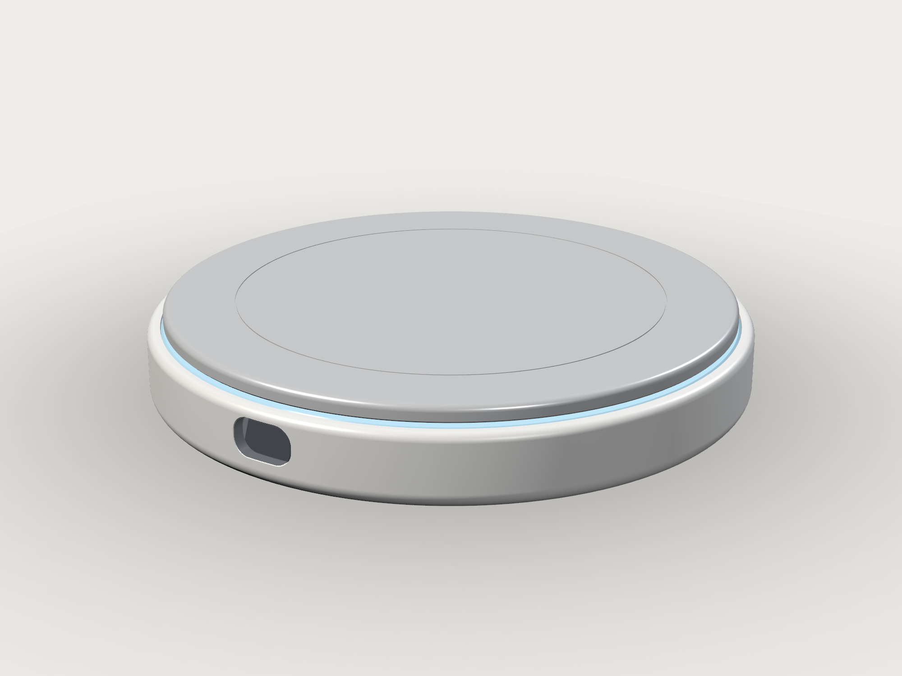

# 交付说明：两个独立版本 + 本机 CAD 工具链

> 日期：2026-11-03
> 工作区：`/data/Documents/projects/SmartCoaster`
> 结论：agentcad / build123d / FreeCAD 已安装并验证；方形 V1 与圆形 LUMEN **分成两个独立项目**，各自有模型、脚本、STEP/STL、渲染与自检，不共用几何文件、不混在一张图里。

---

## 1. 两个版本（互相独立）

| | **方形 V1** | **圆形 LUMEN** |
|---|---|---|
| 目录 | `mechanical/square_v1/` | `mechanical/lumen/` |
| 外形 | 100 × 100 × 18 mm，R8 | Ø110 × 17 mm |
| 前缘 | OLED 18×7 + Ø8.2 实体圆键 | 12×7 烟熏窗，无实体键（敲击唤醒） |
| 顶板 | 100×100×3 浮板 + 裙边 | Ø104×3 浮板 + C 形裙边 |
| 签名特征 | 方形，功能优先 | 360° 光晕 + 0.6 mm 浮动光缝 |
| 零件 / 实体 | 12 / 12 | 13 / 13 |
| 自检 | **18/18**，37 组干涉 0，0.5 mm 满行程无遮挡 | **21/21**，38 组干涉 0，0.6 mm 满行程无遮挡 |
| 体积 / 质量 | 78 086 mm³ / 154.8 g | 63 797 mm³ / 129.8 g |
| FreeCAD | 可打开 `build/assembly/assembly_v01.step` | 已用 FreeCAD 验证 13 solids / 110×110×17 |

### 方形 V1


### 圆形 LUMEN



> 每个版本自己的读者文档：
> `mechanical/square_v1/README.md`、`mechanical/lumen/README.md`、`mechanical/lumen/docs/design_brief.md`（含受力路径、BOM、饮水算法、DFM、待确认项）。

---

## 2. 工具链（本机，已全局可用）

| 工具 | 版本 | 入口 | 说明 |
|---|---|---|---|
| agentcad | 0.7.1 | `agentcad`（任意目录） | `~/.local/bin/agentcad` → `/data/Documents/tools/agentcad-venv/bin/agentcad` |
| build123d | **0.10.0** | 两个项目 `.venv` + 全局 venv | 锁定 0.10，0.11 API 不兼容 |
| OCP | 7.8.1.1 | 随 agentcad | 未装系统 OCC |
| FreeCAD | 1.0.2 (Rev 39319) | `freecad` / `freecadcmd` | `/data/Documents/tools/freecad`，AppImage 解压，免 sudo |
| VTK | 9.1 | 系统 `python3` | 仅用于 PBR 工作室渲染 |
| Xvfb | 21.1.4 | `mechanical/square_v1/.tools/xvfb/usr/bin/Xvfb` | 桌面 X 退出后的无头 GL 备用 |

- **所有目录可用**：`agentcad`、`freecad`、`freecadcmd` 都在 `~/.local/bin`（PATH 内）。
- **项目隔离**：`mechanical/square_v1/.venv`、`mechanical/lumen/.venv` 各自独立；均锁定 `agentcad[mcp]==0.7.1` + `build123d==0.10.0`。
- **未 clone 源码**：agentcad 用 pip 安装到 `/data/Documents/tools/agentcad-venv`；FreeCAD 用官方 AppImage 解压。两者都不需要源码编译。
- 安装细节/踩坑：`docs/环境安装记录-agentcad-freecad.md`。

---

## 3. 实验测试（全部在本机跑过）

| # | 测试 | 命令 | 结果 |
|---|---|---|---|
| 1 | 全局 agentcad | `cd /tmp && agentcad --help` | ✅ |
| 2 | 版本 | `agentcad-python -c "import build123d,OCP"` | 0.10.0 / 7.8.1.1 |
| 3 | 最小闭环 E4 | `agentcad run examples/minimal_plate.py --params T=6/10` | 100×100×6 / ×10，STEP+STL+GLB，valid |
| 4 | 圆形总装 | `mechanical/lumen/.venv/bin/python cad/export_v01.py` | 13 solids，110×110×17，valid |
| 5 | 圆形自检 | `mechanical/lumen/.venv/bin/python cad/verify_v01.py` | **21/21**，0 干涉，满行程无遮挡 |
| 6 | 圆形 agentcad | `agentcad run cad/lumen_assembly_v01.py` | assembly，13 命名零件，valid |
| 7 | 方形总装 | `mechanical/square_v1/.venv/bin/python cad/export_v01.py` | 12 solids，100×100×18，valid |
| 8 | 方形自检 | `mechanical/square_v1/.venv/bin/python cad/verify_v01.py` | **18/18**，0 干涉，满行程无遮挡 |
| 9 | 方形 agentcad | `DISPLAY=:99 agentcad run cad/square_assembly_v01.py` | assembly，12 命名零件，valid |
| 10 | FreeCAD 复核 | 圆形 13 solids / 109.99×110×17；方形 12 solids / 100×100×18 | 均 PASS |
| 11 | 旧版脚本 | `legacy/src/*.py`（去 NBSP 副本） | 4 个脚本全部复跑成功 |
| 12 | 渲染 | VTK PBR | 每版 6–7 张图 + LUMEN 半剖 |

> 关键坑：桌面 X 在会话后段退出，GLX 不可用；agentcad 的 preview 与 VTK 渲染都依赖 GL。
> 已在 `mechanical/square_v1/.tools/xvfb` 放解压版 Xvfb，`DISPLAY=:99` 下全部恢复。

---

## 4. 一键复现

```bash
# 圆形
cd /data/Documents/projects/SmartCoaster/lumen
.venv/bin/python cad/export_v01.py
.venv/bin/python cad/verify_v01.py
python3 tools/render_studio.py --shot all        # 需要 DISPLAY
agentcad run cad/lumen_assembly_v01.py --label lumen_final --no-daemon

# 方形
cd /data/Documents/projects/SmartCoaster/square_v1
.venv/bin/python cad/export_v01.py
.venv/bin/python cad/verify_v01.py
./.tools/xvfb/usr/bin/Xvfb :99 -screen 0 1600x1200x24 &
DISPLAY=:99 python3 tools/render_studio.py --shot all
DISPLAY=:99 agentcad run cad/square_assembly_v01.py --label square_v1 --no-daemon

# FreeCAD 查看
freecad lumen/build/assembly/assembly_v01.step
freecad square_v1/build/assembly/assembly_v01.step
```

---

## 5. 文件索引

| 用途 | 路径 |
|---|---|
| 圆形几何源 | `mechanical/lumen/cad/lumen_model.py` |
| 圆形总装 STEP | `mechanical/lumen/build/assembly/assembly_v01.step` |
| 圆形设计说明 | `mechanical/lumen/docs/design_brief.md` |
| 正方形几何源 | `mechanical/square_v1/cad/square_model.py` |
| 方形总装 STEP | `mechanical/square_v1/build/assembly/assembly_v01.step` |
| 方形说明 | `mechanical/square_v1/README.md` |
| 环境安装记录 | `docs/环境安装记录-agentcad-freecad.md` |
| 原始 V1 脚本（未改） | `cad/*.py` |
| V1 可运行副本（去 NBSP） | `legacy/src/*.py` |
| FreeCAD 安装/验证 | `/data/Documents/tools/freecad/INSTALL_NOTES.md` |

---

## 6. 仍未闭环 / 需要你确认

1. **HY928D 真实内部结构**：中心 Ø5 含义、U 形腔/梁宽、应变梁方向、全桥/半桥。两版都把它标为 PROVISIONAL，没有把猜测当结论。
2. **安全位移**：方形 0.5 mm / 圆形 0.6 mm 过载限位需要按实物形变复核。
3. **方形按键位置**：参数手册是“按键在左（x=5）、OLED 在右（x=27）”；V1 任务书 §2 图示把按键画在右。本版按手册，改一个参数即可切换。
4. **顶板防脱**：两版都可整片取下清洗；量产建议 bayonet 卡爪或径向磁铁。
5. **OLED 具体型号**：方形按 22×8 模组、圆形按 14.6×11.4 模组建模，打样前请按实际采购件核对。
