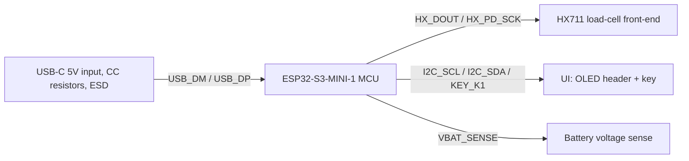
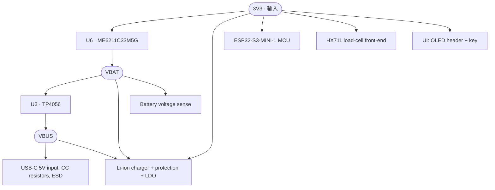

> **注（2026-11-05）**：本报告由 eprj3 skill 自动生成，其中“板框 3860×3680 mil（自动）”是生成时的临时自动尺寸；
> 构建后 `scripts/patch_board.py` 已把板框替换为机械 C 形（93.2×93.2 mm、R6、38×38 开口、80° 前 C 口、
> 4×M2 NPTH @(±40,±24) mm）。PCB 仍是 placement-only（无铜），DRC 100/100 只评价摆放。
> 机械与网表事实以 `inputs/canonical.json`、`reports/parity.log` 和 `REPORT.md` 为准。

# smartcoaster_easyeda 工程报告

> 由 `scripts/report.js` 从 design.json 与已构建工程自动生成；"建议"一节可人工补充。

## 工程概述

| 项 | 值 |
| --- | --- |
| 工程名 | smartcoaster_easyeda |
| 生成时间 | 2026-11-05T13:27:16.769Z |
| 源 | `design.json` |
| 板框 | 3860 × 3680 mil（自动：封装 bbox 面积 ×1.25） |
| PCB 布局 | skill 规划摆放 |
| 输入电源 | USB-C 5 V (VBUS) / LiPo 3.7 V (VBAT) |
| 电源轨 | 3V3 / VBUS / VBAT · 地 GND |
| 对外接口 | USB 2.0、I2C OLED、HX711 2-wire、UART/BOOT、BLE antenna |
| 原理图页 | 1 |
| 器件 / 网络 / 引脚 | 47 / 29 / 213 |

## 功能描述

**功能定位**：Smart coaster main board: USB-C charging, Li-ion protection, 3V3 rail, ESP32-S3 MCU, HX711 load-cell front-end, OLED header, key header, battery sense.。

**电源**：输入电源为 **USB-C 5 V (VBUS) / LiPo 3.7 V (VBAT)**；经 U6 · ME6211C33M5G 把 3V3 变为 VBAT、U3 · TP4056 把 VBAT 变为 VBUS；可用电源轨：3V3 / VBUS / VBAT；GND 为公共地。本 skill 只做布局，铜皮在客户端完成。

**功能模块**：

- **USB-C 5V input, CC resistors, ESD** — J1（HRO TYPE-C-31-M-12 USB_C_16P）、U7（USBLC6-2SC6 USBLC6-2SC6）、R9（5.1k 5.1k）、R10（5.1k 5.1k）、C1（10uF 10uF）
- **Li-ion charger + protection + LDO** — U3（TP4056 TP4056）、C3（10uF 10uF）、C2（1uF 1uF）、R8（2.4k 2.4k）、J2（JST B2B-PH-K-S BATT 3.7V）、U4（DW01A DW01A）、U5（FS8205A FS8205A）、R11（100 100）、C4（100nF 100nF）、R12（1k 1k）、U6（ME6211C33M5G ME6211C33M5）、C5（1uF 1uF）、C6（1uF 1uF）、C7（10uF 10uF）
- **ESP32-S3-MINI-1 MCU** — U1（ESP32-S3-MINI-1-N8R2 ESP32-S3-MINI-1）、R1（10k 10k）、C9（1uF 1uF）、SW2（Omron B3U-1000P RESET）、R2（10k 10k）、SW3（Omron B3U-1000P BOOT）、C10（100nF 100nF）
- **HX711 load-cell front-end** — U2（HX711 HX711）、R5（10k 10k）、C11（100nF 100nF）、C12（1uF 1uF）、C14（100nF 100nF）、C15（100nF 100nF）、C16（100nF 100nF）、R25（1k 1k）、R26（1k 1k）、J3（JST BM04B-SRSS-TB LOAD CELL）
- **UI: OLED header + key** — J4（PinHeader 1x04 2.54 OLED 0.91in）、J5（JST B2B-PH-K-S KEY K1）、R3（2.2k 2.2k）、R4（2.2k 2.2k）
- **Battery voltage sense** — R6（100k 100k）、R7（100k 100k）、C13（100nF 100nF）
- **Mechanical mounting holes** — H1（M2 M2）、H2（M2 M2）、H3（M2 M2）、H4（M2 M2）

**信号流**：USB-C 5V input, CC resistors, ESD → ESP32-S3-MINI-1 MCU（USB_DM/USB_DP）；ESP32-S3-MINI-1 MCU → HX711 load-cell front-end（HX_DOUT/HX_PD_SCK）；ESP32-S3-MINI-1 MCU → UI: OLED header + key（I2C_SCL/I2C_SDA/KEY_K1）；ESP32-S3-MINI-1 MCU → Battery voltage sense（VBAT_SENSE）。

## 功能特性

- **主要功能**：Smart coaster main board: USB-C charging, Li-ion protection, 3V3 rail, ESP32-S3 MCU, HX711 load-cell front-end, OLED header, key header, battery sense.
- **供电**：输入 USB-C 5 V (VBUS) / LiPo 3.7 V (VBAT)；内部电源轨 3V3 / VBUS / VBAT；地 GND。
- **对外接口**：USB 2.0、I2C OLED、HX711 2-wire、UART/BOOT、BLE antenna
- **主控**：ESP32-S3-MINI-1 (N8R2)
- **板级**：2 层；封装 按器件库；板框 3860 × 3680 mil（自动：封装 bbox 面积 ×1.25）；47 个器件 / 29 个网络。
- **验证**：五道门禁全部通过。

## 物料清单（BOM）

| # | 位号 | 器件 / 型号 | 值 | 封装 | 数量 | 立创编号 |
| --- | --- | --- | --- | --- | --- | --- |
| 1 | C1, C3, C7 | 10uF | 10uF | FP_C_0805_2012Metric | 3 | — |
| 2 | C2, C5, C6, C9, C12 | 1uF | 1uF | FP_C_0603_1608Metric | 5 | — |
| 3 | C4, C10, C11, C13, C14, C15, C16 | 100nF | 100nF | FP_C_0603_1608Metric | 7 | — |
| 4 | H1, H2, H3, H4 | M2 | M2 | FP_MountingHole_2.2mm_M2 | 4 | — |
| 5 | J1 | HRO TYPE-C-31-M-12 | USB_C_16P | FP_USB_C_Receptacle_HRO_TYPE-C-31-M-12 | 1 | — |
| 6 | J2 | JST B2B-PH-K-S | BATT 3.7V | FP_JST_PH_B2B-PH-K_1x02_P2.00mm_Vertical | 1 | — |
| 7 | J3 | JST BM04B-SRSS-TB | LOAD CELL | FP_JST_SH_BM04B-SRSS-TB_1x04-1MP_P1.00mm_Ve | 1 | — |
| 8 | J4 | PinHeader 1x04 2.54 | OLED 0.91in | FP_PinHeader_1x04_P2.54mm_Vertical | 1 | — |
| 9 | J5 | JST B2B-PH-K-S | KEY K1 | FP_JST_PH_B2B-PH-K_1x02_P2.00mm_Vertical | 1 | — |
| 10 | R1, R2, R5 | 10k | 10k | FP_R_0603_1608Metric | 3 | — |
| 11 | R3, R4 | 2.2k | 2.2k | FP_R_0603_1608Metric | 2 | — |
| 12 | R6, R7 | 100k | 100k | FP_R_0603_1608Metric | 2 | — |
| 13 | R8 | 2.4k | 2.4k | FP_R_0603_1608Metric | 1 | — |
| 14 | R9, R10 | 5.1k | 5.1k | FP_R_0603_1608Metric | 2 | — |
| 15 | R11 | 100 | 100 | FP_R_0603_1608Metric | 1 | — |
| 16 | R12, R25, R26 | 1k | 1k | FP_R_0603_1608Metric | 3 | — |
| 17 | SW2 | Omron B3U-1000P | RESET | FP_SW_SPST_B3U-1000P | 1 | — |
| 18 | SW3 | Omron B3U-1000P | BOOT | FP_SW_SPST_B3U-1000P | 1 | — |
| 19 | U1 | ESP32-S3-MINI-1-N8R2 | ESP32-S3-MINI-1 | FP_ESP32-S3-MINI-1 | 1 | — |
| 20 | U2 | HX711 | HX711 | FP_SOIC-16_3.9x9.9mm_P1.27mm | 1 | — |
| 21 | U3 | TP4056 | TP4056 | FP_SOIC-8-1EP_3.9x4.9mm_P1.27mm_EP2.41x3.81 | 1 | — |
| 22 | U4 | DW01A | DW01A | FP_SOT-23-6 | 1 | — |
| 23 | U5 | FS8205A | FS8205A | FP_SOIC-8_3.9x4.9mm_P1.27mm | 1 | — |
| 24 | U6 | ME6211C33M5G | ME6211C33M5 | FP_SOT-23-5 | 1 | — |
| 25 | U7 | USBLC6-2SC6 | USBLC6-2SC6 | FP_SOT-23-6 | 1 | — |

共 25 类、47 个器件。

## 信号框架图

（方框 = 功能模块；箭头 = 跨模块信号，超过 3 个网络时只标注前 3 个与总数）

## 电路框架图（电源）

（圆角 = 电源轨，方框 = 变换器件，向下箭头 = 该轨供电的模块；GND 为公共地，不逐块连线）

## 网络概览

| 网络 | 类型 | 引脚数 | 电源旗标 | 页 |
| --- | --- | --- | --- | --- |
| `3V3` | 供电 | 17 | 11 | SmartCoaster/SmartCoaster V1 schematic (EasyEDA re-im |
| `BAT_MID` | 信号 | 4 | 0 | SmartCoaster/SmartCoaster V1 schematic (EasyEDA re-im |
| `CELL_N` | 信号 | 4 | 0 | SmartCoaster/SmartCoaster V1 schematic (EasyEDA re-im |
| `ESP_BOOT` | 信号 | 3 | 0 | SmartCoaster/SmartCoaster V1 schematic (EasyEDA re-im |
| `ESP_EN` | 信号 | 4 | 0 | SmartCoaster/SmartCoaster V1 schematic (EasyEDA re-im |
| `GND` | 地 | 65 | 14 | SmartCoaster/SmartCoaster V1 schematic (EasyEDA re-im |
| `HX_A_N` | 信号 | 3 | 0 | SmartCoaster/SmartCoaster V1 schematic (EasyEDA re-im |
| `HX_A_P` | 信号 | 3 | 0 | SmartCoaster/SmartCoaster V1 schematic (EasyEDA re-im |
| `HX_DOUT` | 信号 | 3 | 1 | SmartCoaster/SmartCoaster V1 schematic (EasyEDA re-im |
| `HX_PD_SCK` | 信号 | 2 | 0 | SmartCoaster/SmartCoaster V1 schematic (EasyEDA re-im |
| `HX_S_N` | 信号 | 2 | 0 | SmartCoaster/SmartCoaster V1 schematic (EasyEDA re-im |
| `HX_S_P` | 信号 | 2 | 0 | SmartCoaster/SmartCoaster V1 schematic (EasyEDA re-im |
| `HX_VBG` | 信号 | 2 | 0 | SmartCoaster/SmartCoaster V1 schematic (EasyEDA re-im |
| `I2C_SCL` | 信号 | 3 | 1 | SmartCoaster/SmartCoaster V1 schematic (EasyEDA re-im |
| `I2C_SDA` | 信号 | 3 | 1 | SmartCoaster/SmartCoaster V1 schematic (EasyEDA re-im |
| `KEY_K1` | 信号 | 2 | 1 | SmartCoaster/SmartCoaster V1 schematic (EasyEDA re-im |
| `NC` | NC | 45 | 0 | SmartCoaster/SmartCoaster V1 schematic (EasyEDA re-im |
| `PROG` | 信号 | 2 | 0 | SmartCoaster/SmartCoaster V1 schematic (EasyEDA re-im |
| `PROT_CS` | 信号 | 2 | 0 | SmartCoaster/SmartCoaster V1 schematic (EasyEDA re-im |
| `PROT_OC` | 信号 | 2 | 0 | SmartCoaster/SmartCoaster V1 schematic (EasyEDA re-im |
| `PROT_OD` | 信号 | 2 | 0 | SmartCoaster/SmartCoaster V1 schematic (EasyEDA re-im |
| `PROT_VDD` | 信号 | 3 | 0 | SmartCoaster/SmartCoaster V1 schematic (EasyEDA re-im |
| `USB_CC1` | 信号 | 2 | 0 | SmartCoaster/SmartCoaster V1 schematic (EasyEDA re-im |
| `USB_CC2` | 信号 | 2 | 0 | SmartCoaster/SmartCoaster V1 schematic (EasyEDA re-im |
| `USB_DM` | 信号 | 5 | 1 | SmartCoaster/SmartCoaster V1 schematic (EasyEDA re-im |
| `USB_DP` | 信号 | 5 | 1 | SmartCoaster/SmartCoaster V1 schematic (EasyEDA re-im |
| `VBAT` | 供电 | 8 | 5 | SmartCoaster/SmartCoaster V1 schematic (EasyEDA re-im |
| `VBAT_SENSE` | 信号 | 4 | 1 | SmartCoaster/SmartCoaster V1 schematic (EasyEDA re-im |
| `VBUS` | 供电 | 9 | 2 | SmartCoaster/SmartCoaster V1 schematic (EasyEDA re-im |

## 验证结果

| 门禁 | 结果 |
| --- | --- |
| format | 通过 |
| ERC | 通过（0 警告） |
| intent | 通过 |
| lint | 100/100 |
| DRC | 100/100（仅布局） |
| netcheck | 通过 |

## 遗留问题

- 交付物只含原理图 + 布局好的 PCB；自动布线、铺铜、制造文件导出（坐标 / Gerber / 客户端 BOM 格式）都不归本 skill 管，在 EasyEDA Pro 客户端完成（本报告的 BOM 一节是设计侧清单，可直接核对）。
- 跨模块/跨页信号用网络端口（按名全局合并）而非长导线；短距离同模块网络才画可见导线。
- PCB 是 placement-only（`rats:` 交接清单列出还需手工连的网络）；铜皮由人在客户端完成。

## 建议

- （无自动建议；可结合具体应用场景在此补充，例如器件选型、防护、接口电平等。）

