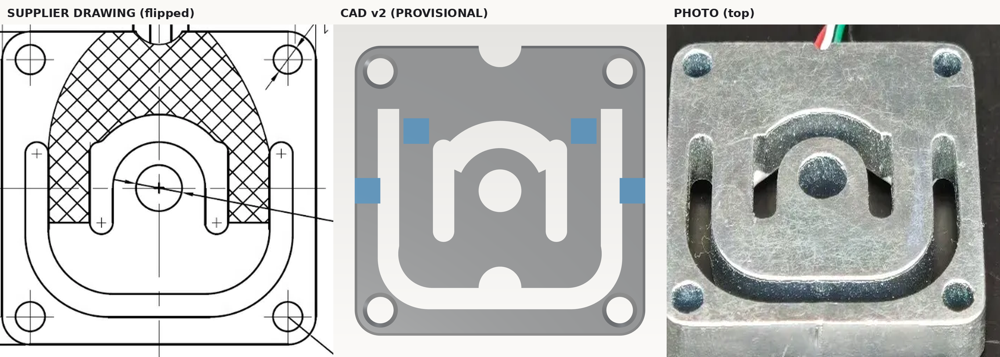

# HY928D v2 — 重建说明与检视清单

> 目的：把 M1.2 里"SlotOverall 近似"的传感器，替换成按**新图纸 + 实物照片**重建的版本。
> 状态（2026-11-04 更新）：**仍待供应商/实物确认**（8 问未答），但已在 `simulation/mechanical/hy928d/` 完成通槽方案的 S1 线弹性趋势 FEA；U 槽/拱/竖槽曲线参数保持 `PROVISIONAL`，不作为定型依据。
> 源：`ref/hy928d/hy928d_size.webp`、`hy928d_param.webp`、`hy928d_photo.webp`、`hy928d_photo1.webp`

## 1. 硬尺寸（图纸明确）

| 项 | 值 |
|---|---|
| 外形 | 34 × 34 mm |
| 厚度 H（5 kg） | 1.0 mm |
| 安装孔 | 4 × Ø3.1 @ 28 × 28 |
| 中心孔 | Ø5 |
| 材料 | 65Mn |
| 全桥/半桥 | 1.2 / 0.6 mV/V |

## 2. 推断尺寸（图纸未标，按图像比例 + 照片）

| 参数 | 值 | 依据 |
|---|---|---|
| U 槽形式 | **通槽** | 照片可见背景透过 |
| 槽宽 | 2.5 mm | 图纸 2.5/2.5/10 链条 + 照片比例 |
| 外边界 | 半宽 14.3；顶 9.6；底 −14.0；底角 R6 | 像素比例 |
| 内边界 | 半宽 11.8；底 −11.5；底角 R4 | 像素比例 |
| 拱形槽 | 环扇形 r 5.0–8.2，25°–155° | 照片/图纸轮廓 |
| 内侧竖槽 ×2 | x=±6.6，长 12，宽 2.5，与拱形连通 | 图纸/照片的中央舌片两侧 |
| 线缆出口 | **顶边中心 R2.5 半圆**（照片） | 照片 |
| U 底边小缺口 | 舌片底边中心 R2.5 | 图纸/照片的波浪底 |
| 边倒角 | 0.3 × 45° | 照片边缘 |
| 孔口倒角 | 0.5（沉孔） | 照片孔口 |

参数在 `src/hy928d_v2.py` 顶部集中；`build/params.json` 有快照。

## 3. 与 M1.2 旧模型的差异

| | M1.2 旧 | v2 |
|---|---|---|
| U 槽 | `SlotOverall(29,10)` 浅槽 0.7 深 | 马蹄形**通槽** 2.5 宽 |
| 中央 | 无拱形 | 拱形槽 + 两个舌片/梁 |
| 孔口 | 平孔 | 0.5 沉孔 |
| 边缘 | 无倒角 | 0.3 倒角 |
| 线缆 | 无 | 底边缺口 |

> 旧模型把传感器当成"中央槽 + 0.3 mm 腹板"的膜片；照片显示是**通槽 + 顶部舌片**的平行梁结构。受力/刚度会差一个量级，必须替换。

## 4. 检视清单（请逐项确认）

1. U 槽**外边界**：半宽 14.3、顶 9.6、底 −14.0、底角 R6 —— 是否与实物一致？
2. U 槽**宽度**：2.5 mm —— 还是 2.0 / 3.0？
3. **内边界/舌片**：半宽 11.8、底 −11.5、底角 R4 —— 舌片底部是不是更宽/更窄？
4. **拱形槽**：r 5.0–8.2、25°–155° —— 实际是不是更薄（2.5）或更靠近 Ø5？
5. **内侧竖槽**：x=±6.6、长 12（y ±6）、宽 2.5，顶部与拱形连通，底部圆头封闭 —— 长度/位置是否对？
6. **舌片顶部/两个梁**：拱形上方留了 1.4 mm 连接桥；是否应开到与 U 槽连通、只留两侧梁？
6. **线缆出口**：已按照片改到**顶边**；U 底边另有一个 R2.5 小缺口。位置/大小是否对？
7. **孔口**：Ø3.1 的 0.5 沉孔是否正确？还是通孔 + 平垫？
8. **边倒角**：0.3 是否合适？

## 5. 文件

- 模型：`src/hy928d_v2.py`（参数化，build123d 0.10）
- STEP/STL：`build/hy928d_v2.step` / `.stl`；应变片标记 `hy928d_v2_gauges.stl`
- 参数快照：`build/params.json`
- 渲染：`renders/top.png`、`iso.png`、`compare.png`
- 复跑：`/data/Documents/tools/agentcad-venv/bin/python src/hy928d_v2.py`
- 渲染：`DISPLAY=:99 python3 src/render_hy928d.py`（Xvfb 见根目录 `.tools/xvfb`）

## S1 FEA 结果（2026-11-04，通槽，C3D10 h=0.28）

| 指标 | 5 kg | 1 kg |
|---|---:|---:|
| 中心 \|Uz\| | **0.3435 mm**（k≈142.8 N/mm） | 0.0687 mm |
| max von Mises | 588 MPa @ U 槽端 90° 尖角（**奇异**） | 118 MPa |
| 非奇异热点 | **468 MPa** @ 竖槽端 R1.25 (±6.1, −5.9) | 95.7 MPa |
| 舌片根部名义 | 229 MPa | 45.7 MPa |
| 四角支反力 | 49.05 N（100%）；+y 两颗 99.4% | 9.81 N（100%） |

- 网格收敛：0.35/0.30/0.28 位移差 0.072%/0.036%；C3D10 更细网格（0.25/0.20）在本机 SPOOLES 分解时 SIGSEGV，0.28 已收敛。
- 通槽 vs 0.7 mm 浅腔：浅腔 1.72× 更刚、根部 −72%，但竖槽端热点只降 6.5%，灵敏度 −42% → **不做浅腔**。
- **传感器是外购件**，不自己制造；绝对应力（尤其 588 MPa 尖角）只作“实物必须倒圆”的信号，不作设计许用值。65Mn 的屈服/热处理需供应商确认。
- 装配含义：+y（线缆侧）两颗螺钉承担几乎全部载荷，四角凸台必须共面、+y 预紧一致；−y 两颗主要定位。
- 浮动间隙：0.5 mm（方形）→ 5 kg 剩 **0.156 mm**，约 **7.3 kg** 接触（≈150% 过载保护）；LUMEN 0.6 mm → 约 8.6 kg 接触，略晚于 150%，若要严格保护可考虑 0.55。

产物：`simulation/mechanical/hy928d/`（README、results.json、inp/msh/frd、figs）。
