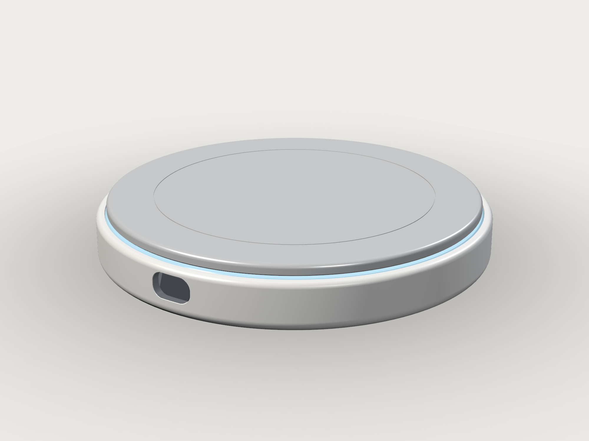

# LUMEN — Smart Hydration Coaster

Ø110 × 17 mm 圆形智能杯垫。浮板称重 + 360° 光晕 + 0.49" 隐藏 OLED，用代码（build123d 0.10 / agentcad 0.7）完整建模。



## 快速开始

```bash
cd /data/Documents/projects/SmartCoaster/lumen

# 生成 13 个零件的 STEP/STL + 总装
.venv/bin/python cad/export_v01.py

# 21 项自检：实体数 / 包围盒 / 间隙 / 下压行程 / 38 组干涉 / STEP 回读
.venv/bin/python cad/verify_v01.py

# agentcad 版本化构建（写 STEP + preview + viewer）
agentcad run cad/lumen_assembly_v01.py --label lumen_v3 --no-daemon

# 渲染
python3 tools/render_studio.py --shot all     # hero / front / top / detail / back / exploded

# 查看
freecad build/assembly/assembly_v01.step
```

## 目录

```
lumen/
├── .venv/                     Python 3.10 项目环境（agentcad 0.7.1 + build123d 0.10.0）
├── agentcad.json              agentcad 项目（init 生成）
├── AGENTS.md                  agentcad init 写入的 agent 指南（此前无同名文件）
├── cad/
│   ├── lumen_model.py         ★ 唯一几何源：参数表 + 13 个零件 + 装配
│   ├── lumen_assembly_v01.py  agentcad 入口（逐件 show_object，13 个命名零件）
│   ├── export_v01.py          STEP/STL 导出 + meta.json
│   └── verify_v01.py          几何/干涉/STEP 回读自检
├── tools/
│   ├── render_studio.py       VTK PBR 工作室渲染（hero/front/top/detail/back/exploded）
├── build/
│   ├── parts/                 13 × STEP + STL
│   ├── assembly/              assembly_v01.step / .stl + meta.json
│   ├── render/                hero.png / front.png / top.png / detail.png / back.png
│   │                          exploded.png / section.png
│   └── verify_report.json     18 项自检结果
├── v8_lumen_final/            agentcad 版本快照（STEP / preview / viewer / parts）
└── docs/
    └── design_brief.md        ★ 设计说明（概念、尺寸、受力、BOM、算法、验证、待确认）
```

## 关键数字

| | |
|---|---|
| 外形 | Ø110 × 17.0 mm |
| 零件 / 实体 | 13 / 13（全部 valid，单实体） |
| 包围盒 | 110 × 110 × 17 mm |
| 体积 / 估算质量 | 63 797 mm³ / 129.8 g |
| 浮动间隙 | 0.6 mm（过载限位 + 出光缝） |
| 干涉 | 38 组必须分离对，0 mm³；0.6 mm 满行程无遮挡 |
| 传感器 | HY928D 5 kg，34×34×1.0，中央受力、四角固定 |
| 主控 | ESP32-S3 + HX711 + USB-C + 500 mAh LiPo |
| 显示 | 0.49" 64×32 OLED，烟熏随形透镜 |
| 光 | 12× RGBW → PMMA 光导 → 0.6 mm 光缝 |

## 工具链

| 工具 | 版本 | 位置 |
|---|---|---|
| agentcad | 0.7.1 | `/data/Documents/tools/agentcad-venv/bin/agentcad`（`~/.local/bin/agentcad` 全局软链） |
| build123d | 0.10.0 | 全局 venv + 本项目 `.venv` |
| Python | 3.10.12 | 系统 |
| FreeCAD | 1.0.2 | `/data/Documents/tools/freecad`（见 `docs/` 安装记录） |
| VTK | 9.1 | 系统 python3（仅渲染） |

> build123d 必须锁 0.10.x；0.11 API 不兼容。agentcad 自带 cadquery-ocp 7.8，不要另装系统 OCC。
