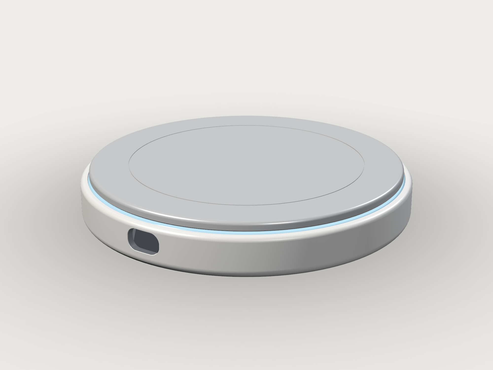
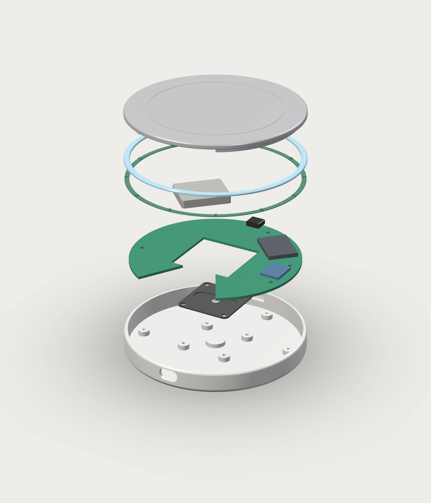
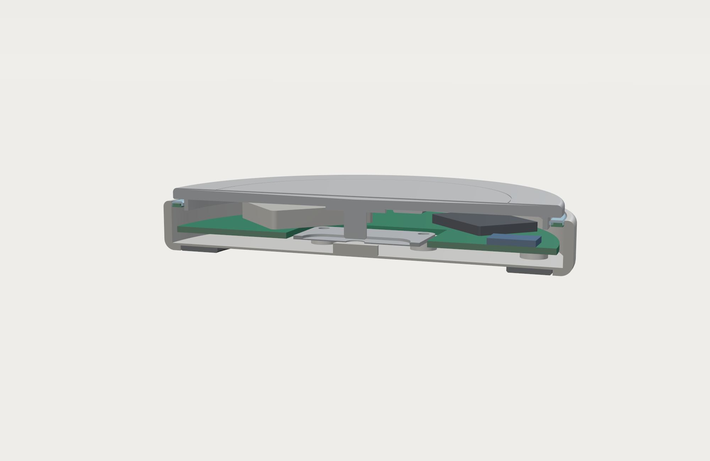
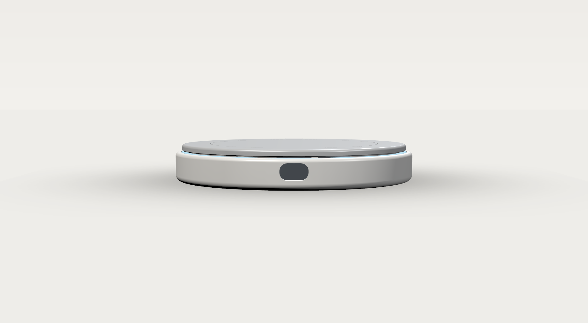
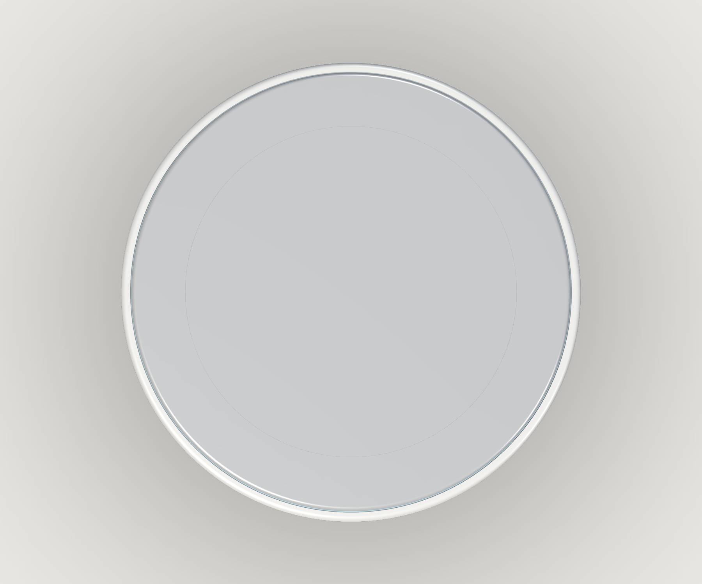
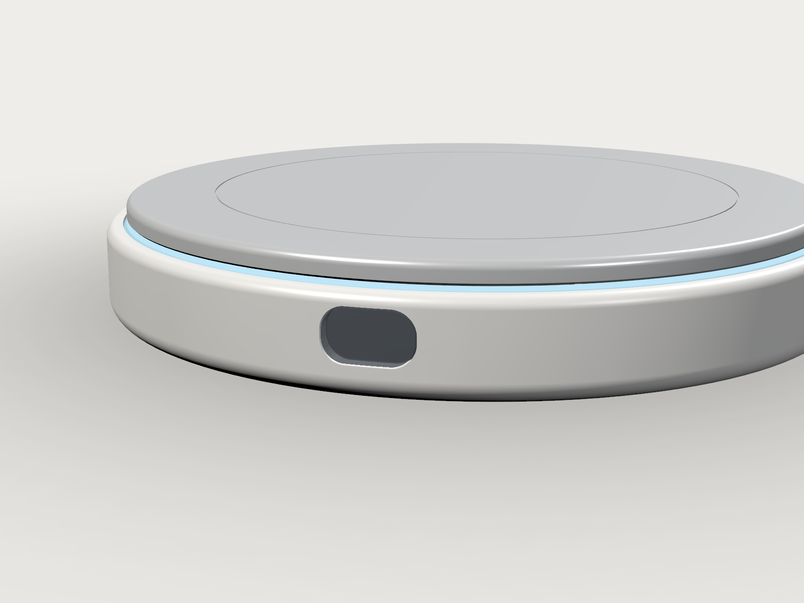

# LUMEN · 智能饮水杯垫 — 设计说明 v1.0

> 项目：SmartCoaster / LUMEN
> 日期：2026-11-03
> 状态：概念级完整装配（M2 结构 + M3 干涉/间隙自检已通过），可直接进入打样评审
> 源文件：`cad/lumen_model.py`（唯一几何源）、`cad/export_v01.py`、`cad/verify_v01.py`
> 输出：`build/assembly/assembly_v01.step`、`build/parts/*.step|stl`、`build/render/*.png`



---

## 0. 一句话

**Ø110 × 17 mm 的圆形智能杯垫：一块阳极氧化铝浮板停在 0.6 mm 的光缝上，360° 光晕显示今天的饮水进度；放下杯子即称重，敲一下杯垫就亮起一个 0.49" 的数字窗口。**

它把“称重”藏进了一个看起来不该有电子件的日用品里：没有按键、没有屏幕边框、没有可见螺钉。唯一的界面是一圈光，和一条 12 × 7 mm 的烟熏窗口。

---

## 1. 设计概念（红点奖叙事）

红点的评审语言通常看四件事：**概念是否成立、形式是否诚实、功能是否被形式增强、是否可制造/可持续**。LUMEN 的答案：

| 维度 | 设计回应 |
|---|---|
| 概念 | 饮水是一个“每天重复、但没人愿意记录”的动作。杯垫是杯子每天必然接触的平面——把秤藏进杯垫，记录就变成零操作。 |
| 形式 | 圆形、无方向、无按键。顶板“悬浮”在光缝上，产品的分模线被光缝吞掉；从任何角度看都是同一个安静的圆。 |
| 功能被形式增强 | 光晕本身就是进度条：越接近目标越亮、越满；完成时呼吸一次。数字屏只在被敲击时出现，平时是一条深色玻璃缝。 |
| 可制造 | 13 个零件，无外露螺钉，单一主分模方向；顶板整片可取下清洗；USB-C 通用充电；电池可更换。 |
| 可持续 | 铝顶板可 100% 回收；外壳单一 PC/ABS 材料；无胶粘接的顶板/光导（压配 + 硅胶垫）；待机 2–3 周。 |

**与 V1 方形版的关系**：V1（100×100×18，方形 R8，前右 OLED + 实体圆键）是“功能优先、先验证传感器与受力路径”的工程基线；LUMEN 是“形式优先、把同一套受力架构收进一个圆形日用品”的设计版本。两版并存，但各自独立成项目：`lumen/`（圆形）与 `square_v1/`（方形），互不混在一个模型/渲染里。

---

## 2. 外观与 CMF

| 项 | 规格 |
|---|---|
| 外形 | Ø110 × 17.0 mm，正面投影正圆 |
| 主体 | 暖白 PC/ABS + 软触感涂层（细磨砂，指纹弱） |
| 顶板 | 6063-T5 铝，喷砂 + 阳极氧化银灰；顶面 0.6 mm 浅碟，Ø78 处 0.25 mm 激光蚀刻细环 |
| 光缝 | 顶板底 14.0 / 壳口 13.4，**0.6 mm 全周**；径向 0.6 mm（顶板 Ø104 / 壳内 Ø105.2） |
| 光晕 | 12 颗 RGBW LED → PMMA 光导环 → 0.6 × 0.6 mm 缝隙；默认青色，随进度变亮 |
| 显示 | 0.49" 64×32 OLED（14.6 × 11.4 × 1.2），后倾 20°，烟熏 PMMA 曲面透镜（R55 随形） |
| 接口 | USB-C 后缘，9.4 × 3.6 mm 圆角开口，连接器内凹 2.5 mm |
| 底部 | 硅胶 50A 环形脚垫 Ø100 / Ø78 × 1.4 mm，同色深灰 |
| 触摸 | 无实体键：敲击顶板（重量尖峰）唤醒显示 6 s |

> 视觉记忆点：**一条会呼吸的光缝**。它同时是过载限位、分模线、导光出口和“悬浮”错觉的来源——一个几何特征承担四个功能。

---

## 3. 关键尺寸总表（mm）

坐标：Z 向上，原点 = 底壳底面中心，前缘 = −Y。

### 3.1 外壳 / 顶板

| 参数 | 值 | 说明 |
|---|---|---|
| `D_OUT / R_OUT` | 110 / 55 | 外径 |
| `SHELL_H` | 13.4 | 壳口高度 |
| `WALL` | 2.4 | 侧壁 |
| `FLOOR` | 2.0 | 底板 |
| `R_IN` | 52.6 | 内腔半径 |
| `R_PLATE / PLATE_T` | 52.0 / 3.0 | 顶板 Ø104 × 3 |
| `FLOAT_GAP` | **0.6** | 顶板底 14.0 − 壳口 13.4（过载限位 + 出光缝） |
| `PLATE_TOP` | 17.0 | 总高 |
| 顶板裙边 | Ø97.4 / 1.2 壁厚 / 高 3.0 | 活塞式侧向导向，与光导内孔 Ø98.0 单边 0.3 |
| 裙边缺口 | 前缘 ±30° | 让位 OLED（不承重） |
| 中心力柱 | Ø6 × 8.0 | z 6.0 → 14.0，底端 0.4×45° 倒角 |
| 中心加强台 | Ø16 × 1.0 | 顶板背面 |
| 顶板碟面 | 0.6 深 / Ø96 | 杯底自动居中，不积水 |

### 3.2 传感器与支撑

| 参数 | 值 | 状态 |
|---|---|---|
| HY928D | 34 × 34 × 1.0 | 图纸 |
| 安装孔 | 4 × Ø3.1 @ 28×28 | 图纸 |
| 中央孔 | Ø5 | ⚠ 含义待确认 |
| U 形腔 | L29 × 槽宽 10 × 深 0.7，梁宽 2.5 | ⚠ 推算（PROVISIONAL） |
| 四角 boss | Ø7 × 3.0，顶面 z=5.0，M2.5 底孔 Ø2.1 | 设计 |
| 中央过载垫 | Ø12，z 2.0→4.6，距传感器底 0.4 | 设计 |
| 传力柱落点 | 传感器顶面 z=6.0，平面接触 | 设计 |

### 3.3 光学 / 显示

| 参数 | 值 |
|---|---|
| 光导环 | Ø105.0 / Ø98.0 × 1.2，z 12.2→13.4，顶部内外 0.4 倒角 |
| LED flex | Ø104.6 / Ø99.0 × 0.4，z 11.8→12.2，12 颗 LED 2.0×1.6×0.6 嵌入光导底部 12 个 2.8×2.8×0.6 袋 |
| OLED | 14.6 × 11.4 × 1.2，中心 (0, −48.6, 8.0)，绕 X 后倾 20° |
| 窗口 | 12.0 × 7.2，R3.2，中心 z=8.0 |
| 透镜 | 11.6 × 6.8 × 2.3，R55 随形，烟熏 PMMA，单边 0.2 胶缝 |

### 3.4 电控

| 参数 | 值 |
|---|---|
| 主 PCB | Ø102 × 1.6，中央方孔 38×38，前缘 60° C 口；z 5.0→6.6 |
| 安装柱 | 4 × Ø7，r=45，角度 15/75/195/345°；M2 底孔 Ø1.8 |
| ESP32-S3 | 18 × 25 × 2.5，r=38 @45°，z 6.6 |
| HX711 | 12 × 15 × 1.6，r=40 @0°，z 6.6 |
| USB-C | 8.94 × 7.5 × 3.26，后缘，z 6.6 |
| 电池 | 25 × 30 × 5（≈500 mAh），r=32 @135°，z 6.6→11.6 |
| 硅胶垫 | Ø100 / Ø78 × 1.4，底部 0.4 倒角 |

---

## 4. 装配结构（13 件）



```
顶板 plate            Ø104×3 铝，含 Ø6 力柱 + C 形裙边 + Ø16 台     1
光导 guide            Ø105/98×1.2 PMMA，12 个 LED 袋                1
LED flex ledflex      Ø104.6/99×0.4 + 12 颗 LED                      1
电池 battery          25×30×5 LiPo                                   1
主 PCB pcb            Ø102×1.6，C 形，中央 38×38 方孔                1
  ├ ESP32-S3         18×25×2.5                                       1
  ├ HX711            12×15×1.6                                       1
  └ USB-C            8.94×7.5×3.26                                   1
传感器 sensor         HY928D 34×34×1.0                                1
底壳 shell            Ø110×13.4，含 4 传感器 boss / 4 PCB 柱 / 端口   1
OLED oled             14.6×11.4×1.2，后倾 20°                        1
透镜 glass            11.6×6.8×2.3 烟熏                              1
脚垫 pad              Ø100/78×1.4 硅胶                                1
```

**装配顺序**：底壳 → 传感器（4×M2.5 自攻）→ PCB（4×M2 自攻）→ USB-C/电池/OLED/透镜 → LED flex（背胶）→ 光导（压配 + 点胶）→ 顶板（自由落位）→ 脚垫。

---

## 5. 受力路径（唯一路径）

```
杯子 + 水
   │
   ▼
顶板 plate（Ø104 铝，3 mm）
   │  Ø6 力柱，平面接触
   ▼
HY928D 中央区（z=6.0）
   │  应变梁
   ▼
4 个 Ø7 角柱 boss（z=5.0）
   │
   ▼
底壳 shell → 桌面
```

### 5.1 旁路排查（逐项）

| 可能旁路 | 设计对策 | 验证 |
|---|---|---|
| 顶板边缘碰壳口 | 全周 0.6 mm 间隙，满行程才接触 | 下压 0.6 mm 无遮挡 ✅ |
| 顶板裙边碰光导 | 单边 0.3 mm，仅导向不承重 | `plate skirt vs light guide bore` ✅ |
| 螺钉穿透浮动面 | 传感器/Pcb 螺钉全部从底壳向上，不跨光缝 | 结构定义 ✅ |
| 排线/电源线支撑顶板 | OLED FPC 走前缘 C 口；LED flex 固定在光导下方 | 结构定义 ✅ |
| 透镜/装饰件承重 | 透镜只与壳壁粘接，与顶板无接触 | 0 干涉 ✅ |
| 电池/元件顶到顶板 | 电池顶 11.6，顶板底 14.0 | `battery top clears plate` ✅ |
| OLED 顶到光导/顶板 | 后倾 20°，顶部半径 47.78 < 49.0；顶 13.56 < 14.0 | ✅ |



*半剖（y=0，去掉前半）：可见 3 mm 铝板、Ø6 力柱、HY928D、C 形 PCB、ESP32/HX711、电池、光导与 2.4 mm 壳壁的完整堆叠。*

### 5.2 过载保护

- **主限位**：顶板底 14.0 → 壳口 13.4，行程 0.6 mm。超过 0.6 mm 后顶板落在壳口全周环面上，力不再经过传感器。
- **二级保护**：传感器中央下方 Ø12 垫块，顶面 4.6，距传感器底 0.4 mm；传感器中央下挠 0.4 mm 后触底，避免应变梁过弯。
- 0.6 / 0.4 均为**待实物形变确认**的参数（见 §10）。

### 5.3 侧向与拆装

- 顶板 C 形裙边（Ø97.4）在光导内孔（Ø98.0）中滑动，单边 0.3 mm，限制横移与倾斜；前缘 ±30° 缺口让位 OLED。
- 顶板无卡扣，可整片取下清洗。**量产建议**：加 3 个 bayonet 卡爪或 3 颗径向磁铁做防脱（径向磁力不引入垂直预载，避免称重零点漂移）。当前版本按“可拆洗”定义，搬运时托底。

---


### 5.4 功能验证：它首先是一台秤

“能装配”不等于“能称重”。本版把**下压行程**当成一条硬约束，写进 `verify_v01.py`：

| 检查 | 方法 | 结果 |
|---|---|---|
| 满行程无遮挡 | 顶板整体下移 0.598 mm，与除传感器外的全部零件求交 | 0 mm³（无阻挡） |
| 静止时无隐形支撑 | 顶板下移 0.05 mm 求交 | 0 mm³（只有力柱压传感器） |
| 过载限位确实存在 | 顶板下移 0.65 mm，与光导求交 | 37.3 mm³（全周接触，限位成立） |
| 中央垫块不抢前置限位 | 垫块顶 4.2 / 传感器底 5.0 | 0.8 mm，晚于 0.6 mm 边限位 |

评审中真实查出的两个“会毁掉秤”的问题（已修）：

1. **LUMEN：OLED 模组顶到顶板**。原 11.4 mm 高、20° 后倾的模组顶部在 13.56 mm，顶板下压 0.44 mm 就碰到它——实际可用行程只有 0.44 mm，且过载时压的是屏幕。改为 11.0 mm 高、中心 7.9 mm 后，顶部 13.27 mm，满行程仍有 0.13 mm 余量。
2. **方形：按键凸缘在满行程顶住裙边**。Ø9.6 凸缘顶部 12.0 mm，顶板下移 0.5 mm 后裙边到 11.9 mm，差 0.1 mm；改为 Ø9.0（顶 11.7），满行程余量 0.2 mm。

仍未闭环（打样必须测）：

- **传感器实际形变**：0.6 mm 边隙必须 ≥ 5 kg 满量程形变 + 安全余量；若形变更大，顶板会先落在光导上限位，量程被截断。参数在 `FLOAT_GAP`，改一处即可。
- **偏载倾斜/旁路**：单点支撑的顶板在偏载时会微倾；0.6 mm 边隙在 r=52 处对应约 0.66° 倾角就开始接触。打样时测传感器转角刚度，必要时把边隙加到 0.8–1.0 mm（光缝会更明显），或把限位内移到 r≈35（用壳内台阶，不碰光导）。
- **光导的过载支撑**：顶板限位落在光导顶面，光导靠 0.05 mm 压配 + 结构胶固定在壳口；量产建议在光导下方加 3 个壳体内台阶（约 0.2 mm 高）把过载力直接传到壳体，而不是只靠胶层剪切。

## 6. 电子架构与 BOM

```
USB-C ── 充电 IC ── 500 mAh LiPo ── 3.3 V LDO
                                 │
                            ESP32-S3 ── BLE ── 手机 App
                                 │
              ┌──────────────────┼─────────────────┐
           HX711             12× LED            0.49" OLED
              │                  │                  │
        HY928D 5 kg         光导环            烟熏透镜
```

| # | 件 | 规格 | 估价（RMB） |
|---|---|---|---|
| 1 | 底壳 | PC/ABS 注塑 + 软触 | 7 |
| 2 | 顶板 | 6063 阳极氧化 CNC | 22 |
| 3 | 光导 | PMMA 注塑/CNC | 2 |
| 4 | LED flex | 12× RGBW，Ø100 环形 | 4 |
| 5 | 主 PCB | 4 层，Ø102 C 形 | 12 |
| 6 | ESP32-S3 | 模组 | 12 |
| 7 | HX711 | 24-bit ADC | 2 |
| 8 | USB-C | 16P 母座 | 1 |
| 9 | 电池 | 500 mAh 25×30×5 | 8 |
| 10 | OLED | 0.49" 64×32 | 8 |
| 11 | 透镜 | 烟熏 PMMA 2H | 2 |
| 12 | 脚垫 | 硅胶 50A | 1.5 |
| 13 | 传感器 | HY928D 5 kg | 15 |
| — | 装配/测试 | — | 15 |
| | **合计** | | **≈110** |

> 5 kg 量程对 1 kg 以内的杯子有 5× 安全裕度；HX711 24-bit + 5 kg 传感器理论分辨率 <0.1 g，软件按 1 g 稳定窗口滤波。

---

## 7. 饮水算法（固件伪代码）

```text
每 200 ms 采样 HX711，1 g 死区 + 2 s 稳定判据

on_stable(w):
    if cup_absent and w > 40 g:            # 放杯
        cup = match_or_create_cup(w)       # 按空杯重量聚类 ±5 g
        if cup.last_w is not None:
            d = cup.last_w - w
            if d > 10 g:                   # 两次放置之间喝掉了 d
                today += d
                pulse_halo()
            elif d < -10 g:                # 续水
                pass
        cup.last_w = w
        cup_absent = False

    if not cup_absent and w < 10 g:        # 拿走
        cup_absent = True

    if cup_absent and stable_empty_10s:    # 空载自动去皮/温漂补偿
        tare()

每天 04:00 本地时间清零；目标默认 2000 ml（App 可改）
光晕：today / goal，青→白亮度；100% 时呼吸 3 次
敲击唤醒：<1 s 的 >30 g 尖峰 → 显示 6 s（“1250 / 2000 ml”）
```

**为什么是“放杯时称”而不是“连续称”**：杯子在垫上时人喝不到水；每次放回都是一次天然、稳定、无扰动的测量点。这样既省电（大部分时间深睡），也避开了手扶杯子造成的噪声。

---

## 8. 交互

| 动作 | 反馈 |
|---|---|
| 放杯 | 光晕从当前进度“涨”到新进度，0.6 s 缓动 |
| 喝了一口再放回 | 光晕脉冲一次（亮度 +30%，300 ms） |
| 敲顶板 | 前窗亮起 6 s：今日 ml / 目标 ml + 杯数 |
| 达到目标 | 光晕呼吸 3 次，转暖白 |
| 低电 | 光晕每 5 s 闪一次琥珀色；USB-C 插入后常亮充电进度 |
| 长按 App | 设置目标、杯子、单位、清空当天 |

**无按键的取舍**：V1 的实体圆键被去掉——它在前缘会破坏圆的完整性，也会引入一条跨浮动面的导线。用“敲击顶板”的重量尖峰替代，零新增零件、零旁路风险。代价是需要固件做尖峰识别（已有成熟做法）。

---

## 9. 可制造性 / DFM

| 项 | 方案 | 风险 |
|---|---|---|
| 底壳 | 单腔注塑，主分模沿 Z；USB-C 开口需 1 个侧抽或斜顶 | 中 |
| 顶板 | CNC 铝 + 阳极氧化；Ø78 蚀刻环可激光 | 低 |
| 光导 | PMMA 注塑，压配 + 点胶；12 个 LED 袋 | 低 |
| 透镜 | 随形 R55 曲面，注塑或热弯 | 中 |
| 脚垫 | 硅胶压缩模 | 低 |
| 公差 | 顶板 Ø104 −0.1/0；裙边 Ø97.4 −0.1；光导内孔 Ø98.0 +0.1 → 0.2–0.5 间隙 | 低 |
| 防护 | IPX2（光导与壳口点胶，透镜胶缝，USB-C 内凹） | 中 |

---

## 10. 验证结果（本机，build123d 0.10.0）

`cad/verify_v01.py` → **21/21 通过**：

- 13 个零件 / 13 个 solid，全部 `is_valid`，每件单实体
- 包围盒 **110.000 × 110.000 × 17.000 mm**
- 总体积 **63 797 mm³**，估算质量 **129.8 g**（不含螺钉/胶）
- **38 组“必须分离”零件对，干涉体积 = 0**
- 关键间隙：0.6（浮动）/ 0.3（裙边）/ 2.0（PCB 方孔）/ 0.4（OLED 与顶板）
- STEP 回读：13 solids，包围盒一致
- agentcad：`output_type=assembly`，13 个命名零件，`is_valid=true`，302 faces



*正视：12×7 烟熏窗、全周光缝、Ø110 圆。*



*顶视：Ø104 浮板、Ø78 蚀刻环、3 mm 白色壳缘。*



*细节：0.6 mm 光缝与光导倒角形成的光晕；窗内为 0.49" OLED（关闭状态）。*

---

## 11. 两个版本并存

| | V1 方形（基线） | LUMEN（本版） |
|---|---|---|
| 外形 | 100 × 100 × 18，R8 | Ø110 × 17 |
| 前缘 | OLED 18×7 + Ø8.2 实体键 | 12×7 烟熏窗，无按键 |
| 顶板 | 100×100×3 浮动板 | Ø104×3 浮动板 + C 形裙边 |
| 光 | 无 | 360° 光晕 |
| 受力 | 4 角柱 + 中央传力柱 + 0.5 过载 | 同架构，0.6 + 0.4 二级保护 |
| 目标 | 工程验证 | 红点级外观 + 可制造 |
| 文件 | `../../square_v1/`（独立项目，见该目录 README） | `cad/lumen_model.py` |

> 原始 `cad/*.py` 内有 440 处 U+00A0 不可见字符，Python 3.10 无法解析；已保留原件不动，另存 `legacy/src/` 清理副本并成功复跑（方形壳 100×100×18、HY928D、C 环 PCB、包装研究）。

---

## 12. 待确认项（打样前）

1. **HY928D 内部结构**：中心 Ø5 是通孔还是定位凸台；U 形腔真实尺寸；应变梁方向；全桥/半桥接法。
2. **额定形变 / 安全位移**：决定 0.6 mm 主限位与 0.4 mm 二级限位是否合理。
3. **OLED 模组实际尺寸**：本版按 14.6×11.4×1.2（0.49" 64×32）建模。
4. **电池**：25×30×5 / 500 mAh 是否为目标容量；无线充电版本另议。
5. **LED 数量/功耗**：12 颗 RGBW 的峰值电流与光导均匀性需打样验证。
6. **螺钉**：M2.5 自攻（传感器）/ M2 自攻（PCB）长度与材质。
7. **顶板防脱**：bayonet 卡爪 vs 径向磁铁，M2 评审后定。
8. **声学/触觉**：是否需要蜂鸣器或马达（当前无）。

---

## 13. 复现

```bash
cd /data/Documents/projects/SmartCoaster/lumen

# 1) 生成全部 STEP/STL（13 零件 + 总装）
.venv/bin/python cad/export_v01.py

# 2) 18 项几何/干涉/回读自检
.venv/bin/python cad/verify_v01.py

# 3) 通过 agentcad 生成版本化 STEP + 预览 + viewer
agentcad run cad/lumen_assembly_v01.py --label lumen_v3 --no-daemon

# 4) 工作室渲染（VTK，系统 python3）
python3 tools/render_studio.py --shot all

# 5) FreeCAD 查看 / 装配
freecad build/assembly/assembly_v01.step
```

> 渲染图为概念级 PBR 示意；工程判断以 STEP + `verify_report.json` 为准。
