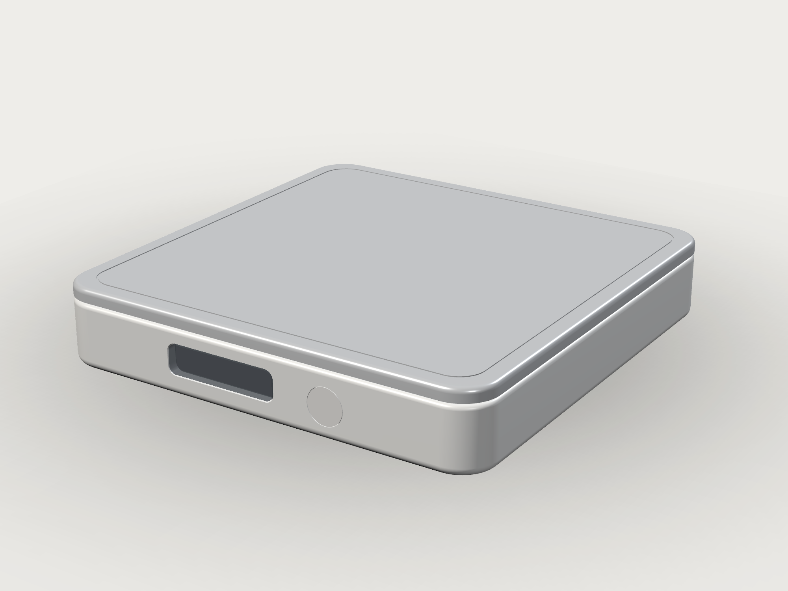

# SmartCoaster V1 — 方形版（100 × 100 × 18）

独立的方形版本，与圆形 LUMEN **完全分开**（不同目录、不同模型、不同渲染，不共用任何几何文件）。



## 这一版是什么

按 `../../docs/任务：智能杯垫 V1 机械结构设计.md` 与 `../../docs/恢复：智能杯垫工程（自包含参数手册）.md` 的 M1.2 基线，做成一个完整可装配的方形样机：

- 100 × 100 mm，R8 圆角，总高 18 mm（底壳 14.5 + 浮板 3 + 0.5 间隙）
- HY928D 5 kg 传感器：四角固定、中央 Ø6 传力柱、0.5 mm 过载限位
- 浮动顶板带下裙边（定位、不承重），可整片取下清洁
- C 形主 PCB 93.2 × 93.2，中央 38 × 38 方孔，前缘 80° C 口
- 前缘干净：26 × 7 烟熏 OLED 窗（中心 x=-8、**窗中心 z=8.0**）+ Ø8.2 圆形实体按键（x=17、**z=7.2**），视觉上同一水平线（相差 0.8 mm）
- 后缘 USB-C，PCB 上置 ESP32-S3 / HX711 / 500 mAh 电池
- **无光导**（用户 2026-11-04 决定）：窗周 halo、前缘灯线、底部灯线、Y 分光、顶板-底座缝隙光环全部取消；顶板-底座的 0.5 mm 只是称重浮动/过载限位缝，不放光
- 12 个零件，全部单实体、valid；37 组“必须分离”零件对 0 干涉

## 快速开始

```bash
cd /data/Documents/projects/SmartCoaster/mechanical/square_v1

# 生成 STEP/STL（12 零件 + 总装）
.venv/bin/python cad/export_v01.py

# 21 项自检（实体数 / 包围盒 / 间隙 / 下压行程 / 37 组干涉 / STEP 回读）
.venv/bin/python cad/verify_v01.py

# agentcad 版本化构建（需要显示；无桌面时用 Xvfb）
./.tools/xvfb/usr/bin/Xvfb :99 -screen 0 1600x1200x24 &
DISPLAY=:99 agentcad run cad/square_assembly_v01.py --label square_v1 --no-daemon

# 渲染（VTK，需要 DISPLAY；无桌面时用上面的 Xvfb）
DISPLAY=:99 python3 tools/render_studio.py --shot all

# FreeCAD 查看
freecad build/assembly/assembly_v01.step
```

## 目录

```
square_v1/
├── .venv/                    Python 3.10 + agentcad 0.7.1 + build123d 0.10.0
├── cad/
│   ├── square_model.py       ★ 唯一几何源（12 个零件 + 装配）
│   ├── square_assembly_v01.py  agentcad 入口
│   ├── export_v01.py         STEP/STL 导出
│   └── verify_v01.py         21 项自检
├── tools/
│   ├── render_studio.py      方形专属工作室渲染
│   ├── export_glb.py         逐件 GLB（Blender 渲染管线用）
│   └── freecad_verify.py     FreeCAD 无头 STEP 回读复查
├── build/
│   ├── parts/                12 × STEP + STL
│   ├── assembly/             assembly_v01.step / .stl + meta.json
│   ├── glb/                  12 × GLB（仅可视化）
│   ├── render/               hero / front / back / top / detail / exploded
│   └── verify_report.json    21/21
└── v6_square_v1/             agentcad 版本快照（最新：12 件，无光导）
```

## 关键数字

| | |
|---|---|
| 外形 | 100 × 100 × 18 mm |
| 零件 / 实体 | 12 / 12（全部 valid） |
| 体积 / 估算质量 | 78 338 mm³ / 155.3 g |
| 浮动间隙 | 0.5 mm（顶板底 15.0 / 壳口 14.5） |
| 传力柱 | Ø6，z 6.0 → 15.0 |
| 顶板裙边 | 93.6 / 92.4 × 2.6，与内腔单边 0.8 |
| PCB | 93.2 × 93.2 × 1.6，中央 38 × 38，前 80° C 口，z 5.0 |
| 干涉 | 37 组，0 mm³；0.5 mm 满行程无遮挡 |
| 传感器 | HY928D 34 × 34 × 1.0（U 腔参数为 PROVISIONAL） |

## 与圆形 LUMEN 的关系

两版**并列**、互不混合：

| | V1 方形（本目录） | LUMEN 圆形（`../lumen/`） |
|---|---|---|
| 外形 | 100 × 100 × 18 | Ø110 × 17 |
| 前缘 | OLED 26×7 + Ø8.2 实体键 | 12×7 烟熏窗，无实体键（敲击唤醒） |
| 光 | 无 | 360° 光晕 |
| 顶板 | 100×100×3 | Ø104×3 |
| 零件 | 12 | 13 |

## 设计取舍 / 偏离说明

1. **USB-C 放在后缘**（手册 M1.2 曾放在前右 320°）。后缘让前脸只保留 OLED + 按键，线缆也朝后走，更符合桌面使用。
2. **OLED 模组按 38 × 12 × 1.2 建模**（0.91" 128×32 类），配合用户确认的 26 × 7 前窗。
3. **PCB 前 C 口取 80°**（手册 70°），为 38 mm 宽 OLED 模组让位；否则模组右端会压到 PCB。
4. **窗在左、键在右**（窗口中心 x=-8，按键 x=17）；手册 M1.2 与 V1 任务书图示不完全一致，本版以当前模型为准，若需左右互换只需改 `OLED_X` / `BTN_X`。
5. **顶板无卡扣**：整片可取下清洗；量产可加 3 个 bayonet 卡爪或径向磁铁防脱。
6. **按键行程 0.6 mm** 由背后的轻触开关提供（未建模），按键只与底壳接触，不跨浮动面、不参与称重。
7. **无光导**：2026-11-04 用户决定全部取消（含窗周 halo / 前缘灯线 / 底部灯线 / Y 分光 / 缝隙光环），壳体前脸不再有浅槽或过孔，只剩屏窗与按键；顶板-底座 0.5 mm 浮动缝仅作称重过载限位。
