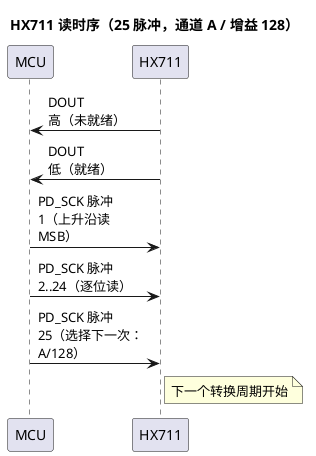

# HX711 电子秤专用 24 位 A/D 转换器 — 数据手册转录（海芯 / AVIA）

> 来源：`ref/hx711官方资料(海芯).pdf`（AVIA SEMICONDUCTOR，中文版，11 页）
> 转录：保留全部引脚、电气参数、时序、应用电路、参考驱动代码和注意事项；补充"对本项目意味着什么"。
> 关联：`ref/HY928D_5kg_称重传感器_图纸转录.md`、`docs/02_Smart_Coaster_PRD.md` §5.3

---

## 1. 简介

HX711 是海芯科技（AVIA）专为高精度电子秤设计的 **24 位 Σ-Δ A/D 转换器**。片内集成：

- 两路可选择差分输入（通道 A / B）；
- 低噪声可编程放大器（PGA，增益 32 / 64 / 128）；
- 稳压电源（可直接给外部传感器和片内 ADC 供电）；
- 片内时钟振荡器（无需外接器件）；
- 上电自动复位；
- 50 Hz / 60 Hz 电源干扰同步抑制。

与 MCU 的接口只需要 **DOUT + PD_SCK** 两根线，所有控制由引脚驱动，**芯片内没有可编程寄存器**。

## 2. 主要特点（原文）

- 两路可选择差分输入
- 片内低噪声可编程放大器，增益 32 / 64 / 128
- 片内稳压电路可直接向外部传感器和片内 A/D 转换器提供电源
- 片内时钟振荡器无需任何外接器件，必要时也可使用外接晶振或时钟
- 上电自动复位电路
- 简单的数字控制和串口通讯：所有控制由管脚输入，芯片内寄存器无需编程
- 可选择 10 Hz 或 80 Hz 的输出数据速率
- 同步抑制 50 Hz 和 60 Hz 的电源干扰
- 耗电量（含稳压电源电路）：典型工作电流 **< 1.6 mA**，断电电流 **< 1 µA**
- 工作电压范围 **2.6 ~ 5.5 V**
- 工作温度范围 **−40 ~ +85 ℃**
- **SOP-16** 封装

## 3. 内部框图

```plantuml
@startuml
skinparam componentStyle rectangle
left to right direction

package "HX711" {
  [Input MUX\nA / B] as MUX
  [PGA\nGain 32 / 64 / 128] as PGA
  [24-bit ΣΔ ADC] as ADC
  [Bandgap Reference\nVBG = 1.25 V] as BG
  [Internal Oscillator] as OSC
  [Analog Supply Regulator\nVSUP / BASE / VFB / AVDD] as REG
  [Digital Interface\nDOUT / PD_SCK] as DIF
}

[Bridge sensor\nINA+ / INA−] --> MUX
[Battery / system\nINB+ / INB−] --> MUX
MUX --> PGA --> ADC --> DIF --> [MCU]
BG --> ADC
OSC --> ADC
REG --> [Sensor excitation\nAVDD]
REG --> ADC
@enduml
```

## 4. 引脚（SOP-16L）

```
        ┌───────U───────┐
 VSUP 1 │               │ 16 DVDD
 BASE 2 │               │ 15 RATE
 AVDD 3 │               │ 14 XI
  VFB 4 │    HX711      │ 13 XO
 AGND 5 │               │ 12 DOUT
  VBG 6 │               │ 11 PD_SCK
 INNA 7 │               │ 10 INPB
 INPA 8 │               │  9 INNB
        └───────────────┘
```

| 脚 | 名称 | 类型 | 说明 |
|---|---|---|---|
| 1 | VSUP | 电源 | 稳压电路供电：2.6–5.5 V |
| 2 | BASE | 模拟输出 | 稳压电路控制输出（不用稳压时 NC） |
| 3 | AVDD | 电源 | 模拟电源：2.6–5.5 V |
| 4 | VFB | 模拟输入 | 稳压电路控制输入（不用稳压时接地） |
| 5 | AGND | 地 | 模拟地 |
| 6 | VBG | 模拟输出 | 参考电源输出（1.25 V） |
| 7 | INA− | 模拟输入 | 通道 A 负 |
| 8 | INA+ | 模拟输入 | 通道 A 正 |
| 9 | INB− | 模拟输入 | 通道 B 负 |
| 10 | INB+ | 模拟输入 | 通道 B 正 |
| 11 | PD_SCK | 数字输入 | 断电控制（高有效）+ 串口时钟 |
| 12 | DOUT | 数字输出 | 串口数据输出 |
| 13 | XO | 数字输入输出 | 晶振（不用时 NC） |
| 14 | XI | 数字输入 | 外部时钟/晶振输入；**0 = 用片内振荡器** |
| 15 | RATE | 数字输入 | 0 = 10 Hz；1 = 80 Hz |
| 16 | DVDD | 电源 | 数字电源：2.6–5.5 V |

## 5. 主要电气参数（原文表二）

| 参数 | 条件 | 最小 | 典型 | 最大 | 单位 |
|---|---|---|---|---|---|
| 满额度差分输入范围 | V(INP)−V(INN) | | ±0.5·(AVDD/GAIN) | | V |
| 有效位数 ENB | 增益 128，10 Hz | | 19.7 | | bit |
| 无噪声位数 | 增益 128，10 Hz | | 17.3 | | bit |
| 积分非线性 INL | 满量程百分比 | | ±0.001 | | %FSR |
| 输入共模电压范围 | | AGND+1.2 | | AVDD−1.3 | V |
| 输出数据速率 | 片内时钟，RATE=0 | | 10 | | Hz |
| 输出数据速率 | 片内时钟，RATE=DVDD | | 80 | | Hz |
| 输出数据速率 | 外部时钟，RATE=0 | | fclk/1,105,920 | | Hz |
| 输出数据速率 | 外部时钟，RATE=DVDD | | fclk/138,240 | | Hz |
| 输出数据编码 | 二进制补码 | 800000 | | 7FFFFF | HEX |
| 输出稳定时间 | RATE=0 | | 400 | | ms |
| 输出稳定时间 | RATE=DVDD | | 50 | | ms |
| 输入零点漂移 | 增益 128 | | 0.1 | | mV |
| 输入零点漂移 | 增益 64 | | 0.2 | | mV |
| 输入噪声 | 增益 128，10 Hz | | 50 | | nV(rms) |
| 输入噪声 | 增益 128，80 Hz | | 90 | | nV(rms) |
| 温度系数（零点） | 增益 128 | | ±12 | | nV/℃ |
| 温度系数（增益） | 增益 128 | | ±7 | | ppm/℃ |
| 共模抑制比 | 增益 128，10 Hz | | 100 | | dB |
| 电源干扰抑制比 | 增益 128，10 Hz | | 100 | | dB |
| 输出参考电压 VBG | | | 1.25 | | V |
| 外部时钟频率 | | 1 | 11.0592 | 20 | MHz |
| 电源电压 DVDD | | 2.6 | | 5.5 | V |
| 电源电压 AVDD / VSUP | | 2.6 | | 5.5 | V |
| 模拟电源电流（含稳压） | 正常 | | 1500 | | µA |
| 模拟电源电流（含稳压） | 断电 | | 0.5 | | µA |
| 数字电源电流 | 正常 | | 100 | | µA |
| 数字电源电流 | 断电 | | 0.2 | | µA |

**定义**：
- ENB = ln(FSR / RMS Noise) / ln(2)
- 无噪声位数 = ln(FSR / Peak-to-Peak Noise) / ln(2)
- 输出稳定时间：从上电、复位、输入通道或增益改变到有效稳定输出的时间。

## 6. 模拟输入与增益

- **通道 A**：接桥式传感器差分输出；增益 128 → 满量程 **±20 mV**；增益 64 → **±40 mV**。
- **通道 B**：固定增益 32 → 满量程 **±80 mV**；用于系统参数检测（电池电压等）。
- 通道 A 适合小信号；通道 B 适合电池分压检测。

## 7. 供电与片内稳压

- DVDD 应使用与 MCU **相同的数字电源**。
- 片内稳压可同时给 ADC 和外部传感器供电：`VAVDD = VBG·(R1+R2)/R2`。
  - 要求 `VAVDD` 比 `VSUP` 低至少 **100 mV**。
  - 外部传感器和 ADC 用**同一模拟电源**。
- 不用片内稳压时：VSUP 接 DVDD/AVDD 中较高者；VFB 接地；BASE 悬空；VBG 不外接电容。
- 建议用 **PNP 管 S8550** 与片内稳压配合（也可用 MOS/三极管，但要注意稳定性）。

## 8. 时钟

- XI 接地 → 用片内振荡器，输出 10 Hz 或 80 Hz。
- 需要精确速率时：外部时钟经 **20 pF 隔直电容**接 XI；或晶振接 XI/XO。
- 外部时钟不要求方波；可用 MCU 晶振输出经 20 pF 隔直电容，幅值可低至 **150 mV**。

## 9. 串口通讯与时序

### 9.1 读一次数据

1. DOUT 为高 = 转换未完成；此时 **PD_SCK 必须为低**。
2. DOUT 变低后，给 PD_SCK **25 / 26 / 27 个时钟脉冲**。
3. 第 1 个上升沿读出 24 位数据的 **MSB**，第 24 个沿读完 LSB。
4. 第 25/26/27 个脉冲选择**下一次**转换的通道和增益。

| PD_SCK 脉冲数 | 输入通道 | 增益 |
|---|---|---|
| 25 | A | 128 |
| 26 | B | 32 |
| 27 | A | 64 |

- 脉冲数 **少于 25 或多于 27 → 串口通讯错误**。
- 改变通道/增益后，需要 **4 个数据输出周期** 才稳定；DOUT 在 4 个周期后才变低输出有效数据。

### 9.2 时序图



| 符号 | 说明 | 最小 | 典型 | 最大 | 单位 |
|---|---|---|---|---|---|
| T1 | DOUT 下降沿 → PD_SCK 上升沿 | 0.1 | | | µs |
| T2 | PD_SCK 上升沿 → DOUT 有效 | | | 0.1 | µs |
| T3 | PD_SCK 正脉冲宽度 | 0.2 | | 50 | µs |
| T4 | PD_SCK 负脉冲宽度 | 0.2 | | | µs |

> 注意：T3 最大 50 µs —— 时钟不能拉高太久，否则可能被当成断电（见 §10）。

### 9.3 数据格式

- 24 位二进制补码，`800000` = 负满量程，`7FFFFF` = 正满量程。
- 常见驱动把 24 位异或 `0x800000` 转成无符号偏移码；两种表示都可用，关键是零点/满量程标定一致。

## 10. 复位与断电

- 上电自动复位；复位后默认 **通道 A / 增益 128**。
- PD_SCK 保持高电平 **> 60 µs** → 进入断电（传感器和 ADC 同时断电）。
- PD_SCK 回低 → 自动复位，4 个周期后输出有效数据。
- 因此：**读数据的 25–27 个脉冲必须连续、宽度 < 50 µs**，读完后 PD_SCK 拉低。

## 11. 应用参考电路（图四）

```
USB-C / 电池 ── 充电电路 ── 电池 ── Q1 ── VSUP/DVDD ── L1(磁珠) ── VDD(MCU)
                                          │
                                     HX711 (SOP-16)
                                     BASE ── S8550 ── AVDD
                                     VFB  ── 分压 R1/R2
                                     INA+/INA− ── 传感器
                                     INB+/INB− ── 电池分压
                                     DOUT/PD_SCK ── MCU GPIO
```

- **L1 磁珠**：隔离模拟/数字电源。
- **Q1**：关断传感器和 ADC 电源，进一步省电。
- 传感器与 ADC 用同一模拟电源；模拟地与数字地单点连接。

## 12. 参考驱动（C，原文）

```c
sbit ADDO = P1^5;      // DOUT
sbit ADSK = P0^0;      // PD_SCK

unsigned long ReadCount(void){
  unsigned long Count;
  unsigned char i;
  ADSK = 0;                 // 使能 AD（PD_SCK 低）
  Count = 0;
  while (ADDO);             // 等转换完成（DOUT 变低）
  for (i = 0; i < 24; i++) {
    ADSK = 1;
    Count = Count << 1;
    ADSK = 0;
    if (ADDO) Count++;
  }
  ADSK = 1;
  Count = Count ^ 0x800000; // 补码转偏移码
  ADSK = 0;
  return Count;
}
```

> 这段是 8051 风格；ESP32 上要用 GPIO + 微秒级延时实现，注意 T3 < 50 µs、读完把 PD_SCK 拉低。

## 13. 封装与注意事项

- **SOP-16L**：本体约 9.90–10.10 × 5.80–6.20 mm，引脚间距 1.27 mm，引脚宽 0.39–0.48 mm，引脚跨度 3.70–4.10 mm，厚度 1.20–1.60 mm。
- 数字输入（RATE、XI、PD_SCK）**内部无上/下拉**，不能悬空。
- 建议通道 A 接传感器，通道 B 做系统参数检测。
- 建议 PNP S8550 配合片内稳压。
- PD_SCK 脉冲数必须 25–27。
- 与 DOUT 相连的 MCU 引脚设为**输入、无上/下拉**，减少 MCU 与 ADC 之间的电流交换（干扰）。

## 14. 对本项目的设计含义

| 项 | 结论 | 依据 |
|---|---|---|
| 增益 | 选 **128**（±20 mV） | 5 kg 全桥 1.2 mV/V，3.3–4.3 V 激励 → 4–5 mV，占 20–26% 量程 |
| 速率 | 默认 **10 Hz**（RATE=0） | 噪声最低（50 nVrms），称重不需要 80 Hz |
| 稳定时间 | 400 ms（10 Hz） | 上电/换通道后等 4 个周期；固件初始化要等 ≥500 ms |
| 激励 | 用片内稳压 + S8550，或外部 3.3 V | 传感器 3–10 V；5 kg 桥流约 3–5 mA |
| 噪声 | 50 nVrms @128/10 Hz | 折算到 5 kg 量程约 0.01 g 级（理论），实际受机械/温漂限制 |
| 工频抑制 | 片内 50/60 Hz 抑制 | 国标 50 Hz 环境有利 |
| 布线 | 模拟/数字电源磁珠隔离，单点接地 | 图四 |
| 省电 | PD_SCK 高 >60 µs 断电 | 待机可 <1 µA（芯片），适合电池版 |
| 校准 | 必须做零点 + 满量程标定 | 每颗传感器零点不同（参考产品原文） |

### 14.1 与 HY928D 的匹配核算（理论值，非实测）

| 激励 | 全桥输出（5 kg） | 占 ±20 mV 比例 | 备注 |
|---|---|---|---|
| 3.3 V | 3.96 mV | 19.8% | 适合 3.3 V 系统 |
| 4.3 V（片内稳压典型） | 5.16 mV | 25.8% | 需核算 S8550 压降/功耗 |
| 5.0 V | 6.00 mV | 30.0% | 桥流 5 mA，功耗 25 mW |

> 以上只说明"量级够用"；实际噪声、温漂、机械回差必须实物标定。

## 15. 待确认 / 风险

1. HX711 没有公开的芯片级 SPICE 模型；电路仿真只能用**行为模型/等效桥路**，不能声称仿真了芯片内部。
2. 模块市售品（绿板）与裸芯片的电源/地去耦差异大；若用模块，需实测噪声。
3. 5 kg 传感器的实际灵敏度分布 ±0.2 mV/V，批次差异要用软件校准。
4. 片内稳压的 S8550 方案在 3.3 V 供电时压差可能不够（VAVDD 需低于 VSUP 100 mV），要核算。
5. ESP32-S3 的 GPIO 3.3 V 与 HX711 DVDD 电平匹配（DVDD 接 3.3 V 即可）。
