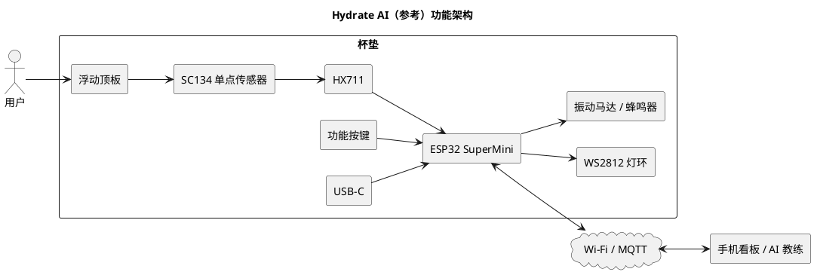

# Hydrate AI 智能杯垫 — 拆解、结构参考与目标形态

> 来源：
> - `ref/ref.jpeg`（Autonomous Hydrate AI 实物拆解照）
> - `ref/design.png`（目标形态概念图：100×100×14、前缘 OLED + 双按键）
> - <https://www.autonomous.ai/engineering/how-we-built-hydrate-ai>（官方构建日志，2026）
> 目的：为 Smart Coaster 的 **方形 100×100** 版本提供结构/交互参考。**只参考，不照抄**；HY928D 与 SC134 的受力方式不同。

---

## 1. 官方构建日志要点（原文提炼）

### 1.1 形态

| 项 | 值 |
|---|---|
| 外形 | 直径 **3.54 in ≈ 90 mm** 的圆盘 |
| 总高 | **0.6 in ≈ 15 mm** |
| 供电 | USB-C，离线运行（可选 Wi-Fi/MQTT 同步） |
| 顶板 | 浮动，压在称重传感器上 |
| 底壳 | 承载电子件，侧边 USB-C 开孔 |

### 1.2 关键器件

| 件 | 型号/方案 | 说明 |
|---|---|---|
| MCU | **ESP32 SuperMini** | 带 USB-C，尺寸小；作者试过 ESP32-S3 开发板但太厚 |
| 称重 | **SC134 单点式** | 单点、非四角；四角更准但会多 4 mm 高度 |
| ADC | **HX711** | 24 位；作者先用 ESP32 内部 12 位 ADC，噪声大、误判，换 HX711 后解决 |
| 灯 | **WS2812 环** | 通过扩散环发光，是主要输出 |
| 触觉/声音 | 振动马达 + 蜂鸣器 | 分级提醒：灯 → 振动 → 蜂鸣 |
| PCB | 自制 **2 层板** | 全 SMT；JST-SH 连接器；无飞线 |
| 电池 | 未提 | 该版本以 USB-C 为主 |

### 1.3 装配（作者强调的坑）

- SC134 是**单点式**：**一端固定在底壳，另一端固定在浮动顶板**，中间梁弯曲产生信号。
- **两端都固定在同一块板上 → 永远读零**。作者踩过这个坑。
- 传感器四线：E+、E−、A+、A−；**厂家线色经常变，按数据手册，不要按颜色**。
- ESP32 SuperMini 直接焊在板上（不用插座，省高度）。
- 合盖时**对角均匀拧紧**，否则顶板不平、传感器被偏置。

### 1.4 固件行为（可直接借鉴）

| 功能 | 实现 |
|---|---|
| 采样 | 每 **100 ms** 读 HX711 |
| 滤波 | 滑动平均 + 稳定性判定；未稳定不发事件 |
| 事件 | 放杯、拿杯、饮水（稳定下降）、加水（稳定上升） |
| 标定 | 放 100 g 砝码，记录 counts/gram 偏移 |
| 提醒 | 默认 30 min；灯 → 振动 → 蜂鸣逐级升级；拿杯即重置 |
| 目标 | 每日目标，完成时灯环特效；约 **00:00:05** 清零 |
| 连接 | Wi-Fi + MQTT；OTA |
| 交互 | 长按功能键约 5 s 进 AP 配网 |

### 1.5 数据看板

- 今日摄入 / 目标（如 838 / 2000 ml）
- 24 h 时间轴、日/周视图、历史日期
- 连续达标天数
- AI 饮水教练（结合天气与饮水模式）
- 设备配置（提醒间隔、灯色、振动/蜂鸣开关、多设备）

---

## 2. 实物拆解照（`ref/ref.jpeg`）读图

```
┌───────────────────────────── 绿色切割垫 ─────────────────────────────┐
│                                                                      │
│   ┌──────────────────┐        ┌──────────────────┐                  │
│   │  C 形黑色 PCB     │        │  传感器 + 白色    │                  │
│   │  Autonomous       │        │  U 形转接件       │                  │
│   │  HYDRATE REV 1.1  │        │  （红黑线）       │                  │
│   │  · USB-C          │        └──────────────────┘                  │
│   │  · QFN + 晶振     │                                              │
│   │  · 环形 LED 焊盘   │        ┌──────────────────────────┐          │
│   │  · JST 连接器      │        │  灰色底壳（3D 打印）       │          │
│   └──────────────────┘        │  · 中央大孔               │          │
│                               │  · 斜向支架（两端螺孔）    │          │
│                               │  · 4 个周边 boss           │          │
│                               │  · 侧壁筋位/卡扣           │          │
│                               └──────────────────────────┘          │
└──────────────────────────────────────────────────────────────────────┘
```

### 2.1 C 形 PCB

- 外径约 90 mm 级，**C 形缺口**（约 60–90°），给前缘的传感器/按键/排线让位。
- 板上可见：USB-C 母座、QFN（可能是充电/电源管理或 MCU）、晶振、多个 JST-SH（灯环、传感器、马达、蜂鸣器）。
- 沿外圈一圈 **LED 焊盘**（WS2812 或类似），说明灯环是独立柔性/硬板环，或直接布在主板外圈。
- 板上有 "Autonomous HYDRATE REV 1.1" 丝印；四角有安装孔。

### 2.2 传感器与白色 U 形件

- 传感器是一块方形金属板，四角有孔；上面粘了一个**白色 3D 打印的 U 形/马鞍形件**。
- 红/黑（以及可能的绿/白）线从传感器引出。
- 白色件的功能**不能从照片确定**，可能是：
  1. 把顶板载荷集中到传感器自由端的**压头/杠杆**；
  2. 传感器与顶板之间的**限位/防过载垫块**；
  3. 应变片区域的**保护盖/隔热垫**。
- 结合 SC134 的单点用法，更像 **1（力传递件）**：一端压在传感器自由端，另一端与顶板接触。

### 2.3 底壳

- 灰色 3D 打印（FDM，层纹明显）。
- **中央大孔**：让传感器/传力件穿过或让位。
- **斜向支架**：一条从中心附近斜向到边缘的加强筋/悬臂，两端各有一个螺孔——很可能就是 SC134 的**固定端安装座**：一端锁在底壳，另一端悬空并与顶板接触。
- 周边 4 个 boss：顶板导向/限位或壳体连接。
- 侧壁有卡扣/筋位，USB-C 开口在侧面。

> 结论：参考产品是 **"单点梁 + 斜向悬臂 + 浮动顶板"**，不是四角固定 + 中央受力。这与 HY928D 的 U 形对称结构不同。

---

## 3. 目标形态（`ref/design.png`）

| 项 | 目标 |
|---|---|
| 外形 | **100 × 100 mm**，大圆角，白色/浅灰 |
| 厚度 | **≈14 mm**（比 M1.2 的 18 mm 更薄） |
| 前缘 | 黑色 OLED 窗显示 **"250 g" + 水滴图标**；右侧 **两个圆形按键**（一大一小） |
| 顶板 | 可擦拭、可拆 |
| 内部 | 顶板 → HY928D + 支架 → PCB + OLED → 底壳（防滑垫） |
| 爆炸图 | 顶板 / 传感器支架 / PCB+OLED / 底壳 四层 |

### 3.1 与当前 M1.2 的差异

| 项 | M1.2（当前） | 目标（design.png） |
|---|---|---|
| 总高 | 18 mm | **14 mm** |
| 前缘 | OLED 18×7 + 1 个 Ø8.2 按键 | OLED + **2 个按键** |
| 显示内容 | 仅占位 | 重量（g）+ 水滴图标 |
| 传感器 | 四角固定 + 中央传力 | 图上写 HY928D，但结构更像单点支架 |
| 底壳 | 注塑壁 + C 形 PCB | 3D 打印底壳 + 支架 |

> 14 mm 总高对 HY928D（1 mm 厚）+ 浮动间隙 + 顶板 3 mm + PCB 1.6 mm + 电池 5 mm 的堆叠是很紧的；需要重新做高度预算（见 §5）。

### 3.2 "多一些按键" 的落点

参考产品只有 1 个功能键；目标图给了 2 个。建议 3 键方案（前缘同一直线）：

| 键 | 位置 | 功能（建议） |
|---|---|---|
| K1 唤醒/确认 | 左 | 短按唤醒/确认；长按 5 s 配网 |
| K2 模式/单位 | 中 | 短按切换 g / ml / 杯数；长按去皮 |
| K3 重置/目标 | 右 | 短按查看今日目标；长按 5 s 清空当天 |

- 按键固定于**底壳**，只与底壳接触；按键帽与顶板之间留 ≥0.5 mm，**不跨浮动面**。
- 三个按键在同一水平线（z 与前缘 OLED 中心一致），开孔直径可统一 Ø8.2，间距 ≥12 mm。
- 若只做 2 键：K1 唤醒/确认，K2 模式/单位；配网用 K1 长按。

---

## 4. 参考产品的架构图



---

## 5. 对 Smart Coaster 的采用 / 不采用

### 5.1 采用

- **浮动顶板 + 底壳承载电子件**的分层；
- **C 形/环形 PCB** 环绕传感器，中央让位；
- **前缘 OLED + 多按键**（目标图 2 键，建议 3 键）；
- **环形灯**作为低干扰输出（LUMEN 已做）；
- **硅胶防滑垫 + USB-C 侧开**；
- **固件事件状态机 + 100 ms 采样 + 滑动平均 + 稳定窗口**；
- **100 g 砝码标定**流程。

### 5.2 不直接采用

- **SC134 的单点安装**：HY928D 是"四角固定 + 中央受力"的 U 形梁结构（见 HY928D 图纸转录 §4）。除非供应商确认 HY928D 可单点使用，否则不要把一角固定、一角浮动套上去。
- **14 mm 总高**：需要先做高度预算；如果电池 5 mm + PCB 1.6 + 传感器 1 + 顶板 3 + 浮动 0.5 + 底壳 2 = 13.1 mm，理论上可行，但 HX711/ESP32 的模块厚度、连接器、屏幕要重新选型（建议用裸芯片/超薄模组）。
- **ESP32 SuperMini**：它没有 S3 的算力，但更薄；如果坚持 S3，需要选 **ESP32-S3-MINI-1** 这类模组并做板载天线净空。

### 5.3 高度预算（14 mm 目标）

| 层 | 厚度 (mm) | 备注 |
|---|---|---|
| 顶板 | 3.0 | 铝/PC |
| 浮动间隙 | 0.5 | 过载限位 |
| 传感器 | 1.0 | HY928D 5 kg |
| 传感器下方支撑/PCB | 1.6（PCB）+ 2.0（底壳底） | 与传感器同层或下方 |
| 电池 | 5.0 | 25×30×5 |
| 底壳底 + 脚垫 | 2.0 + 0.8 | |
| **合计** | **≈14.4** | 已超 14，需要压缩（电池 4.5、底壳 1.8、顶板 2.5） |

> 结论：14 mm 是**紧目标**，不是当前 M1.2 的 18 mm 直接压扁。需要一次专门的高度预算评审。

---

## 6. 与 HY928D 的结构取舍（决策点）

| 方案 | 说明 | 优点 | 风险 |
|---|---|---|---|
| **A. 四角固定 + 中央传力**（M1.2 / LUMEN） | 4 角锁底壳，顶板中央柱压传感器中心 | 与 HY928D 图纸最吻合；对称、温漂小 | 四角平面度/拧紧顺序敏感；中央柱要防偏载 |
| **B. 单点式**（参考产品） | 一端固定，一端连顶板 | 零件少、厚度低 | HY928D 非单点设计；两梁受力不对称；需供应商确认 |
| **C. 混合** | 四角固定，但顶板通过**球头**压中心，周边加长导向 | 保留 HY928D 对称性，降低偏载力矩 | 球头接触应力、加工精度 |

> **FEA 第一步必须先选 A/B/C。** 选 A 则边界条件为 4 孔固定 + 中心位移/力；选 B 则为 2 孔固定 + 自由端位移。两者的应力/位移结果不可互相套用。

---

## 7. 参考链接

- 构建日志：<https://www.autonomous.ai/engineering/how-we-built-hydrate-ai>
- 产品页：<https://www.autonomous.ai/habit/hydrate>
- 图片：`ref/ref.jpeg`、`ref/design.png`
- HX711：`ref/HX711_数据手册_海芯.md`
- HY928D：`ref/HY928D_5kg_称重传感器_图纸转录.md`
