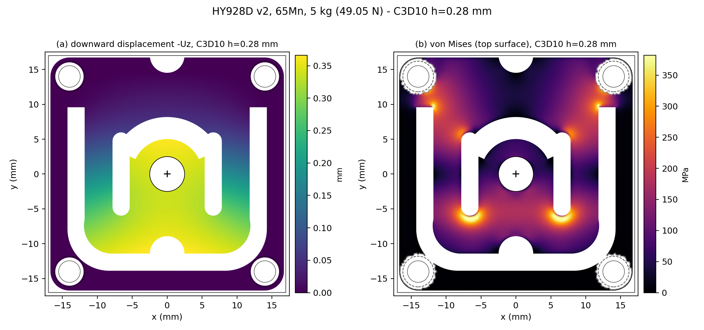
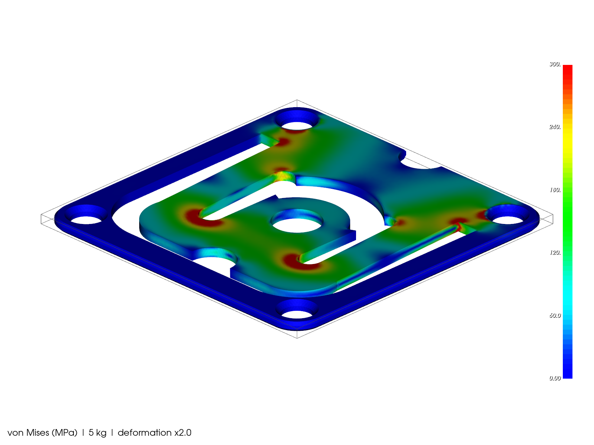
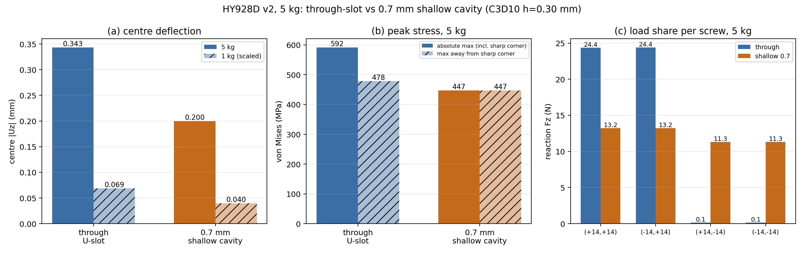
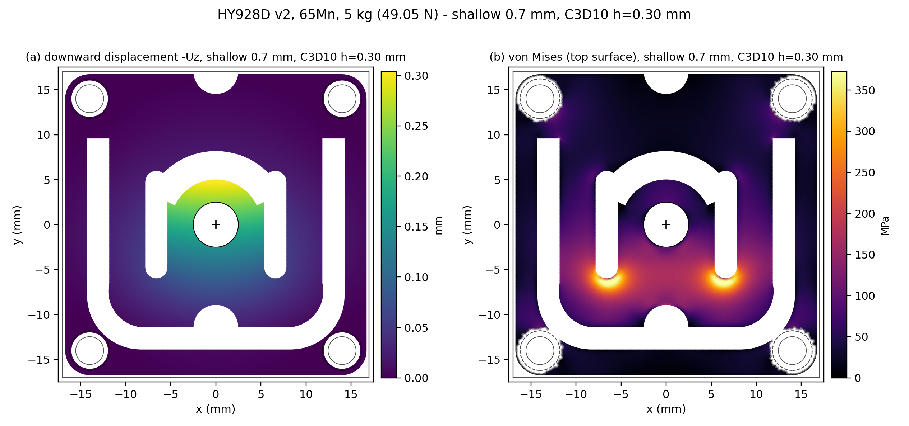

# HY928D 5 kg 传感器 — S1 线弹性静力 FEA（第一轮）

> **一句话结论**：5 kg 时中心下沉 **0.343 mm**，四角支反力合计 **49.050 N（100.0%）**；舌片根部名义应力 **229 MPa**，但竖槽端 R1.25 处有 **468 MPa** 的集中，U 槽端直角处 588 MPa 是网格相关的奇异点。按 0.5–0.6 mm 的装配浮动间隙，0.343 mm 已用掉 57–69%，过载限位和公差需要系统级复核。
>
> 这是"能不能当秤"的**趋势分析**，不是定型/认证结论；几何中 U 槽/拱/竖槽曲线仍是 `PROVISIONAL`。

---

## 1. 一眼看懂

**表 1 — 通槽方案主结果（C3D10，h = 0.28 mm，5 kg = 49.05 N）**

| 指标 | 5 kg | 1 kg（直接算，非缩放） |
|---|---:|---:|
| 中心 \|Uz\|（Ø5 孔缘平均，mm） | **0.3435**（范围 0.337–0.354） | **0.0687** |
| 整体 max \|U\|（mm） | **0.3691** @ 舌片底部缺口 (−2.5, −11.4) | 0.0737 |
| max von Mises（MPa） | **588.4** @ U 槽端直角 (11.8, 9.6) — **奇异，不代表真实应力** | 118.3 |
| 非奇异热点（MPa） | **467.7** @ 竖槽端 R1.25 (6.1, −5.9) | 95.7 |
| 舌片根部名义应力（MPa） | **229**（\|x\| ≤ 10.5, y 8.5–12.5） | ~46 |
| 四角支反力合计（N） | **49.050（100.00%）** | 9.810（100.00%） |
| 1 kg / 5 kg 中心位移比 | — | **0.200000**（理论 0.2） |

> 1 kg 列为 h=0.30 网格上的独立求解（与 0.2×5 kg 的差 <1%）；5 kg 主列是 h=0.28。

**图 1 — 位移与应力云图（通槽，5 kg）**



左：顶面向下位移 −Uz（mm），中心舌片整体下沉约 0.34 mm，外框基本不动。
右：顶面 von Mises（MPa），热点在 U 槽端、竖槽端和拱端；色标上限做了截断，真实峰值见表 1/表 2。

**图 2 — 三维应力云图（通槽，5 kg，变形 ×2）**



> 图 1 的色标为便于看分布做了 99.7% 截断；最大 588 MPa 是尖角奇异点，不能当作设计应力。设计上应看 468 MPa 的竖槽端和 229 MPa 的舌片根部。

### 这意味着什么（给非仿真专家）

1. **位移够大，但余量不多。** 5 kg 下中心走 0.343 mm，1 kg 走 0.0687 mm，线性度极好（比例 0.200000）。按当前方形/圆形版本的 0.5 / 0.6 mm 浮动间隙，5 kg 已经用掉 **69% / 57%**；按文档里"中心位移 < FLOAT_GAP/2"的暂定验收线（0.25 / 0.30 mm），**0.343 mm 已超过**。这不是说传感器坏了，而是说**过载限位、装配公差、顶板下沉**必须在整机模型里一起复核，否则 5 kg 附近可能提前接触限位。
2. **载荷几乎全由 +y 侧两颗螺钉承担。** 四角支反力：**24.39 / 24.38 / 0.142 / 0.142 N**。U 槽向上开口，−y 侧外框像一条很软的"尾巴"，所以下侧两颗螺钉只占 0.6%。真实底座、螺钉预紧和摩擦会重新分配，但"上侧两颗是主承力、下侧两颗主要定位"这个趋势要在装配 FEA/实测中确认；上侧两颗的预紧和平整度更关键。
3. **限制承载的是槽端，不是舌片根部。** 舌片根部名义应力只有 229 MPa，拱端 266 MPa，中央梁/连接带 136 MPa；真正高的是竖槽端 R1.25 的 **468 MPa**。如果 65Mn 的屈服在 400–500 MPa 量级（**具体按供应商热处理状态，项目尚未给定**），这个点已经在屈服边缘。**优先改竖槽端半径/槽宽，而不是加厚舌片**；U 槽端直角（588 MPa）是重建几何的尖角奇异，实物必须倒圆，不能拿这个数做设计。
4. **0.7 mm 浅腔不是"免费的加强筋"。** 它让中心位移从 0.343 降到 0.200 mm（**1.72× 更刚**），舌片根部应力从 229 降到 64 MPa，但**竖槽端热点只从 478 降到 447 MPa（同 h=0.30 对比，−6.5%）**，而灵敏度（同样载荷下的位移/应变）下降约 42%。如果桥路按 1.2 mV/V 设计，浅腔可能不够灵敏；通槽+槽端倒圆更合理。

---

## 2. 模型、材料、边界与载荷

| 项 | 内容 |
|---|---|
| 几何 | `mechanical/hy928d/build/hy928d_v2.step`（只读）；34×34×1.0 mm，4×Ø3.1 @28×28，Ø5 中心孔，通槽 U（2.5 mm 宽）、拱槽 R5.0–8.2 / 25–155°、两条 12×2.5 mm 竖槽 @x=±6.6 |
| 材料 | 65Mn：E = 210000 MPa，ν = 0.3，ρ = 7.85e-9 t/mm³；线弹性、小应变、各向同性 |
| 单元 | **C3D10** 二阶四面体（主网格 h = 0.28 mm，厚度方向约 3–4 层（1 mm / 0.28 mm））；C3D4 仅用于交叉检查 |
| 边界（假设 A） | 每个角孔中心 **±2.2 mm 半径、全厚度** 的节点 **ENCASTRE**（Ux=Uy=Uz=0）。这是"螺钉夹紧区"的简化，不是接触/螺钉模型 |
| 载荷 | 5 kg = **49.05 N**，−Z；顶面 z=1 mm、r ≤ 4.0 mm 环带（r=2.5–4.0，面积 30.59 mm²，平均压力 1.60 MPa）按**一致节点力**施加，合计精确等于 F；1 kg = 9.81 N 单独算 |
| 求解 | CalculiX 2.22（SPOOLES），`*STATIC`，线性；输出 `.dat` / `.frd` |
| 单位 | mm–N–MPa |

> 边界条件的几何解释：角孔中心正好是 R3 圆角的外轮廓圆心，2.2 mm 夹紧半径完全落在材料内（孔边 1.55 mm 到 2.2 mm 的环带）。这比真实螺钉头/垫片略大或略小，但覆盖了主要夹紧区。

**网格与质量**

| 网格 | 单元 | 节点 | 四面体 | 角点质量 min / p1 / 中位 | C3D10 雅可比 min 比 |
|---|---|---:|---:|---|---:|
| 主网格 h=0.28 | C3D10 | 304,892 | 182,289 | 0.093 / 0.177 / 0.375 | **0.920**（p1 = 0.980，0 个坏单元） |
| 收敛 h=0.30 | C3D10 | 264,169 | 156,001 | 0.099 / 0.177 / 0.373 | 0.907 |
| 收敛 h=0.35 | C3D10 | 179,157 | 102,327 | 0.101 / 0.172 / 0.357 | 0.896 |
| 交叉 h=0.20 | C3D4 | 105,493 | 460,629 | — | — |
| 交叉 h=0.15 | C3D4 | 225,000 | 1,057,372 | — | — |
| 浅腔 h=0.30 | C3D10 | 286,186 | 167,267 | 0.037 / 0.177 / 0.381 | 0.534 |

- "角点质量" = 6√2·V / l_max³（1 = 正四面体）；C3D10 雅可比比 = 4 个积分点 |det J| 的最小值 / (6V)，1 = 直边正元。
- 主网格没有负雅可比/坏单元；h=0.28 是最细的**成功** C3D10 网格。h=0.25 / 0.20 的 C3D10 网格本身质量合格，但求解器在 SPOOLES 分解阶段 **SIGSEGV**（见 §5）。

---

## 3. 结果明细

### 3.1 应力分区

**表 2 — 通槽方案（h=0.28）分区 max von Mises**

| 区域 | max vM (MPa) | 位置 (x, y, z) | 说明 |
|---|---:|---|---|
| U 槽端直角（舌片根部） | 588.4 | (11.8, 9.6, 1.0) | **尖角奇异**，网格相关；实物必须倒圆 |
| 竖槽端 R1.25 | **467.7** | (6.1, −5.9, 0.49) | 真实几何热点，收敛值约 468–478 |
| 拱槽端（25°/155°） | 266.5 | (−7.84, 4.89, 1.0) | 拱端为径向尖边，也有一定奇异性 |
| 舌片根部名义区（\|x\|≤10.5） | **229.1** | (−10.48, 9.67, 0) | 弯曲名义应力，远离尖角 |
| 中央梁/连接带（\|x\| 2.5–5.5, \|y\|≤2） | 136.3 | (−2.54, −1.94, 1.0) | 梁根/舌片连接带 |
| Ø5 周围 r≤4 加载区 | 162.9 | (0.10, −3.99, 0) | 加载环带附近 |
| 夹紧区边缘 | 247.1 | — | ENCASTRE 边缘伪影，不代表真实螺钉应力 |
| 自由表面 99.9 分位 | 394.0 | — | 统计值 |
| 自由表面 99 分位 | 265.4 | — | 统计值 |

### 3.2 支反力

**表 3 — 四角支反力（5 kg）**

| 角孔中心 | Fz (N) | 占载荷 |
|---|---:|---:|
| (+14, +14) | 24.385 | 49.7% |
| (−14, +14) | 24.380 | 49.7% |
| (+14, −14) | 0.1423 | 0.29% |
| (−14, −14) | 0.1422 | 0.29% |
| **合计** | **49.050** | **100.00%** |

Fx、Fy 合计分别为 −6.5×10⁻⁶、+1.1×10⁻⁵ N（数值零），力矩由夹紧区的反力矩平衡。上/下侧分配强烈不对称，是 U 槽向上开口 + 下侧外框很软的直接结果，也是本轮最需要在装配模型中复核的项。

### 3.3 网格收敛

**表 4 — 中心位移与热点应力随网格变化**

| 网格 | 单元 | 节点 | 中心 \|Uz\| (mm) | 相对上一档 | 非奇异热点 (MPa) | 相对上一档 |
|---|---|---:|---:|---:|---:|---:|
| h=0.35 | C3D10 | 179,157 | 0.34360 | — | 471.9 | — |
| h=0.30 | C3D10 | 264,169 | 0.34336 | **−0.072%** | 478.3 | +1.35% |
| **h=0.28** | **C3D10** | **304,892** | **0.34348** | **+0.036%** | **467.7** | **−2.21%** |
| h=0.20 | C3D4 | 105,493 | 0.29591 | — | 340.6 | — |
| h=0.15 | C3D4 | 225,000 | 0.31442 | +6.26% | 385.3 | +13.1% |

- **C3D10 0.35 → 0.30 → 0.28 的中心位移差 < 0.1%**，说明 0.28 的位移已收敛；非奇异热点在 468–478 MPa 之间，差约 2%。
- **C3D4 0.20 → 0.15 收敛 6.3%**，但即使 0.15 也比 C3D10 0.28 低 **8.4%**：线性四面体在弯曲主导的薄板上偏刚，不能拿 C3D4 的绝对值当结论。这与工具链笔记里"线性四面体弯曲偏刚"一致。
- **手算 sanity check**：把舌片近似成 23.6 mm 宽 × 1 mm 厚、悬臂长 L≈20 mm、端部 49.05 N 的悬臂：
  δ = FL³/(3EI) ≈ **0.317 mm**，根部弯曲应力 σ = M·(t/2)/I ≈ **249 MPa**。
  FEA 给出 0.343 mm / 229 MPa，量级和趋势一致（差 8–10%，且真实根部并非完全固支、载荷是环带而非点载）。
  这说明结果不是"数量级错误"，可以拿来做趋势判断；但绝对精度仍受夹紧/几何假设限制。
- **失败档**：C3D10 h=0.25（413,814 节点 / 1.24M DOF）和 h=0.20（731,936 节点 / 2.20M DOF）在 SPOOLES 分解阶段段错误（exit 139），无结果。网格质量本身合格（h=0.20 的最小 C3D10 雅可比比 0.939，0 个坏单元），是本机 ccx/ SPOOLES 的容量限制，不是网格问题。**0.28 已收敛，因此没有牺牲结论。**

### 3.4 通槽 vs 0.7 mm 浅腔

浅腔做法：复制 `mechanical/hy928d/src/hy928d_v2.py` 到本目录的 `hy928d_v2_shallow.py`，只把 U 槽的通切改为**从顶面向下 0.7 mm 的浅腔**（留 0.3 mm 底筋），其余特征不变；**未修改 `mechanical/` 下任何文件**。对比用同一 C3D10 h=0.30 网格。

**表 5 — 通槽 vs 浅腔（5 kg，h=0.30 对 h=0.30）**

| 指标 | 通槽 | 0.7 mm 浅腔 | 变化 |
|---|---:|---:|---|
| 中心 \|Uz\| (mm) | 0.3434 | **0.1998** | **1.72× 更刚（−42%）** |
| 1 kg 中心 (mm) | 0.0687 | 0.0400 | −42% |
| max vM（绝对值，MPa） | 591.7（U 槽尖角） | 447.2 | 尖角消失 |
| max vM（非奇异，MPa） | 478.3（竖槽端） | 447.2（竖槽端） | **−6.5%** |
| 舌片根部名义 (MPa) | 228.5 | 63.6 | **−72%** |
| 拱端 (MPa) | 266.9 | 99.8 | −63% |
| 竖槽端 (MPa) | 478.3 | 447.2 | −6.5% |
| 四角 Fz (N) | 24.36 / 24.40 / 0.142 / 0.146 | 13.22 / 13.21 / 11.32 / 11.31 | 载荷分配变均匀 |

**图 3 — 通槽 vs 浅腔对比（中心位移、峰值应力、四角载荷分配）**



**图 4 — 浅腔位移/应力云图（5 kg）**



**结论**：浅腔把"舌片根部/拱端"的应力大幅降下来，也让四角载荷分配更均匀，但**没有解决竖槽端 R1.25 的 447 MPa 热点（仅降 6.5%）**，同时把灵敏度（同载荷位移）砍掉 42%。它更像"用灵敏度换根部应力"的折中，而不是免费的加强。若桥路按 1.2 mV/V 设计，浅腔可能不够；通槽 + 竖槽端倒圆/加宽更值得优先评估。

> 浅腔的 0.3 mm 底筋在 h=0.30 下只有约 1 层 C3D10 单元，绝对刚度是**初步估计**（预计误差 ~10% 量级）；"显著更刚、但竖槽端热点仍在"这个趋势是稳的。

---

## 4. 怎么复跑

环境：`~/.local/bin/ccx`（2.22）、`~/.local/bin/gmsh`（4.13.1）、`/data/Documents/tools/sim-venv/bin/python`（numpy/pandas/matplotlib）、系统 `python3`（VTK 9.1，用于 3D）。

```bash
cd /data/Documents/projects/SmartCoaster/simulation/mechanical/hy928d

# 1) 网格（主结果 h=0.28；改 hmax/hmin/order 即可复现其他档）
gmsh -3 -format msh2 -setnumber hmax 0.28 -setnumber hmin 0.1 -setnumber order 2 \
     -o mesh_h028_c3d10.msh mesh_hy928d.geo

# 2) 生成 CalculiX 输入（含夹紧/加载节点集、材料、*STATIC）
python3 build_case.py --msh mesh_h028_c3d10.msh --case case_h028_c3d10_5kg --force 49.05

# 3) 求解；输出 case_h028_c3d10_5kg.dat / .frd
ccx case_h028_c3d10_5kg

# 4) 后处理：results_h028_c3d10.json + 顶视图 + VTP
/data/Documents/tools/sim-venv/bin/python post_case.py \
  --msh mesh_h028_c3d10.msh --case case_h028_c3d10_5kg \
  --label "C3D10 h=0.28 mm" --out results_h028_c3d10.json \
  --figs figs --vtp figs/case_h028_c3d10.vtp

# 5) 3D 云图（系统 python3 + VTK）
python3 render_vtk.py figs/case_h028_c3d10.vtp figs/fig_through_3d 300

# 6) 汇总 results.json
python3 make_results.py
```

其他档：

```bash
# 1 kg（同 h=0.30 网格，验证线性）
python3 build_case.py --msh mesh_h030_c3d10.msh --case case_h030_c3d10_1kg --force 9.81
ccx case_h030_c3d10_1kg

# 0.35 / 0.30 / C3D4 0.20 / C3D4 0.15 同理，只改 --msh / --case / --force

# 浅腔：先重建几何（只写本目录），再套同一流程
/data/Documents/tools/agentcad-venv/bin/python hy928d_v2_shallow.py   # -> hy928d_v2_shallow07.step
gmsh -3 -format msh2 -setnumber hmax 0.30 -setnumber hmin 0.1 -setnumber order 2 \
     -o mesh_shallow07_h030_c3d10.msh mesh_hy928d_shallow.geo
python3 build_case.py --msh mesh_shallow07_h030_c3d10.msh \
  --case case_shallow07_h030_c3d10_5kg --force 49.05
ccx case_shallow07_h030_c3d10_5kg
```

- `build_case.py` 自动做三件事：按 2.2 mm 半径选夹紧节点；在顶面 r≤4.0 的三角形上用 3 点积分做**一致节点力**（合计精确 = F）；按 8 个/行写 `*NSET`，并把 gmsh tet10 的 9/10 号中节点交换成 CalculiX/Abaqus 顺序（不交换会 `nonpositive jacobian`）。
- `post_case.py` 从 `.frd` 读节点位移/应力、从 `.dat` 读支反力；`make_results.py` 汇总成 `results.json`。
- 网格质量用 `mesh_quality.py mesh_*.msh`，结果写 `mesh_*_quality.json`。

---

## 5. 局限（请连同结论一起读）

1. **夹紧模型是最大简化。** 2.2 mm 半径全厚度 ENCASTRE 不等于真实螺钉/垫片/底座接触；它会把弯矩硬扛在夹紧边缘，并放大上/下侧支反力分配的不对称。真实结构需要螺钉预紧 + 接触 + 底座柔度的装配模型。
2. **U 槽端 588 MPa 是尖角奇异。** 重建几何在 (±11.8, 9.6) 是 90° 内角，网格变化时 541（0.35）→ 592（0.30）→ 588（0.28），不收敛，是典型的尖角奇异，不能作为设计应力。实物线切割/铣削必须带圆角；建议下一轮把该处显式倒 R0.2–0.5 再算。
3. **几何仍是 PROVISIONAL。** U 槽/拱/竖槽曲线来自图纸像素比例 + 照片（`params.json` 已标 provisional）。竖槽端 468 MPa 和浅腔 1.72× 都依赖这些曲线；供应商确认后要重跑。
4. **线性、小应变、无接触。** 0.343 mm 对 1 mm 板不算很小，几何非线性（膜效应）可能让实际位移略小；过载限位接触、螺钉预紧、装配预变形都没有建模。在未接触限位的前提下，线性结果对位移**偏保守**（偏大），对应力的符号/量级仍可用。
5. **C3D10 0.25/0.20 没跑出来。** 不是网格坏，是本机 ccx/SPOOLES 在 1.24M/2.20M DOF 分解时段错误；0.28 与 0.30/0.35 的位移差 <0.1%，已足够判断收敛。若换 PARDISO/更大内存，建议补 0.20 复核。
6. **浅腔底筋欠分辨。** 0.3 mm 底筋在 h=0.30 下约 1 层 C3D10；绝对 0.200 mm 和 447 MPa 可能有 ~10% 误差。趋势（1.7× 更刚、竖槽端仍高、灵敏度降 42%）可信。
7. **没建模应变片/胶层/焊盘/线缆/热应力。** 桥路输出、温漂、蠕变、回差必须实物标定；FEA 通过 ≠ 实物通过。
8. **屈服强度未给定。** 文中"400–500 MPa"只是 65Mn 常见供货态的量级，用于解释风险，不是项目数据；请向供应商确认 Rp0.2 后再算安全系数。

---

## 6. 文件清单

| 文件 | 内容 |
|---|---|
| `results.json` | **总结果**：假设、几何、材料、网格/质量、载荷、位移、应力、支反力、1 kg 线性、收敛、通槽 vs 浅腔、局限 |
| `results_h028_c3d10.json` | 主结果（h=0.28）原始指标 |
| `results_h030_c3d10.json` / `_1kg.json` | h=0.30 的 5 kg / 1 kg（线性验证、浅腔同网格对比） |
| `results_h035_c3d10.json` | h=0.35 收敛点 |
| `results_h020_c3d4.json` / `results_h015_c3d4.json` | C3D4 0.20/0.15 交叉检查 |
| `results_shallow07_h030_c3d10.json` | 浅腔 0.7 mm（h=0.30） |
| `mesh_h028_c3d10.msh` … | 各档网格（主网格 + 收敛 + 交叉 + 浅腔） |
| `mesh_*_quality.json` | 每档网格的角点质量、C3D10 雅可比比、坏单元数 |
| `case_*.inp` / `.dat` / `.frd` | CalculiX 输入与结果（`.dat` 位移/支反力，`.frd` 全场） |
| `figs/fig_through_top.png` | 图 1：通槽位移 + von Mises 顶视图 |
| `figs/fig_through_3d_vm.png` / `_uz.png` | 图 2：通槽三维应力/位移（变形 ×2） |
| `figs/fig_shallow_top.png` / `fig_shallow_3d_vm.png` | 图 4：浅腔顶视/三维 |
| `figs/fig_compare.png` | 图 3：通槽 vs 浅腔三连图 |
| `build_case.py` | MSH → CalculiX .inp（节点集、一致节点力、tet10 顺序） |
| `post_case.py` | .dat/.frd → 指标 JSON + 顶视图 + VTP |
| `mesh_quality.py` | 网格质量/雅可比检查 |
| `render_vtk.py` | VTP → 三维 PNG（系统 python3 + VTK） |
| `compare_cases.py` / `make_results.py` | 对比图 / 汇总 results.json |
| `mesh_hy928d.geo` / `mesh_hy928d_shallow.geo` | gmsh 网格脚本（参数化 hmax/hmin/order） |
| `hy928d_v2_shallow.py` | 浅腔几何重建脚本（复制自 `mechanical/`，只改 U 槽切深与输出路径） |
| `hy928d_v2_shallow07.step` | 浅腔 STEP（0.7 mm 腔 + 0.3 mm 底筋） |

**未改动** `mechanical/` 下任何文件；所有写入都在 `simulation/mechanical/hy928d/`。没有 commit/push，没有上传任何文件。

---

### 建议的下一轮（按优先级）

1. 把 U 槽端和竖槽端显式倒圆（R0.2–0.5），重跑 h=0.28，确认 468 MPa 能降到多少。
2. 加螺钉预紧 + 底座接触 + 顶板/限位，做装配级 FEA，复核上/下侧支反力分配和 0.5–0.6 mm 浮动间隙。
3. 用供应商确认的 65Mn Rp0.2 和 U 槽曲线重跑，给出安全系数和过载限位接触顺序。
4. 若追求 0.20 mm 网格：换 PARDISO/更大内存的 ccx，或做 1/2 对称模型（x=0 对称面）把 DOF 减半。
